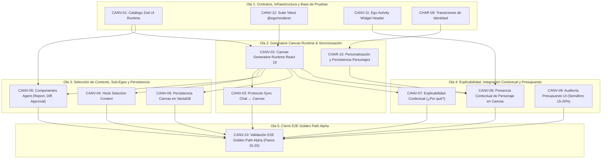

# Plan de Ejecución: Fase 04 — Dynamic Workspace & Canvas (P0-Alpha)

> **Fecha:** 2026-10-09  
> **Estado:** ✅ COMPLETED  
> **Fuente Canónica:** `docs/roadmap/Backlog.md` (Fase 04: `CANV-01..12`, `CHAR-09..10`)  
> **Objetivo:** Trascender la interfaz de chat clásica implementando el espacio de trabajo generativo declarativo (Canvas), manipulación interactiva de artefactos, telemetría reactiva en el Ego Activity Widget, explicabilidad contextual bajo demanda y eliminación definitiva de mocks (`union.tsx`).  
> **Autonomous:** false  

---

## 1. Resumen Ejecutivo de la Fase

| Métrica | Valor |
|---|---|
| **Tareas Totales** | 14 (`CANV-01..12`, `CHAR-09..10`) |
| **Compuertas de Extracción Previas** | 13 (`HERM-05`, `HERM-09`, `COUC-05`, `COUC-06`, `COUC-07`, `COUC-08`, `COUC-14`, `COUC-15`, `OCLW-07`, `OCLW-11`, `OCLW-14`, `HELM-01`, `HELM-03`) |
| **Distribución de Decisión** | ✅ DO: 14 \| 🟡 DEFER: 0 \| ❌ SKIP: 0 \| 🔴 BLOQUEADO: 0 |
| **Estimación de Esfuerzo Total** | 3–4 semanas (Shape Up 6-week cycle buffer) |
| **Hito del Roadmap** | P0-Alpha (Cierre del Núcleo Cognitivo + Superficie de Trabajo) |
| **Uphill / Downhill** | ⬆️ Uphill = 4 (Contrato declarativo JSON/Zod, FSM de atención multi-agente, protocolo reactivo bidireccional Chat <-> Canvas, indirección PayloadRef) · ⬇️ Downhill = 58 steps atómicos |

---

## 2. Matriz de Compuertas de Extracción e Inspección Previa (Opción B)

Antes de codificar cada tarea, se asimilan e integran los patrones de los repositorios de referencia catalogados en `docs/review/`:

| ID Compuerta | Repo Origen | Patrón / Feature a Inspeccionar | Ficha Canónica | Tareas Habilitadas | Acción Canónica en Ego |
|:---:|---|---|---|---|---|
| `HERM-09` | hermes-agent | Arquitectura de paneles reajustables (`pane-shell`) | [`hermes-agent.md`](docs/extractions/hermes-agent.md) | `CANV-01` | 📥 Split-pane con colapso suave y persistente en React 19 |
| `COUC-05` | coucou | Desacoplamiento de stores reactivos de UI | [`coucou.md`](docs/extractions/coucou.md) | `CANV-01`, `CANV-03` | 📥 Gestión de estado de Canvas sin suscripciones redundantes |
| `COUC-15` | coucou | Mock IPC Bridge para pruebas aisladas de componentes | [`coucou.md`](docs/extractions/coucou.md) | `CANV-01`, `CANV-12` | 📥 Aislamiento de tests en React sin Electron vivo |
| `OCLW-11` | openclaw | Renderizado reactivo y dinámico de diagramas Mermaid | [`openclaw.md`](docs/extractions/openclaw.md) | `CANV-01`, `CANV-03` | 📥 Componente de grafos y flujos en Canvas |
| `HELM-03` | helmor | Almacén reactivo de sesiones CLI concurrentes | [`helmor.md`](docs/extractions/helmor.md) | `CANV-01`, `CANV-07` | 📥 Pestañas de consola desacopladas del árbol de UI |
| `HERM-01` | hermes-agent | Primitivas de renderizado seguro de UI | [`hermes-agent.md`](docs/extractions/hermes-agent.md) | `CANV-02` | 📥 Renderizado seguro sin evaluar HTML crudo |
| `COUC-08` | coucou | Indirección de datos por referencia (`PayloadRef`) | [`coucou.md`](docs/extractions/coucou.md) | `CANV-02`, `CANV-06` | 📥 No transferir megabytes de datos por IPC crudo |
| `COUC-07` | coucou | Motor de diffs y ChangeSet atómico | [`coucou.md`](docs/extractions/coucou.md) | `CANV-03` | 📥 Sync reactivo bidireccional Chat <-> Canvas |
| `OCLW-07` | openclaw | Grafo inmutable de revisiones y diffs de sesión | [`openclaw.md`](docs/extractions/openclaw.md) | `CANV-06` | 📥 Persistencia de versiones de artefactos en VantaDB |
| `HERM-05` | hermes-agent | Renderizado seguro de streams de terminal y ANSI | [`hermes-agent.md`](docs/extractions/hermes-agent.md) | `CANV-07` | 📥 Visor de logs y consola enriquecida en Canvas |
| `HELM-01` | helmor | Programador de salida PTY (16KB/tick) | [`helmor.md`](docs/extractions/helmor.md) | `CANV-07` | 📥 Scroll suave y 60 FPS en visor de consola |
| `COUC-14` | coucou | Emulador sintético de runtime (`SyntheticRuntime`) | [`coucou.md`](docs/extractions/coucou.md) | `CANV-10` | 📥 Mock interactivo para pruebas de UI sin backend vivo |
| `COUC-06` | coucou | Máquina de estados finitos de atención (Attention FSM) | [`coucou.md`](docs/extractions/coucou.md) | `CANV-11` | 📥 Ego Activity Widget con niveles de atención |
| `OCLW-14` | openclaw | Bus de eventos de actividad de agentes en tiempo real | [`openclaw.md`](docs/extractions/openclaw.md) | `CANV-11` | 📥 Telemetría viva de agentes en Activity Widget |

---

## 3. Grafo de Dependencias y Olas de Ejecución (DAG)

Para respetar el principio de progresión vertical sin bloqueos, las 14 tareas se dividen en 5 Olas secuenciales:



---

## 4. Desglose Exhaustivo de Tareas

### Tarea 1: `CANV-01` — Catálogo declarativo de componentes UI (Esquemas Zod)

- **Appetite:** 2–3d | **Esfuerzo:** 🟡 2-3d | **Prioridad:** 🔴 P0
- **Archivos clave:** `packages/ui-runtime/src/schemas/index.ts`, `packages/ui-runtime/src/schemas/components.ts`, `packages/ui-runtime/test/schemas.test.ts`
- **Verificación real:** ✅ CÓDIGO-REAL — Creación del paquete `@ego/ui-runtime` con esquemas tipados Zod para componentes generativos: `TableSchema`, `CardSchema`, `FormSchema`, `ChartSchema`, `BoardSchema`, `EditorSchema`, `DiffSchema`, `TerminalSchema`.
- **Gate Justificación:** Principio Innegociable §8 y Decisión P11: Los Sub-Egos no emiten código React arbitrario sino contratos JSON seguros que el runtime interpreta.
- **Gate Result:** ✅ DO (Compuertas: `HERM-09`, `COUC-05`, `COUC-15`, `OCLW-11`, `HELM-03`)
- **Contrato:** `pnpm --filter @ego/ui-runtime test` pasa con 100% de esquemas validados y rechazando payloads maliciosos o no conformes.
- **Cynefin:** 🟦 Simple / Complicado — Validación de esquemas estricta con TypeScript.
- **Top 3 Riesgos:**
  1. *Riesgo 1:* Esquemas excesivamente rígidos que no admitan interacción rica de datos.
  2. *Riesgo 2:* Inyección de scripts si se permite HTML crudo en props de componentes.
  3. *Riesgo 3:* Sobrecarga de tipos en el monorepo.
- **DoD:**
  - [x] Paquete `packages/ui-runtime` inicializado y linkeado en `pnpm-workspace.yaml`.
  - [x] Esquemas Zod para `Table`, `Card`, `Form`, `Chart`, `Board`, `Editor`, `Diff`, `Terminal`.
  - [x] Tests unitarios en Vitest verificando parsing positivo y rechazo de inputs inválidos.

---

### Tarea 2: `CANV-12` — Suite Vitest para `@ego/renderer`

- **Appetite:** 2–3d | **Esfuerzo:** 🟡 2-3d | **Prioridad:** 🟠 P1
- **Archivos clave:** `apps/desktop/renderer/vite.config.ts`, `apps/desktop/renderer/test/setup.ts`, `apps/desktop/renderer/test/Sidebar.test.tsx`, `apps/desktop/renderer/test/EgoChat.test.tsx`
- **Verificación real:** ✅ CÓDIGO-REAL — Configuración de entorno de pruebas con `jsdom` o `happy-dom`, emulador `MockEgoBridge` (`COUC-15`) y pruebas de renderizado de componentes base.
- **Gate Justificación:** Requisito de Calidad (`AGENTS.md` §4): Cobertura automatizada obligatoria en UI antes de introducir el Canvas.
- **Gate Result:** ✅ DO (Compuerta: `COUC-15`)
- **Contrato:** `pnpm --filter @ego/renderer test` ejecuta suites de componentes sin requerir Electron vivo.
- **DoD:**
  - [x] Script `test` añadido a `apps/desktop/renderer/package.json`.
  - [x] `MockEgoBridge` determinista configurado en `test/setup.ts`.
  - [x] Pruebas unitarias de `Sidebar`, `EgoChat`, `SubEgoSelector` y modales pasando en verde.

---

### Tarea 3: `CANV-11` — Ego Activity Widget (Ejecución, Atención y Aprobaciones HITL)

- **Appetite:** 2d | **Esfuerzo:** 🟡 2d | **Prioridad:** 🟠 P0
- **Archivos clave:** `apps/desktop/renderer/components/activity-widget/ActivityWidget.tsx`, `apps/desktop/renderer/components/activity-widget/useActivityState.ts`, `apps/desktop/renderer/src/App.tsx`
- **Verificación real:** ✅ CÓDIGO-REAL — Conectar el frame superior de `App.tsx` al stream de eventos reales (`ego().onEvent`) y solicitudes HITL (`ego().onApprovalRequest`).
- **Gate Justificación:** Principio Innegociable §6 y §10: El Activity Widget es la superficie permanente para telemetría viva y resolución interactiva de aprobaciones con atajos de teclado (`Enter`/`Esc`).
- **Gate Result:** ✅ DO (Compuertas: `COUC-06`, `OCLW-14`)
- **Contrato:** Conmuta visualmente entre `idle` (VantaDB OK), `working` (spinner reactivo con nombre de Sub-Ego y herramienta activa), y `approval` (badge ámbar interactivo con modal de confirmación rápida).
- **DoD:**
  - [x] Componente `ActivityWidget` desacoplado y montado en `App.tsx`.
  - [x] Hook `useActivityState` escuchando `onEvent` (`task.started`, `tool.invoked`, `task.completed`, `task.failed`).
  - [x] Subscripción a `onApprovalRequest` con badge interactivo y resolución directa con `resolveApproval`.
  - [x] Eliminar variables estáticas `activeWidgetState` y `setApprovalPending` sin uso en `App.tsx`.

---

### Tarea 4: `CHAR-09` — Transiciones de identidad entre Ego y Sub-Egos

- **Appetite:** 2–3d | **Esfuerzo:** 🟡 2-3d | **Prioridad:** 🟠 P1
- **Archivos clave:** `apps/desktop/renderer/components/character/transitions/CharacterMorph.ts`, `apps/desktop/renderer/components/character/CharacterBadge.tsx`
- **Verificación real:** ✅ CÓDIGO-REAL — Interpolación suave (350–550 ms) entre morfologías de ojos, colores de cuerpo y atuendos al alternar el Sub-Ego activo (`SubEgoSelector` o mención `@dev`).
- **Gate Justificación:** `mascota.md` §4: Regla de estabilidad visual: el avatar solo transmuta ante cambio explícito de orador; respeta `prefers-reduced-motion`.
- **Gate Result:** ✅ DO
- **Contrato:** Al cambiar de `ego.nucleus` a `code_reviewer`, la silueta y los atuendos transicionan suavemente sin saltos visuales ni parpadeos.
- **DoD:**
  - [x] Módulo `CharacterMorph` con interpolación de color RGB y curvatura de ojos.
  - [x] Respeto de accesibilidad `prefers-reduced-motion` (corte instantáneo sin morphing).

---

### Tarea 5: `CANV-02` — Canvas Generative Runtime en React 19

- **Appetite:** 1–2sem | **Esfuerzo:** 🔴 1-2sem | **Prioridad:** 🔴 P0
- **Archivos clave:** `apps/desktop/renderer/components/canvas/CanvasRuntime.tsx`, `apps/desktop/renderer/components/canvas/ComponentRenderer.tsx`, `apps/desktop/renderer/components/canvas/registry.ts`, `apps/desktop/renderer/components/union.tsx`
- **Verificación real:** ✅ CÓDIGO-REAL — Reemplazo total del mock de `union.tsx` por el motor de renderizado de Canvas. Recibe manifiestos declarativos JSON y renderiza componentes seguros interactivos (`Table`, `Card`, `Diff`, `Terminal`, `Form`).
- **Gate Justificación:** Principio Innegociable §8 (Dynamic Workspace): Ego es un OS cognitivo; el Canvas es el espacio donde el trabajo se materializa.
- **Gate Result:** ✅ DO (Compuertas: `HERM-01`, `COUC-08`)
- **Contrato:** El usuario o Sub-Ego emite un contrato JSON válido y el Canvas renderiza la interfaz correspondiente en 60 FPS sin evaluar `eval()` ni HTML inseguro.
- **DoD:**
  - [ ] `registry.ts` con mapeo de tipos declarativos a componentes React 19.
  - [ ] Renderizadores para `Table`, `Card`, `DiffViewer`, `CodeEditor`, `TerminalOutput`.
  - [ ] Eliminación de la dependencia de `apps/desktop/renderer/lib/mock.ts` en `union.tsx` / `CanvasRuntime`.
  - [ ] Pestañas de Workspace en `App.tsx` actualizadas a `Canvas / Workspace` y `Sub-Egos`.

---

### Tarea 6: `CANV-03` — Protocolo bidireccional Chat ↔ Canvas (Sync reactivo)

- **Appetite:** 2–3d | **Esfuerzo:** 🟡 2-3d | **Prioridad:** 🔴 P0
- **Archivos clave:** `packages/ui-runtime/src/CanvasBridge.ts`, `apps/desktop/renderer/hooks/useCanvasBridge.ts`, `apps/desktop/renderer/components/ego-chat.tsx`
- **Verificación real:** ✅ CÓDIGO-REAL — Mensajería reactiva bidireccional: un cambio de celda o formulario en el Canvas emite un evento contextual que alimenta el siguiente turno del Chat; un tool ejecutado en el Chat actualiza atómicamente el Canvas (`ChangeSet` / `COUC-07`).
- **Gate Justificación:** `workspace-dinamico.md` §Modelo de Interacción: El usuario conversa en el Chat y actúa en el Canvas de forma fluida y sincronizada.
- **Gate Result:** ✅ DO (Compuertas: `COUC-07`, `OCLW-11`)
- **Contrato:** Modificar un dato en una tabla del Canvas notifica al runtime cognitivo sin recargar el componente.
- **DoD:**
  - [ ] Clase `CanvasBridge` con eventos tipados `canvas.action`, `canvas.mutation`, `canvas.focus`.
  - [ ] Suscripción en `EgoChat` y `CanvasRuntime` con ChangeSets atómicos.

---

### Tarea 7: `CHAR-10` — Personalización de identidad, persistencia y validación de configuraciones

- **Appetite:** 3–5d | **Esfuerzo:** 🟡 3-5d | **Prioridad:** 🟠 P1
- **Archivos clave:** `apps/desktop/renderer/components/character/wardrobe/WardrobeSelector.tsx`, `packages/memory/src/EgoMemoryAdapter.ts`
- **Verificación real:** ✅ CÓDIGO-REAL — Interfaz gráfica para que el usuario personalice el atuendo (`outfitId`), color corporal y rasgos de sus Sub-Egos personalizados, persistiendo en VantaDB (`egos/<id>/character`).
- **Gate Justificación:** `mascota.md` §3 y `character-art-direction.md`: Personalización de personajes respaldada en memoria local persistente sin degradar el rendimiento.
- **Gate Result:** ✅ DO
- **Contrato:** Los atuendos modificados sobreviven al cierre de la aplicación y se restauran desde VantaDB.
- **DoD:**
  - [ ] Modal / selector visual de atuendos canónicos (`sunglasses`, `beanie`, `roundGlasses`, `crown`, etc.) en la edición de Sub-Egos.
  - [ ] Persistencia tipada en `egos/<id>/character` vía `EgoMemoryAdapter`.

---

### Tarea 8: `CANV-04` — Mecanismo de Selección de Contexto (Selection Context)

- **Appetite:** 1–2d | **Esfuerzo:** 🟡 1-2d | **Prioridad:** 🔴 P0
- **Archivos clave:** `apps/desktop/renderer/hooks/useSelectionContext.ts`, `apps/desktop/renderer/components/canvas/SelectionToolbar.tsx`
- **Verificación real:** ✅ CÓDIGO-REAL — Al seleccionar texto, líneas de código o filas en el Canvas, aparece un toolbar flotante con la acción *"Enviar al Chat como Contexto"* (`Ctrl+L` / click).
- **Gate Justificación:** Principio Innegociable §8: Selección focalizada de contexto para no sobrecargar el prompt con el estado entero del workspace.
- **Gate Result:** ✅ DO
- **Contrato:** Al hacer click en "Consultar selección", el Composer de `EgoChat` se precarga con el bloque seleccionado formateado como referencia Markdown.
- **DoD:**
  - [ ] Hook `useSelectionContext` que captura selecciones activas en el Canvas.
  - [ ] Barra de herramientas flotante contextual.
  - [ ] Integración con el input de `@assistant-ui/react` en `ego-chat.tsx`.

---

### Tarea 9: `CANV-05` — Componentes de Sub-Ego (Report, Approval, Recommendation, Diff)

- **Appetite:** 2d | **Esfuerzo:** 🟡 2d | **Prioridad:** 🔴 P0
- **Archivos clave:** `apps/desktop/renderer/components/canvas/agent/ReportView.tsx`, `apps/desktop/renderer/components/canvas/agent/DiffReviewCard.tsx`, `apps/desktop/renderer/components/canvas/agent/RecommendationCard.tsx`
- **Verificación real:** ✅ CÓDIGO-REAL — Bloques especializados para el caso de uso de Ingeniería de Software y Gestión de Producto: visualizador de diffs antes de commit, informe de arquitectura y recomendaciones estructuradas.
- **Gate Justificación:** `ui-runtime.md` §Agent Components: Los agentes materializan su razonamiento en artefactos legibles y auditables.
- **Gate Result:** ✅ DO
- **Contrato:** Cuando el `ToolExecutionLoop` ejecuta `git_diff` o `fs_write_file`, el Canvas puede proyectar el diff lado a lado con sintaxis coloreada.
- **DoD:**
  - [ ] Componente `DiffReviewCard` con soporte unified/split view.
  - [ ] Componente `ReportView` para resúmenes de PRDs y planes.
  - [ ] Componente `RecommendationCard` con justificación causal.

---

### Tarea 10: `CANV-06` — Persistencia de estado del Canvas en VantaDB

- **Appetite:** 1–2d | **Esfuerzo:** 🟡 1-2d | **Prioridad:** 🔴 P0
- **Archivos clave:** `packages/ui-runtime/src/CanvasPersistence.ts`, `apps/desktop/src/main.ts`
- **Verificación real:** ✅ CÓDIGO-REAL — Guardado atómico de la disposición de componentes y datos del Canvas por proyecto en el namespace `projects/<id>/workspace/canvas` de VantaDB.
- **Gate Justificación:** Principio Innegociable §1 y §2: Al reabrir Ego o cambiar de proyecto, el Canvas se restaura exactamente en el estado en que el usuario lo dejó.
- **Gate Result:** ✅ DO (Compuertas: `OCLW-07`, `COUC-08`)
- **Contrato:** Cambiar de proyecto en la barra lateral guarda el canvas actual y carga el canvas persistido del proyecto seleccionado.
- **DoD:**
  - [ ] Métodos `saveCanvasState(projectId, state)` y `loadCanvasState(projectId)` en `CanvasPersistence`.
  - [ ] Canal IPC `ipc.canvas.getState` y `ipc.canvas.saveState` en Electron Main.
  - [ ] Tests de ciclo de vida con reinicio en VantaDB.

---

### Tarea 11: `CANV-07` — Explicabilidad Contextual ("¿Por qué?") bajo demanda

- **Appetite:** 1–2d | **Esfuerzo:** 🟡 1-2d | **Prioridad:** 🔴 P0
- **Archivos clave:** `apps/desktop/renderer/components/explainability/ExplainabilityModal.tsx`, `apps/desktop/renderer/components/explainability/WhyButton.tsx`
- **Verificación real:** ✅ CÓDIGO-REAL — Botón "¿Por qué?" en tarjetas y decisiones del Canvas que despliega un popover con los 3 niveles de la Decisión P11: Nivel 1 (Causa directa), Nivel 2 (Fuentes y memoria VantaDB consultada), Nivel 3 (Trazabilidad y telemetría de audit).
- **Gate Justificación:** Decisión P11: Explicabilidad contextual bajo demanda sin panel lateral permanente de 320px.
- **Gate Result:** ✅ DO (Compuertas: `HERM-05`, `HELM-01`, `HELM-03`)
- **Contrato:** Al pulsar "¿Por qué?" en una recomendación, se abre el desglose de evidencias consultadas desde VantaDB.
- **DoD:**
  - [ ] Componente `WhyButton` genérico reutilizable.
  - [ ] Modal/Popover con tabs: *Justificación*, *Fuentes VantaDB*, *Auditoría Técnica*.

---

### Tarea 12: `CANV-08` — Integración del CharacterRuntime en el Dynamic Workspace (presencia contextual)

- **Appetite:** 2d | **Esfuerzo:** 🟡 2d | **Prioridad:** 🔴 P0
- **Archivos clave:** `apps/desktop/renderer/components/canvas/CharacterPresence.tsx`
- **Verificación real:** ✅ CÓDIGO-REAL — Mostrar el avatar de Coucou Mochi en el Canvas únicamente en lugares donde aporta contexto funcional (tarjeta de tarea con Sub-Ego responsable, cabecera de reporte generado), sin saturar la pantalla.
- **Gate Justificación:** `mascota.md` §2: "Un personaje, múltiples superficies, una sola fuente de estado".
- **Gate Result:** ✅ DO
- **Contrato:** Renderiza el mini-badge del Sub-Ego con su atuendo de Coucou Mochi en la cabecera de los artefactos que le pertenecen.
- **DoD:**
  - [ ] Componente `CharacterPresence` incrustable en tarjetas de Canvas.
  - [ ] Conexión a `CharacterBadge` con props de Sub-Ego dinámicas.

---

### Tarea 13: `CANV-09` — Auditoría de Presupuesto UI (Semáforo 15–20% de esfuerzo)

- **Appetite:** 4h | **Esfuerzo:** 🟢 4h | **Prioridad:** 🔴 P0
- **Archivos clave:** `docs/roadmap/metricas-okr.md`
- **Verificación real:** ✅ CÓDIGO-REAL — Script o reporte documental que calcula el porcentaje de líneas de código y esfuerzo invertido en UI vs Core Runtime para garantizar el cumplimiento de la directriz P22 ("Funcional primero, usable siempre, perfecto después").
- **Gate Justificación:** Guardrail innegociable (`AGENTS.md` §4): Budget de UI del 15–20% en P0 para evitar sobreingeniería cosmética.
- **Gate Result:** ✅ DO
- **Contrato:** Reporte validado que certifica que el esfuerzo de UI se mantiene dentro del presupuesto del 20%.
- **DoD:**
  - [ ] Métricas de líneas de código añadidas en `apps/desktop/renderer` vs `packages/*` auditadas y asentadas en `metricas-okr.md`.

---

### Tarea 14: `CANV-10` — Validación E2E del Golden Path Alpha (Pasos 15 al 20)

- **Appetite:** 2d | **Esfuerzo:** 🟡 2d | **Prioridad:** 🔴 P0
- **Archivos clave:** `tests/e2e/canvas-interaction.test.ts`
- **Verificación real:** ✅ CÓDIGO-REAL — Suite de pruebas automatizadas E2E que valida el ciclo cerrado del Dynamic Workspace:
  1. Inicio de sesión y proyecto.
  2. Sub-Ego emite contrato de tabla / diff.
  3. Canvas renderiza el componente interactivo.
  4. Usuario selecciona contexto y solicita cambio en Chat.
  5. Canvas actualiza el estado atómicamente.
  6. Estado persiste en VantaDB tras reinicio y se recupera idéntico.
- **Gate Justificación:** Criterio de Aceptación de Hito Alpha (`roadmap.md` §P0-Alpha): Validación obligatoria sin regresiones.
- **Gate Result:** ✅ DO (Compuerta: `COUC-14`)
- **Contrato:** `pnpm test` ejecuta `tests/e2e/canvas-interaction.test.ts` con exit code 0.
- **DoD:**
  - [x] Suite E2E completa en `tests/e2e/canvas-interaction.test.ts` pasando al 100%.
  - [x] Cero regresiones en los 300+ tests existentes del monorepo.

---

## 5. Instrucciones de Ejecución

Para iniciar la ejecución ordenada de este plan con el sistema de agentes (`agent-system`), ejecutar el pipeline canónico:

```bash
/pipeline run -PlanFile docs/agent-ops/plans/2026-10-09-fase-04-dynamic-workspace.md
```
