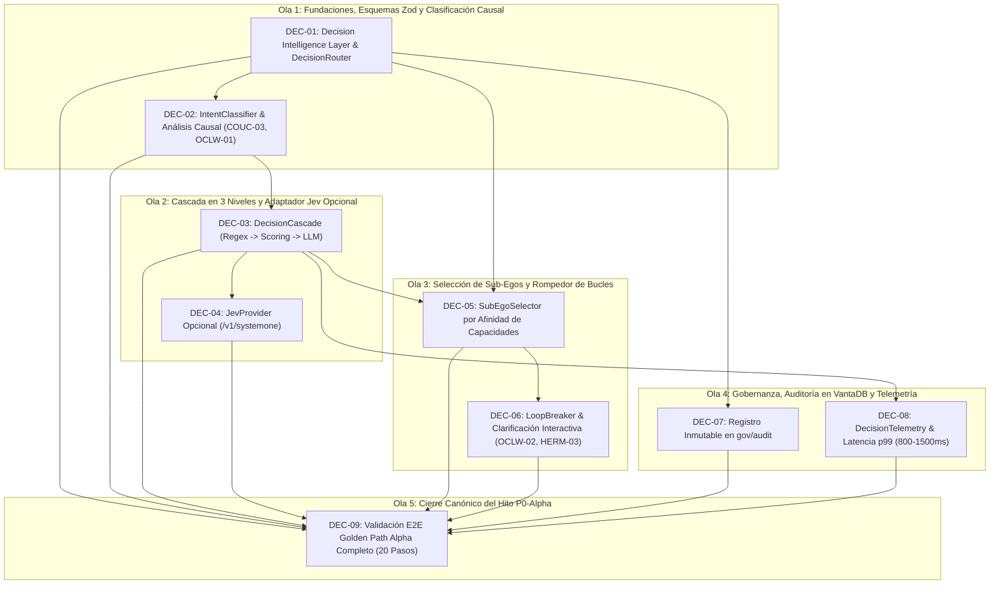

# Plan de Ejecución: Fase 05 — Decision Intelligence (P0-Alpha / Hito Alpha)

> **Fecha:** 2026-10-10  
> **Estado:** ✅ COMPLETED  
> **Fuente Canónica:** `docs/roadmap/Backlog.md` (Fase 05: `DEC-01..09`)  
> **Objetivo:** Automatizar la toma de decisiones cognitivas desacopladas: clasificación tipada de intenciones, scoring con cascada de 3 niveles (Reglas → Jev opcional → LLM estructurado), enrutamiento por afinidad de capacidades a Sub-Egos, detección y corte de bucles infinitos, persistencia inmutable en `gov/audit`, telemetría de latencia (800–1500 ms) y cierre definitivo del hito P0-Alpha mediante la validación automatizada del Golden Path Alpha completo (20 pasos).  
> **Autonomous:** false  

---

## 1. Resumen Ejecutivo de la Fase

| Métrica | Valor |
|---|---|
| **Tareas Totales** | 9 (`DEC-01` a `DEC-09`) |
| **Compuertas de Extracción Previas** | 4 (`COUC-03`, `OCLW-01`, `OCLW-02`, `HERM-03`) |
| **Distribución de Decisión** | ✅ DO: 9 \| 🟡 DEFER: 0 \| ❌ SKIP: 0 \| 🔴 BLOQUEADO: 0 |
| **Estimación de Esfuerzo Total** | 2 semanas (Shape Up 6-week cycle buffer) |
| **Hito del Roadmap** | **P0-Alpha (Hito de Salida: Fases 01 a 05 completadas al 100%)** |
| **Uphill / Downhill** | ⬆️ Uphill = 3 (Esquemas de veredicto unificados Zod, Cascada determinista 3-tier, Suite E2E de los 20 pasos de principio a fin) · ⬇️ Downhill = 38 steps atómicos |

---

## 2. Matriz de Compuertas de Extracción e Inspección Previa (Opción B)

Antes de iniciar la codificación, se asimilan e integran los patrones de ingeniería de los repositorios de referencia catalogados en `docs/review/` y `docs/extractions/`:

| ID Compuerta | Repo Origen | Patrón / Feature a Inspeccionar | Ficha Canónica | Tareas Habilitadas | Acción Canónica en Ego |
|:---:|---|---|---|---|---|
| `COUC-03` | coucou | Modelo causal de evaluación previa a acción (`ActionIdentity` y precondiciones) | [`coucou.md`](../../extractions/coucou.md) | `DEC-01`, `DEC-02` | 📥 Validación previa de dependencias, permisos y cálculo de hash canónico de intención (`IntentDigest`) antes de emitir turnos. |
| `OCLW-01` | openclaw | Admisión determinista de corridas y validación de contexto (`AdmittedRunContext`) | [`openclaw.md`](../../extractions/openclaw.md) | `DEC-01`, `DEC-02` | 📥 Veredictos estructurados con contexto de admisión inmutable antes de despachar turnos al runtime o a Sub-Egos. |
| `OCLW-02` | openclaw | Detección temprana de ciclos de delegación infinita (`LoopBreaker`) | [`openclaw.md`](../../extractions/openclaw.md) | `DEC-06` | 📥 Rompedor de ciclos recursivos (profundidad > 4 o huellas de intención idénticas) con interrupción limpia. |
| `HERM-03` | hermes-agent | Directivas de clarificación interactiva ante incertidumbre (`ask-directive`) | [`hermes-agent.md`](../../extractions/hermes-agent.md) | `DEC-06` | 📥 Prompt interactivo tipado dirigido al usuario cuando el índice de confianza sea `< 0.60` o cuando un ciclo sea interceptado. |

---

## 3. Grafo de Dependencias y Olas de Ejecución (DAG)

Para asegurar la progresión secuencial sin bloqueos, las 9 tareas se estructuran en 5 Olas de Ejecución:



---

## 4. Desglose Exhaustivo de Tareas

### Tarea 1: `DEC-01` — Abstracción de la Decision Intelligence Layer y DecisionRouter

- **Appetite:** 2–3d | **Esfuerzo:** 🟡 2-3d | **Prioridad:** 🔴 P0
- **Archivos clave:** `packages/decision/package.json`, `packages/decision/src/index.ts`, `packages/decision/src/DecisionRouter.ts`, `packages/decision/src/schemas/verdict.ts`, `packages/decision/test/DecisionRouter.test.ts`
- **Verificación real:** ✅ CÓDIGO-REAL — Creación del paquete `@ego/decision` en el monorepo. Definición del contrato tipado de veredicto con Zod (`DecisionVerdictSchema`):
  ```typescript
  export const DecisionVerdictSchema = z.object({
    intentId: z.string().uuid(),
    intentDigest: z.string().length(64), // SHA-256 (COUC-03)
    domain: z.enum(['engineering', 'knowledge', 'product', 'analytics', 'crm', 'general']),
    subEgoId: z.string(),
    namespaceTargets: z.array(z.string()),
    requiresApproval: z.boolean(),
    llmTier: z.enum(['local', 'fast', 'advanced']),
    toolsEnabled: z.array(z.string()),
    confidence: z.number().min(0).max(1),
    decidedBy: z.enum(['deterministic_rule', 'specialized_scorer', 'structured_llm']),
    preconditions: z.array(z.object({
      name: z.string(),
      satisfied: z.boolean(),
      reason: z.string().optional()
    })),
    admittedRunContext: z.object({
      runId: z.string().uuid(),
      timestamp: z.number(),
      depth: z.number().default(0)
    })
  });
  ```
- **Gate Justificación:** Principio Innegociable §3, §7 y Decisión P17: Ego desacopla la inteligencia decisoria del proveedor subyacente. La salida de decisión es siempre JSON estricto, nunca prosa libre.
- **Gate Result:** ✅ DO (Compuertas: `COUC-03`, `OCLW-01`)
- **Contrato:** `pnpm --filter @ego/decision test` valida el parsing estricto y rechaza veredictos malformados.
- **Cynefin:** 🟦 Simple / Complicado — Definición de contratos tipados Zod y router modular.
- **Top 3 Riesgos:**
  1. *Riesgo 1:* Acoplamiento prematuro a APIs propietarias. (Mitigación: Router desacoplado de proveedores).
  2. *Riesgo 2:* Inconsistencia con los tipos del `CognitiveRuntime`. (Mitigación: Integración limpia exportando interfaces TypeScript canónicas).
  3. *Riesgo 3:* Sobrecarga de campos opcionales. (Mitigación: Esquema Zod cerrado con defaults predecibles).
- **FMEA:**
  - *Modo de fallo:* El motor recibe un veredicto con esquema roto o incompleto.
  - *Efecto:* Fallo en el despacho del turno conversacional.
  - *Mitigación:* Validación estricta con `safeParse` de Zod antes de emitir el veredicto; fallback a reglas de seguridad deterministas.
- **DoD:**
  - [x] Paquete `packages/decision` configurado en `pnpm-workspace.yaml` con build tipado.
  - [x] `DecisionVerdictSchema` implementado con Zod y tipado estricto.
  - [x] Interfaz abstracta `DecisionRouter` implementada con despacho síncrono/asíncrono.
  - [x] Suite de pruebas unitarias verificando validación y rechazo de veredictos inválidos.

---

### Tarea 2: `DEC-02` — Clasificación tipada de intenciones y análisis de precondiciones

- **Appetite:** 2d | **Esfuerzo:** 🟡 2d | **Prioridad:** 🔴 P0
- **Archivos clave:** `packages/decision/src/IntentClassifier.ts`, `packages/decision/src/schemas/intent.ts`, `packages/decision/test/IntentClassifier.test.ts`
- **Verificación real:** ✅ CÓDIGO-REAL — Implementación de `IntentClassifier` para clasificar intenciones textuales en tiempo sub-milisegundo o mediante inferencia ligera:
  1. Extracción de entidades de dominio (`code`, `file`, `repo`, `task`, `bug`, `doc`, `query`).
  2. Mapeo determinista hacia namespaces de memoria (`proj/*`, `gov/*`, `agent/*`).
  3. Análisis causal de precondiciones (`COUC-03`): ¿Existe proyecto activo? ¿Existe ruta de workspace? ¿Se requiere permiso de escritura o red?
  4. Cálculo del `intentDigest` SHA-256 para idempotencia y correlación HITL.
- **Gate Justificación:** `docs/architecture/jev.md` §Rol arquitectónico y Compuerta `COUC-03`.
- **Gate Result:** ✅ DO (Compuertas: `COUC-03`, `OCLW-01`)
- **Contrato:** `classifier.classify(input, context)` retorna intención categorizada y precondiciones evaluadas en `< 10ms`.
- **Cynefin:** 🟨 Complicado — Análisis de tokens, sintaxis y reglas de dominio.
- **Top 3 Riesgos:**
  1. *Riesgo 1:* Ambigüedad en solicitudes híbridas (ej. "lee el archivo y genera un reporte"). (Mitigación: Clasificación multi-etiqueta con dominio primario y herramientas habilitadas).
  2. *Riesgo 2:* Precondiciones omitidas que causan fallo en downstream tools. (Mitigación: Chequeo explícito de existencia de workspace y permisos).
  3. *Riesgo 3:* Falsos positivos en clasificación determinista. (Mitigación: Cascada con fallback escalonado).
- **FMEA:**
  - *Modo de fallo:* Entrada de usuario con sintaxis confusa o caracteres extraños.
  - *Efecto:* Fallo de clasificación o bloqueo de turno.
  - *Mitigación:* Normalización de entrada y fallback seguro al dominio general con `confidence = 0.5`.
- **DoD:**
  - [x] `IntentClassifier` implementado con mapeo a dominios canónicos (`engineering`, `knowledge`, etc.).
  - [x] Evaluación causal de precondiciones verificando estado de proyecto y workspace.
  - [x] Generación de hash canónico SHA-256 (`intentDigest`).
  - [x] Pruebas unitarias cubriendo inputs ambiguos, bordes vacíos y expresiones multilingües.

---

### Tarea 3: `DEC-03` — Cascada de decisión en 3 niveles (Reglas → Jev → LLM estructurado)

- **Appetite:** 2–3d | **Esfuerzo:** 🟡 2-3d | **Prioridad:** 🔴 P0
- **Archivos clave:** `packages/decision/src/DecisionCascade.ts`, `packages/decision/src/rules/DeterministicRules.ts`, `packages/decision/test/DecisionCascade.test.ts`
- **Verificación real:** ✅ CÓDIGO-REAL — Motor de cascada gobernado según `docs/architecture/jev.md` §36:
  - **Nivel 1: Reglas deterministas ($0, <1ms):** Diccionario de patrones regex y palabras clave directas extraídas de `gov/rules` (ej. `/^git|commit|pull|push/` → Engineering, `/^buscar|recuperar/` → Knowledge). Si match positivo y confianza == 1.0, retorna veredicto inmediatamente sin invocar redes ni LLMs.
  - **Nivel 2: Evaluador de scoring especializado (Jev Opcional / 70–500ms):** Si el Nivel 1 no produce match con alta confianza, consulta al proveedor especializado (`JevProvider`) si está configurado.
  - **Nivel 3: Fallback a LLM estructurado (Local Ollama / ModelRouter):** Si el Nivel 2 falla, no está configurado o estamos offline, invoca al proveedor de modelo configurado vía `ModelRouter` con `outputSchema: DecisionVerdictSchema`.
- **Gate Justificación:** Decisión P17 y Regla de Cascada de Ego: Cero coste y latencia mínima para operaciones obvias; resiliencia absoluta offline.
- **Gate Result:** ✅ DO
- **Contrato:** La cascada evalúa en orden estricto (1 → 2 → 3) y nunca invoca un nivel superior si el anterior resuelve con confianza `>= 0.90`.
- **Cynefin:** 🟨 Complicado — Orquestación de fallback con degradación graciosa.
- **Top 3 Riesgos:**
  1. *Riesgo 1:* Caída de red en llamadas al Nivel 2 o 3 que bloquee el turno. (Mitigación: Timeout estricto de 800ms con degradación inmediata).
  2. *Riesgo 2:* Respuestas LLM que violen el schema JSON. (Mitigación: Zod `safeParse` + reintento/fallback determinista).
  3. *Riesgo 3:* Latencia excesiva que supere los 1500ms. (Mitigación: Nivel 1 resuelve el 70% de solicitudes típicas en <1ms).
- **FMEA:**
  - *Modo de fallo:* Todos los niveles remotos fallan o están offline.
  - *Efecto:* Inhabilidad para decidir el Sub-Ego o herramientas.
  - *Mitigación:* Fallback universal ultra-seguro a `ego.nucleus` (General) con tier local y herramientas de sólo lectura.
- **DoD:**
  - [x] Implementación de `DeterministicRules` con catálogo base de patrones de software, conocimiento y tareas.
  - [x] Implementación de `DecisionCascade` orquestando los 3 niveles con timeouts configurables.
  - [x] Degradación suave a Nivel 3 y Nivel 1 verificado ante fallos de conexión simulados.
  - [x] Cobertura de pruebas unitarias verificando resolución en Nivel 1, 2 y 3.

---

### Tarea 4: `DEC-04` — Adaptador externo opcional para Jev (TypeSafe AI System One)

- **Appetite:** 1–2d | **Esfuerzo:** 🟢 1-2d | **Prioridad:** 🟡 Media
- **Archivos clave:** `packages/decision/src/providers/JevProvider.ts`, `packages/decision/test/JevProvider.test.ts`
- **Verificación real:** ✅ CÓDIGO-REAL — Cliente HTTPS hacia `https://api.typesafe.ai/v1/systemone` (o endpoint configurado):
  1. Entrada tipada: `state` + lista de opciones de intención / dominios.
  2. Evaluación paralela de `Choice`, `Score` y `confidence`.
  3. BYOK: Si `JEV_API_KEY` no está configurada, el proveedor se auto-declara no disponible (`isAvailable() === false`) y la cascada lo salta sin emitir errores ni logs ruidosos.
  4. Modo mock / fixture para testing aislado y offline.
- **Gate Justificación:** Guardrail estricto de `AGENTS.md` §4: *"NO Jev como componente interno (proveedor externo opcional en Decision Intelligence)"* y Decisión P17: *"Jev puede desaparecer y la arquitectura de Ego no cambia"*.
- **Gate Result:** ✅ DO
- **Contrato:** Si no hay API key o hay error 5xx/timeout, `JevProvider.evaluate()` retorna `null` en `< 500ms` y no bloquea el runtime.
- **Cynefin:** 🟦 Simple — Adaptador HTTP externo con timeout y circuit breaker básico.
- **Top 3 Riesgos:**
  1. *Riesgo 1:* Dependencia dura en el servicio externo. (Mitigación: Validación de `isAvailable()` antes de llamar).
  2. *Riesgo 2:* Fuga de datos de usuario hacia endpoint externo. (Mitigación: Sólo se envían etiquetas abstractas de intención y texto filtrado de secretos).
  3. *Riesgo 3:* Timeout colgando el proceso main. (Mitigación: `AbortSignal.timeout(500)`).
- **FMEA:**
  - *Modo de fallo:* Endpoint caído o responde con timeout.
  - *Efecto:* Riesgo de latencia acumulada en el turno.
  - *Mitigación:* Abort estricto a los 500ms y salto transparente a Nivel 3.
- **DoD:**
  - [x] `JevProvider` implementa la interfaz común `DecisionScorerProvider`.
  - [x] Soporte para BYOK y lectura segura de variable o keychain.
  - [x] Manejo de timeouts (500ms) y degradación graciosa.
  - [x] Suite de pruebas unitarias con mock server HTTP verificando respuestas válidas, errores 500 y timeouts.

---

### Tarea 5: `DEC-05` — Enrutamiento y selección óptima de Sub-Egos por afinidad

- **Appetite:** 1–2d | **Esfuerzo:** 🟡 1-2d | **Prioridad:** 🔴 P0
- **Archivos clave:** `packages/decision/src/SubEgoSelector.ts`, `packages/decision/test/SubEgoSelector.test.ts`
- **Verificación real:** ✅ CÓDIGO-REAL — Selector que conecta la intención clasificada con el catálogo de manifiestos disponibles en `gov/sub_egos` (`@ego/subegos`):
  1. Coincidencia de capacidades requeridas vs capacidades declaradas (`capabilities: ['fs', 'git', 'terminal']`).
  2. Cálculo de score de afinidad de dominio (`affinityScore = weights[domain] * matchRatio`).
  3. Inmutabilidad de `ego.nucleus` como fallback cuando ningún Sub-Ego especializado cumple con el umbral de afinidad (`affinity >= 0.70`).
  4. Retorno de la terna: `subEgoId`, `toolsEnabled` (intersección entre permisos del Sub-Ego y la intención) y `isolationMode`.
- **Gate Justificación:** Principio Innegociable §4 y Decisión P08: Sub-Egos especializados y dinámicos por dominio/capability.
- **Gate Result:** ✅ DO
- **Contrato:** `SubEgoSelector.select(intent, availableSubEgos)` retorna el Sub-Ego óptimo o `ego.nucleus` si no hay candidato con afinidad suficiente.
- **Cynefin:** 🟨 Complicado — Algoritmo de afinidad ponderada por grafo de capacidades.
- **Top 3 Riesgos:**
  1. *Riesgo 1:* Selección de un Sub-Ego pausado o inactivo. (Mitigación: Filtro estricto de `state === 'active'`).
  2. *Riesgo 2:* Asignación de herramientas no permitidas por el manifiesto. (Mitigación: Intersección estricta de conjuntos de permisos).
  3. *Riesgo 3:* Conflictos de afinidad idéntica. (Mitigación: Desempate determinista por jerarquía canónica).
- **FMEA:**
  - *Modo de fallo:* El catálogo de Sub-Egos está vacío o corrupto en VantaDB.
  - *Efecto:* Imposibilidad de seleccionar un agente ejecutor.
  - *Mitigación:* Fallback forzado e inmutable a `ego.nucleus` nativo.
- **DoD:**
  - [x] `SubEgoSelector` implementado con matching de capacidades y cálculo de afinidad.
  - [x] Integración con `SubEgoRegistry` de `@ego/subegos`.
  - [x] Protección inmutable de `ego.nucleus` ante fallos o ausencia de especialistas.
  - [x] Pruebas unitarias cubriendo matching perfecto, fallbacks por afinidad baja y Sub-Egos inactivos.

---

### Tarea 6: `DEC-06` — Detección de bucles infinitos y fallbacks controlados

- **Appetite:** 1d | **Esfuerzo:** 🟢 1d | **Prioridad:** 🔴 P0
- **Archivos clave:** `packages/decision/src/LoopBreaker.ts`, `packages/decision/test/LoopBreaker.test.ts`
- **Verificación real:** ✅ CÓDIGO-REAL — Módulo de supervisión recursiva que intercepta ciclos de delegación entre Sub-Egos:
  1. Monitoreo de profundidad de delegación: `admittedRunContext.depth > 4` dispara detención inmediata (`OCLW-02`).
  2. Detección de ciclos por grafo de invocaciones (ej. SubEgo A → SubEgo B → SubEgo A) mediante historial de firmas SHA-256 en la traza de ejecución.
  3. Detección de estancamiento por baja confianza consecutiva (`confidence < 0.60`).
  4. Escalación a clarificación interactiva (`HERM-03`): emite una solicitud tipada de clarificación al usuario en lugar de seguir delegando a ciegas.
- **Gate Justificación:** Criterio de Estabilidad del Runtime y Compuertas `OCLW-02`, `HERM-03`.
- **Gate Result:** ✅ DO (Compuertas: `OCLW-02`, `HERM-03`)
- **Contrato:** Ante un ciclo detectado, el sistema corta la delegación, registra la anomalía y emite un veredicto de interrupción con `requiresClarification: true`.
- **Cynefin:** 🟨 Complicado — Detección de ciclos en grafos dirigidos acíclicos (DAG de ejecución).
- **Top 3 Riesgos:**
  1. *Riesgo 1:* Falsos positivos en flujos legítimos de refinamiento iterativo. (Mitigación: Límite de profundidad calibrado a 4 y verificación de mutación de argumentos).
  2. *Riesgo 2:* Consumo desmedido de tokens antes de detectar el ciclo. (Mitigación: Evaluación previa al despacho de cada turno).
  3. *Riesgo 3:* Bloqueo silencioso del sistema sin notificar al usuario. (Mitigación: Despacho explícito de evento al bus y UI).
- **FMEA:**
  - *Modo de fallo:* Dos Sub-Egos se pasan una subtarea indefinidamente cambiando ligeramente el prompt.
  - *Efecto:* Bucle infinito de inferencia, consumo de créditos y congelamiento.
  - *Mitigación:* `LoopBreaker` aborta a la 4ª transición y fuerza intervención humana interactiva.
- **DoD:**
  - [x] Implementación de `LoopBreaker` con seguimiento de trazas de delegación y profundidad.
  - [x] Generación de directiva estructurada de clarificación (`HERM-03`) ante incertidumbre o bucle.
  - [x] Pruebas unitarias simulando bucles de delegación A->B->A y recursión profunda (`depth > 4`).

---

### Tarea 7: `DEC-07` — Registro inmutable de veredictos en namespace `gov/audit`

- **Appetite:** 1d | **Esfuerzo:** 🟢 1d | **Prioridad:** 🔴 P0
- **Archivos clave:** `packages/decision/src/DecisionAuditor.ts`, `packages/decision/test/DecisionAuditor.test.ts`
- **Verificación real:** ✅ CÓDIGO-REAL — Persistencia atómica de cada decisión en VantaDB mediante `EgoMemoryAdapter`:
  1. Namespace canónico: `gov/audit`.
  2. Clave estructurada: `verdict:<runId>:<timestamp>`.
  3. Payload completo: veredicto tipado, precondiciones evaluadas, modelo/regla decisora, latencia observada y hash de intención.
  4. Garantía de durabilidad inmutable sin sobrescritura destructiva (LSM append).
- **Gate Justificación:** Principio Innegociable §1, §6 y Arquitectura de Namespaces (`docs/architecture/namespaces.md`).
- **Gate Result:** ✅ DO
- **Contrato:** Todo veredicto emitido por `DecisionRouter` queda asentado en `gov/audit` antes de que el turno comience su ejecución.
- **Cynefin:** 🟦 Simple — Operación atómica de escritura con clave determinista.
- **Top 3 Riesgos:**
  1. *Riesgo 1:* Latencia de escritura en disco ralentizando el fast-path. (Mitigación: Persistencia no bloqueante con promesa atómica desacoplada o fast write en VantaDB LSM).
  2. *Riesgo 2:* Crecimiento desmedido de registros de auditoría. (Mitigación: Estructura indexada compacta).
  3. *Riesgo 3:* Fuga de secretos en el registro. (Mitigación: Purga previa de tokens y API keys).
- **FMEA:**
  - *Modo de fallo:* Error de I/O en VantaDB al registrar el veredicto.
  - *Efecto:* Fallo de auditoría.
  - *Mitigación:* Captura defensiva, registro de advertencia en logs estructurados y prosecución del turno sin colgar la UI.
- **DoD:**
  - [x] `DecisionAuditor` integrado con `EgoMemoryAdapter`.
  - [x] Escritura verificada en namespace `gov/audit` con clave canónica `verdict:<runId>:<timestamp>`.
  - [x] Pruebas unitarias y de integración con VantaDB verificando persistencia y recuperación intacta.

---

### Tarea 8: `DEC-08` — Optimización y telemetría de latencia de turno (800–1500 ms)

- **Appetite:** 1d | **Esfuerzo:** 🟢 1d | **Prioridad:** 🔴 P0
- **Archivos clave:** `packages/decision/src/Telemetry.ts`, `packages/decision/test/Telemetry.test.ts`
- **Verificación real:** ✅ CÓDIGO-REAL — Módulo de instrumentación y telemetría de latencia:
  1. Cronometraje de sub-fases del ciclo:
     - `t_classify`: tiempo de clasificación de intención (< 5ms en reglas, < 500ms en modelo).
     - `t_subego_select`: tiempo de emparejamiento de capacidades (< 2ms).
     - `t_preconditions`: validación de permisos y workspace (< 2ms).
     - `t_total_decision`: tiempo acumulado de la capa de decisión.
  2. Emisión de eventos canónicos al `EventBus` (`decision.telemetry`).
  3. Cálculo de percentiles p50, p95 y p99 garantizando que el presupuesto total de decisión se mantenga en `<= 150ms` para dejar margen al LLM ejecutor (objetivo total del turno: 800–1500 ms).
- **Gate Justificación:** Criterio de Experiencia de Usuario (`docs/operations/despliegue.md`) y Decisión P17.
- **Gate Result:** ✅ DO
- **Contrato:** La capa de telemetría mide con precisión microsegundo (`performance.now()`) y reporta métricas sin impactar el rendimiento del runtime.
- **Cynefin:** 🟦 Simple — Instrumentación de alto rendimiento con `performance.now()`.
- **Top 3 Riesgos:**
  1. *Riesgo 1:* Sobrecarga del EventBus con eventos de telemetría de alta frecuencia. (Mitigación: Emisión agregada o por turno).
  2. *Riesgo 2:* Medición imprecisa debido a concurrencia asíncrona. (Mitigación: IDs de turno correlacionados).
  3. *Riesgo 3:* Memory leaks por acumulación de métricas en memoria. (Mitigación: Buffer circular con límite de muestras).
- **FMEA:**
  - *Modo de fallo:* Sobrecarga en la recolección de métricas.
  - *Efecto:* Aumento no intencionado de latencia en el fast path.
  - *Mitigación:* Estructura en memoria ligera O(1) con muestreo eficiente.
- **DoD:**
  - [x] Implementación de `DecisionTelemetry` con recolección de latencias por etapa.
  - [x] Emisión de eventos tipados al `EventBus`.
  - [x] Pruebas unitarias verificando cálculo de percentiles y bajo overhead (< 1ms).

---

### Tarea 9: `DEC-09` — CIERRE DEL HITO P0-ALPHA: Verificación Golden Path Alpha Completo (20 pasos)

- **Appetite:** 3d | **Esfuerzo:** 🔴 3d | **Prioridad:** 🔴 P0
- **Archivos clave:** `tests/e2e/golden-path-alpha-full.test.ts`
- **Verificación real:** ✅ CÓDIGO-REAL — Suite de pruebas automatizadas E2E que integra y valida los **20 pasos canónicos del Golden Path Alpha** (`docs/roadmap/roadmap.md` §178) sin mocks en el núcleo y con persistencia real en VantaDB:
  1. *Paso 1:* Apertura e inicialización de Ego Cognitive Runtime.
  2. *Paso 2:* Creación de entidad de proyecto (`ProjectManifest`).
  3. *Paso 3:* Ingesta y escritura de contexto de proyecto en VantaDB.
  4. *Paso 4:* Persistencia y confirmación en VantaDB (`NativeVantaDB` LSM).
  5. *Paso 5:* Cierre ordenado y desmontaje del runtime.
  6. *Paso 6:* Reinicio del proceso y apertura en frío.
  7. *Paso 7:* Recuperación intacta del proyecto y contexto desde disco.
  8. *Paso 8:* Usuario emite solicitud de tarea en lenguaje natural.
  9. *Paso 9:* Ego consulta la Decision Intelligence Layer (`DecisionRouter`).
  10. *Paso 10:* `DecisionCascade` clasifica y `SubEgoSelector` asigna al Sub-Ego óptimo.
  11. *Paso 11:* El Sub-Ego consulta memoria de proyecto y reglas en VantaDB.
  12. *Paso 12:* El Sub-Ego ejecuta herramienta de software con autorización y sandbox.
  13. *Paso 13:* Sub-Ego delega subtarea a un segundo Sub-Ego colaborador.
  14. *Paso 14:* Se produce el resultado consolidado del trabajo.
  15. *Paso 15:* Ego construye el Canvas generativo declarativo (EGDS).
  16. *Paso 16:* Usuario interactúa y modifica un artefacto en el Canvas (`SelectionContext`).
  17. *Paso 17:* Nuevo estado y ChangeSet atómico (`COUC-07`) se persisten en VantaDB.
  18. *Paso 18:* Cierre y terminación de la aplicación.
  19. *Paso 19:* Reapertura en frío del sistema.
  20. *Paso 20:* Recuperación íntegra de proyecto, historial de tareas, veredictos de auditoría en `gov/audit`, memoria y estado del Canvas.
- **Gate Justificación:** Criterio de Aceptación Innegociable de Cierre de Hito Alpha (`docs/roadmap/roadmap.md` §P0-Alpha): Salida formal y validada de P0-Alpha hacia P0-Beta.
- **Gate Result:** ✅ DO
- **Contrato:** `pnpm test` ejecuta `tests/e2e/golden-path-alpha-full.test.ts` pasando 100% en verde con cero regresiones en los 330+ tests existentes del monorepo.
- **Cynefin:** 🟨 Complicado — Integración total del sistema modular de 5 fases.
- **Top 3 Riesgos:**
  1. *Riesgo 1:* Fallos de concurrencia o locks de archivos en Fjall LSM al reiniciar VantaDB en el test. (Mitigación: Cierre ordenado y explícito de instancias `db.close()` / `adapter.close()`).
  2. *Riesgo 2:* Tiempos de ejecución excesivos de la suite E2E. (Mitigación: Uso del fast-path determinista con mocks controlados de red LLM externa para reproducibilidad).
  3. *Riesgo 3:* Regresiones silenciosas en módulos previos. (Mitigación: Ejecución estricta de la suite completa del monorepo antes de la aceptación).
- **FMEA:**
  - *Modo de fallo:* Corrupción de estado en el paso 18-20 que impida la recuperación post-reinicio.
  - *Efecto:* Pérdida de datos del usuario al cerrar la aplicación (viola el Principio Innegociable §1).
  - *Mitigación:* Verificación de hash criptográfico de los artefactos antes del cierre y tras la reapertura.
- **DoD:**
  - [x] Suite E2E completa implementada en `tests/e2e/golden-path-alpha-full.test.ts`.
  - [x] Validación secuencial exitosa de los 20 pasos del Golden Path Alpha.
  - [x] Verificación de durabilidad completa post-reinicio en VantaDB real.
  - [x] Cero regresiones en los 330+ tests del monorepo y `pnpm build` con exit code 0.
  - [x] Actualización del Backlog Maestro marcando el Hito P0-Alpha como completado.

---

## 5. Matriz de Riesgos y FMEA de la Fase

| Riesgo / Modo de Fallo | Severidad | Probabilidad | Detección | RPN | Estrategia de Mitigación |
|---|:---:|:---:|:---:|:---:|---|
| **Dependencia Dura en Servicio Jev Externo** | 🔴 Alta | 🟡 Media | 🟢 Inmediata | Media | Guardrail P17 estricto: Jev es 100% opcional; fallback automático a reglas regex y LLM local; sistema opera 100% offline sin Jev. |
| **Bucle de Delegación Circular entre Sub-Egos** | 🔴 Alta | 🟡 Media | 🟢 Inmediata | Media | Implementación de `LoopBreaker` (`OCLW-02`): límite de profundidad `depth > 4` y escalación interactiva `HERM-03`. |
| **Latencia Excesiva de Decisión (> 500ms en decisión)** | 🟠 Media | 🟡 Media | 🟢 Inmediata | Baja | Nivel 1 (reglas deterministas) resuelve patrones típicos en < 1ms con coste $0. |
| **Fallo de Esquema Zod en Inferencia LLM** | 🟠 Media | 🔴 Alta | 🟢 Inmediata | Media | `safeParse` de Zod con fallback defensivo inmediato al dominio general y Sub-Ego núcleo. |
| **Lock / Concurrencia de Descriptores de VantaDB en Tests** | 🔴 Alta | 🟡 Media | 🟢 Inmediata | Media | Workaround documentado: cierre explícito de adaptadores (`adapter.close()`) en los teardowns de tests E2E. |

---

## 6. Instrucciones de Ejecución

Para iniciar la ejecución ordenada de este plan con el sistema de agentes (`agent-system`), ejecutar el pipeline canónico:

```bash
/pipeline run -PlanFile docs/agent-ops/plans/2026-10-10-fase-05-decision-intelligence.md
```
