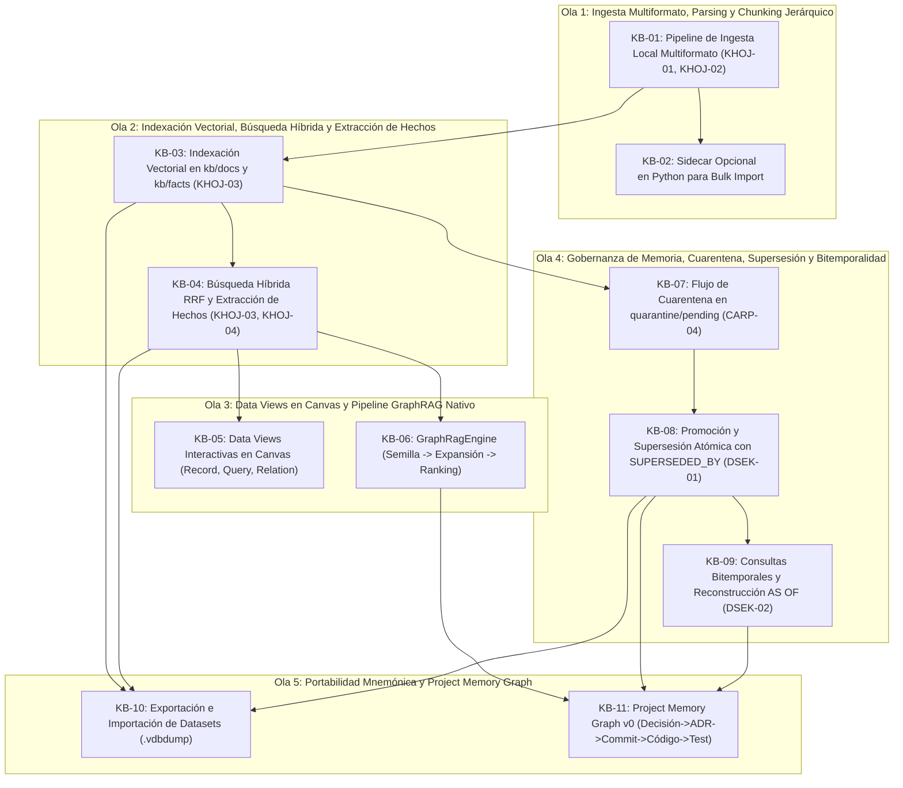

# Plan de Ejecución: Fase 06 — Knowledge & Data (P0-Beta)

> **Fecha:** 2026-10-10  
> **Estado:** 🟡 READY  
> **Fuente Canónica:** `docs/roadmap/Backlog.md` (Fase 06: `KB-01..11`)  
> **Objetivo:** Implementar la infraestructura integral de memoria y conocimiento a largo plazo de Ego: pipeline de ingesta local multiformato, chunking jerárquico adaptativo con deduplicación criptográfica (`KHOJ-01`, `KHOJ-02`), indexación en VantaDB (`kb/docs` y `kb/facts`), motor de búsqueda híbrida con fusión recíproca (RRF) y filtrado por corte dinámico de similitud coseno (`KHOJ-03`), extracción estructurada de hechos (`KHOJ-04`), motor GraphRAG nativo de expansión relacional, Data Views interactivas en el Canvas declarativo (Record, Query y Relation View), gobernanza estricta con aislamiento en cuarentena de 14 días (`CARP-04`), supersesión atómica no destructiva (`DSEK-01`), consultas bitemporales históricas `AS OF` (`DSEK-02`), serialización portable de bases de conocimiento y el grafo mnemónico del proyecto (Project Memory Graph v0).  
> **Autonomous:** false  

---

## 1. Resumen Ejecutivo de la Fase

| Métrica | Valor |
|---|---|
| **Tareas Totales** | 11 (`KB-01` a `KB-11`) |
| **Compuertas de Extracción Previas** | 7 (`KHOJ-01`, `KHOJ-02`, `KHOJ-03`, `KHOJ-04`, `CARP-04`, `DSEK-01`, `DSEK-02`) |
| **Distribución de Decisión** | ✅ DO: 11 \| 🟡 DEFER: 0 \| ❌ SKIP: 0 \| 🔴 BLOQUEADO: 0 |
| **Estimación de Esfuerzo Total** | 3 semanas (Shape Up 6-week cycle buffer) |
| **Hito del Roadmap** | **P0-Beta (Inicio del Bloque de Datos, Dominio y Asistencia Continua)** |
| **Uphill / Downhill** | ⬆️ Uphill = 4 (Chunker semántico adaptativo jerárquico, Motor híbrido RRF + corte coseno, Pipeline GraphRAG nativo con expansión en VantaDB, Data Views interactivas en Canvas) · ⬇️ Downhill = 44 steps atómicos |

---

## 2. Matriz de Compuertas de Extracción e Inspección Previa (Opción B)

Antes de iniciar la codificación, se integran y asimilan formalmente los patrones de ingeniería de los repositorios de referencia catalogados en `docs/extractions/` y `docs/review/`:

| ID Compuerta | Repo Origen | Patrón / Feature a Inspeccionar | Ficha Canónica | Tareas Habilitadas | Acción Canónica en Ego |
|:---:|---|---|---|---|---|
| `KHOJ-01` | khoj | Chunking de 256 tokens con solapamiento (32–64 tokens) y hash digest SHA-256 | [`khoj.md`](docs/extractions/khoj.md) | `KB-01`, `KB-02` | 📥 Segmentación determinista con deduplicación criptográfica previa a la indexación en VantaDB. |
| `KHOJ-02` | khoj | Extracción jerárquica preservando encabezados de contexto (`heading_path`) | [`khoj.md`](docs/extractions/khoj.md) | `KB-01` | 📥 Inyección de linaje estructural jerárquico (`heading_path`) en los metadatos de los chunks en `kb/docs`. |
| `KHOJ-03` | khoj | Filtrado por corte dinámico de umbral de similitud coseno (`min_score`) | [`khoj.md`](docs/extractions/khoj.md) | `KB-03`, `KB-04` | 📥 Descarte temprano de ruido semántico previo a la fusión recíproca RRF, evitando alucinaciones por baja relevancia. |
| `KHOJ-04` | khoj | Extracción estructurada de hechos atómicos (`extract_facts`) en formato JSON | [`khoj.md`](docs/extractions/khoj.md) | `KB-04` | 📥 Extracción tipada de triples (`sujeto`, `predicado`, `objeto`, `certeza`, `temporalidad`) para `kb/facts`. |
| `CARP-04` | career-ops | Cuarentena de payloads entrantes no verificados | [`career-ops.md`](docs/extractions/career-ops.md) | `KB-07` | 📥 Aislamiento en `quarantine/pending` con TTL estricto de 14 días hasta supervisión o promoción explícita. |
| `DSEK-01` | deepseek-harness | Sustitución suave (*soft-replace*) y aristas `SUPERSEDED_BY` en grafo | [`deepseek-harness.md`](docs/extractions/deepseek-harness.md) | `KB-08` | 📥 Reemplazo no destructivo de hechos conservando linaje inmutable con `is_latest: false` y trazabilidad causal. |
| `DSEK-02` | deepseek-harness | Árbol de versiones y reconstrucción temporal de estado | [`deepseek-harness.md`](docs/extractions/deepseek-harness.md) | `KB-09` | 📥 Consultas bitemporales con índices `valid_at` / `invalid_at` y soporte de consultas `AS OF <timestamp>`. |

---

## 3. Grafo de Dependencias y Olas de Ejecución (DAG)

Para asegurar la progresión secuencial sin bloqueos, las 11 tareas se organizan en 5 Olas de Ejecución:



---

## 4. Desglose Exhaustivo de Tareas

### Tarea 1: `KB-01` — Pipeline de ingesta local multiformato (PDF, MD, CSV, TXT, JSON)

- **Appetite:** 2–3d | **Esfuerzo:** 🟡 2-3d | **Prioridad:** 🔴 P0 / 🟠 P1
- **Archivos clave:** `packages/knowledge/package.json`, `packages/knowledge/src/ingest/AdaptiveChunker.ts`, `packages/knowledge/src/ingest/MarkdownExtractor.ts`, `packages/knowledge/src/ingest/DocumentParser.ts`, `packages/knowledge/test/AdaptiveChunker.test.ts`
- **Verificación real:** ✅ CÓDIGO-REAL — Creación del paquete `@ego/knowledge` en el monorepo. Implementación de `AdaptiveChunker` y extractores locales de documentos:
  1. Parsing multiformato seguro en Node.js (Markdown, TXT, JSON, CSV y PDF estructurado).
  2. Algoritmo de chunking de 256 tokens con solapamiento de 32 tokens (`KHOJ-01`).
  3. Preservación del árbol jerárquico de títulos Markdown (`heading_path: "Manual > Capítulo 2 > Instalación"`) inyectado en los metadatos de cada fragmento (`KHOJ-02`).
  4. Generación de hash SHA-256 (`contentHash`) sobre el texto normalizado para deduplicación idempotente previa a la inserción en base de datos.
- **Gate Justificación:** Principio Innegociable §1, §9 y Compuertas `KHOJ-01`, `KHOJ-02`.
- **Gate Result:** ✅ DO (Compuertas: `KHOJ-01`, `KHOJ-02`)
- **Contrato:** `documentParser.parse(filePath)` emite `ParsedDocument` con array de `DocumentChunk`:
  ```typescript
  export interface DocumentChunk {
    id: string;
    content: string;
    tokenCount: number;
    headingPath: string[];
    contentHash: string; // SHA-256
    sourcePath: string;
    mimeType: string;
    index: number;
  }
  ```
- **Cynefin:** 🟨 Complicado — Tokenización, regex de parsing jerárquico y cálculo de hashes.
- **Top 3 Riesgos:**
  1. *Riesgo 1:* Bloqueo del Event Loop al parsear archivos de gran volumen (> 50 MB). (Mitigación: Procesamiento en streams o lotes fraccionados).
  2. *Riesgo 2:* Chunks rotos a mitad de oraciones o código fuente. (Mitigación: Splitter adaptativo que respeta párrafos, saltos dobles y bloques de código).
  3. *Riesgo 3:* Incompatibilidad de codificación de caracteres. (Mitigación: Normalización forzada a UTF-8 y saneamiento de caracteres de control).
- **FMEA:**
  - *Modo de fallo:* Archivo PDF corrupto o con fuentes no incrustadas.
  - *Efecto:* Fallo de lectura que interrumpe la ingesta del lote.
  - *Mitigación:* Captura defensiva por archivo, registro de error detallado y continuación con los demás documentos.
- **DoD:**
  - [ ] Paquete `packages/knowledge` configurado en `pnpm-workspace.yaml` con build tipado.
  - [ ] Implementación de `AdaptiveChunker` con solapamiento y `contentHash` (`KHOJ-01`).
  - [ ] Implementación de `MarkdownExtractor` con preservación de `heading_path` (`KHOJ-02`).
  - [ ] Soporte multiformato verificado para MD, TXT, JSON, CSV.
  - [ ] Suite de pruebas unitarias verificando límites de tokens, deduplicación y preservación de jerarquía.

---

### Tarea 2: `KB-02` — Sidecar opcional en Python para extracción pesada (`bulk_import.py`)

- **Appetite:** 2d | **Esfuerzo:** 🟡 2d | **Prioridad:** 🟡 Media
- **Archivos clave:** `scripts/ingest/bulk_import.py`, `packages/knowledge/src/ingest/PythonSidecarBridge.ts`, `packages/knowledge/test/PythonSidecarBridge.test.ts`
- **Verificación real:** ✅ CÓDIGO-REAL — Proceso secundario desacoplado en Python para importación masiva por lotes:
  1. Invocación segura mediante stdio (`child_process.spawn`) con aislamiento de memoria.
  2. Protocolo JSON-Lines por stdout/stdin con streaming de progreso porcentual (`{ type: "progress", current, total }`).
  3. Opcionalidad absoluta: Si Python no está instalado en el host, Ego opera al 100% mediante el parser TypeScript nativo de `KB-01`.
  4. Sin dependencias de servidor ni puertos TCP abiertos.
- **Gate Justificación:** `docs/engineering/lenguajes.md` §26 ("Sidecar opcional: Python para ingesta masiva") y Guardrail §4.
- **Gate Result:** ✅ DO
- **Contrato:** `bridge.isAvailable()` comprueba la existencia de runtime Python; si está activo, procesa lotes pesados de PDFs o repositorios masivos emitiendo chunks validados por el esquema Zod de Ego.
- **Cynefin:** 🟦 Simple — Envoltorio IPC de proceso hijo vía stdio.
- **Top 3 Riesgos:**
  1. *Riesgo 1:* Fallo por versiones incompatibles de Python o módulos ausentes. (Mitigación: Verificación de entorno previa y fallback inmediato a Node).
  2. *Riesgo 2:* Bloqueo de descriptores de archivos en Windows. (Mitigación: Cierre explícito de streams y buffers).
  3. *Riesgo 3:* Procesos huérfanos al cerrar la aplicación. (Mitigación: Manejo de `exit` y `SIGTERM` atado al PID del proceso Electron).
- **FMEA:**
  - *Modo de fallo:* Caída del subproceso Python durante un lote.
  - *Efecto:* Error de proceso sin salida clara.
  - *Mitigación:* Captura del código de salida y reporte de diagnóstico en `StructuredLogger`.
- **DoD:**
  - [ ] Script `scripts/ingest/bulk_import.py` implementado con interfaz stdio JSONL.
  - [ ] `PythonSidecarBridge` en TypeScript con detección de runtime y streaming de progreso.
  - [ ] Fallback transparente al parser de TypeScript si Python no está presente.
  - [ ] Pruebas unitarias simulando invocación de sidecar y recuperación ante errores.

---

### Tarea 3: `KB-03` — Indexación vectorial en VantaDB (`kb/docs` y `kb/facts`)

- **Appetite:** 1–2d | **Esfuerzo:** 🟡 1-2d | **Prioridad:** 🔴 P0 / 🟠 P1
- **Archivos clave:** `packages/knowledge/src/KnowledgeIndexer.ts`, `packages/knowledge/src/schemas/knowledge.ts`, `packages/knowledge/test/KnowledgeIndexer.test.ts`
- **Verificación real:** ✅ CÓDIGO-REAL — Módulo de inserción masiva e indexación en VantaDB vía `EgoMemoryAdapter`:
  1. Inserción de documentos en namespace `kb/docs/<doc_id>/chunk_<idx>`.
  2. Inserción de aserciones en namespace `kb/facts/<fact_id>`.
  3. Metadatos obligatorios por registro: `org_id`, `project_id`, `ts`, `source`, `confidence`, `heading_path`, `content_hash`.
  4. Respeto estricto del Guardrail §4: **NO calcular embeddings en TypeScript en el fast path**. La indexación deposita el texto y metadatos en `NativeVantaDB` (BM25 LSM in-process), y la inferencia densa ONNX reside exclusivamente en el subproceso `vantadb-mcp`.
  5. Descarte de fragmentos duplicados mediante comparación de `content_hash`.
- **Gate Justificación:** Principio Innegociable §1, Arquitectura de Namespaces (`docs/architecture/namespaces.md`) y Guardrail §4 de VantaDB.
- **Gate Result:** ✅ DO (Compuerta: `KHOJ-03`)
- **Contrato:** `indexer.indexDocument(doc, chunks)` persiste todos los fragmentos atómicamente y retorna recuento de chunks indexados y deduplicados.
- **Cynefin:** 🟦 Simple — Operaciones de escritura estructuradas contra `EgoMemoryAdapter`.
- **Top 3 Riesgos:**
  1. *Riesgo 1:* Sobrecarga del motor LSM por escrituras atómicas individuales. (Mitigación: Lotes de escritura `putBatch` o iteración con pausas de yield).
  2. *Riesgo 2:* Inconsistencia en la estructura de claves primarias. (Mitigación: Claves deterministas prefijadas `doc_<hash>` y `fact_<uuid>`).
  3. *Riesgo 3:* Datos desactualizados tras modificar un archivo fuente. (Mitigación: Reemplazo coordinado con hash de archivo).
- **FMEA:**
  - *Modo de fallo:* Descriptor de archivo bloqueado en VantaDB.
  - *Efecto:* Fallo de indexación.
  - *Mitigación:* Reintento defensivo documentado con backoff según el estándar de `docs/VANTADB-FEEDBACK-Y-MEJORAS.md`.
- **DoD:**
  - [ ] Esquemas Zod para registros de `kb/docs` y `kb/facts`.
  - [ ] Implementación de `KnowledgeIndexer` integrando `EgoMemoryAdapter`.
  - [ ] Deduplicación verificada por `content_hash`.
  - [ ] Pruebas unitarias de indexación masiva y verificación de persistencia en VantaDB.

---

### Tarea 4: `KB-04` — Búsqueda híbrida con fusión RRF y reordenamiento MMR

- **Appetite:** 1–2d | **Esfuerzo:** 🟡 1-2d | **Prioridad:** 🔴 P0 / 🟠 P1
- **Archivos clave:** `packages/knowledge/src/HybridSearch.ts`, `packages/knowledge/src/filters/CosineThresholdFilter.ts`, `packages/knowledge/test/HybridSearch.test.ts`
- **Verificación real:** ✅ CÓDIGO-REAL — Motor de recuperación híbrida combinada:
  1. Recuperación multi-canal: BM25 léxico in-process + recuperación semántica en VantaDB.
  2. Filtrado por corte dinámico de umbral de similitud coseno (`KHOJ-03`): descarta resultados con similitud `< 0.70` antes de la combinación para erradicar ruido y alucinaciones.
  3. Algoritmo Reciprocal Rank Fusion (RRF) canónico:  
     $$RRF(d) = \sum_{m \in M} \frac{1}{60 + r_m(d)}$$
  4. Diversificación de resultados mediante Maximal Marginal Relevance (MMR) para evitar devolver fragmentos idénticos contiguos.
  5. Extracción estructurada de hechos (`KHOJ-04`) para consultas que soliciten aserciones explícitas.
- **Gate Justificación:** `docs/architecture/memoria-vantadb.md` §102 y Compuertas `KHOJ-03`, `KHOJ-04`.
- **Gate Result:** ✅ DO (Compuertas: `KHOJ-03`, `KHOJ-04`)
- **Contrato:** `hybridSearch.search(query, { topK, minConfidence, namespaces })` devuelve lista unificada de `SearchHit` con scores RRF normalizados `[0, 1]` en `< 50ms`.
- **Cynefin:** 🟨 Complicado — Algoritmos de fusión RRF, normalización y diversificación MMR.
- **Top 3 Riesgos:**
  1. *Riesgo 1:* Discrepancias de escala entre scores de BM25 y similitud vectorial. (Mitigación: RRF opera sobre rangos posicionales ordinales, no sobre valores flotantes crudos).
  2. *Riesgo 2:* Latencia superior a 100ms en queries complejas. (Mitigación: Búsqueda federada paralela en namespaces destino).
  3. *Riesgo 3:* Falsos positivos por palabras clave coincidentes en contextos irrelevantes. (Mitigación: El umbral dinámico (`KHOJ-03`) filtra candidatos espurios).
- **FMEA:**
  - *Modo de fallo:* La búsqueda no produce ningún resultado por encima del umbral.
  - *Efecto:* Riesgo de error en downstream agents.
  - *Mitigación:* Retorno de conjunto vacío limpio sin excepciones, permitiendo al Cognitive Runtime declarar falta de contexto en vez de inventar.
- **DoD:**
  - [ ] Implementación de `CosineThresholdFilter` (`KHOJ-03`).
  - [ ] Implementación de `HybridSearch` con algoritmo RRF y diversificación MMR.
  - [ ] Integración de extracción de hechos estructurados (`KHOJ-04`).
  - [ ] Pruebas unitarias validando ordenamiento RRF, filtrado por umbral y descarte de ruido.

---

### Tarea 5: `KB-05` — Data Views interactivas en Canvas (Record, Query y Relation View)

- **Appetite:** 2–3d | **Esfuerzo:** 🟡 2-3d | **Prioridad:** 🔴 P0 / 🟠 P1
- **Archivos clave:** `packages/ui-runtime/src/schemas/data-views.ts`, `apps/desktop/renderer/components/canvas/data/RecordView.tsx`, `apps/desktop/renderer/components/canvas/data/QueryView.tsx`, `apps/desktop/renderer/components/canvas/data/RelationView.tsx`, `apps/desktop/renderer/test/data-views.test.tsx`
- **Verificación real:** ✅ CÓDIGO-REAL — Componentes visuales declarativos para el Canvas de Ego basados en el Ego Generative Design System (EGDS):
  1. `RecordView`: Inspección detallada de un documento o hecho individual con visualización de metadatos, linaje y fragmentos.
  2. `QueryView`: Vista de consulta interactiva con filtros reactivos por namespace, fecha, confianza y umbral semántico.
  3. `RelationView`: Visualización topológica y relacional de nodos del grafo (`node_id` tipado obligatoriamente como `string`) con aristas de causalidad y pertenencia.
  4. Gobernanza por contratos Zod: emitidos como esquemas declarativos por los Sub-Egos, renderizados de forma segura por el runtime sin evaluar HTML arbitrario.
  5. Selección de contexto integrada: el usuario puede seleccionar filas o nodos para enviarlos al Chat Composer con `useSelectionContext`.
- **Gate Justificación:** `docs/architecture/ui-runtime.md` §31, `docs/architecture/workspace-dinamico.md` y Decisión P22.
- **Gate Result:** ✅ DO
- **Contrato:** Esquema Zod formal `DataViewManifestSchema` compatible con `CanvasBridge.injectComponent`.
- **Cynefin:** 🟨 Complicado — Visualización de datos interactiva, estado reactivo y accesibilidad.
- **Top 3 Riesgos:**
  1. *Riesgo 1:* Sobrecarga del presupuesto de UI (> 30% en la fase). (Mitigación: Reutilización estricta de componentes primitivos base de Fase 04 y TanStack Table).
  2. *Riesgo 2:* Renderizado lento con miles de registros en memoria. (Mitigación: Paginación virtualizada en `QueryView`).
  3. *Riesgo 3:* Inconsistencia visual con el tema del Dynamic Workspace. (Mitigación: Tokens CSS canónicos de EGDS).
- **FMEA:**
  - *Modo de fallo:* Entrada de datos malformada desde VantaDB.
  - *Efecto:* Fallo de renderizado en React.
  - *Mitigación:* Error boundary granular con fallback visual a tarjeta de error descriptiva.
- **DoD:**
  - [ ] Esquemas Zod para `RecordViewProps`, `QueryViewProps` y `RelationViewProps`.
  - [ ] Implementación de `RecordView`, `QueryView` y `RelationView` en React 19.
  - [ ] Conexión reactiva con `useSelectionContext` para inyectar selecciones al chat.
  - [ ] Pruebas unitarias de componentes con `@testing-library/react` y Vitest.

---

### Tarea 6: `KB-06` — Integración del pipeline GraphRAG nativo

- **Appetite:** 2d | **Esfuerzo:** 🟡 2d | **Prioridad:** 🔴 P0 / 🟠 P1
- **Archivos clave:** `packages/knowledge/src/GraphRagEngine.ts`, `packages/knowledge/src/schemas/graphrag.ts`, `packages/knowledge/test/GraphRagEngine.test.ts`
- **Verificación real:** ✅ CÓDIGO-REAL — Motor de razonamiento GraphRAG de 4 fases acoplado a VantaDB:
  1. **Fase 1 (Semilla):** Búsqueda inicial de nodos semilla (documentos o hechos) mediante `HybridSearch`.
  2. **Fase 2 (Expansión de Relaciones):** Recorrido de 1 y 2 saltos a través de las aristas del grafo de VantaDB (`mentions`, `depends_on`, `derived_from`, `supersedes`).
  3. **Fase 3 (Ponderación Causal):** Ponderación de nodos vecinos según confianza, frescura temporal y distancia de salto.
  4. **Fase 4 (Ensamblado Estructurado):** Síntesis de subgrafo contextual en formato JSON/Markdown estructurado para inyección directa en el System Prompt de los Sub-Egos.
- **Gate Justificación:** `docs/roadmap/roadmap.md` §Fase 06, Decisión P02 (Project Memory) y Principio Innegociable §1.
- **Gate Result:** ✅ DO
- **Contrato:** `graphRag.search(query, { maxDepth: 2, maxNodes: 20 })` retorna `GraphRagContext` con nodos, aristas explicadas y resumen causal en `< 80ms`.
- **Cynefin:** 🟨 Complicado — Algoritmo de recorrido y poda de grafos sobre VantaDB LSM.
- **Top 3 Riesgos:**
  1. *Riesgo 1:* Explosión combinatoria al expandir nodos densamente conectados. (Mitigación: Límite estricto de `maxDegree` por nodo y límite global de expansión).
  2. *Riesgo 2:* Latencia elevada al recorrer relaciones. (Mitigación: Lecturas por lote de aristas indexadas en VantaDB).
  3. *Riesgo 3:* Contaminación de contexto con relaciones obsoletas. (Mitigación: Filtro estricto excluyendo aristas superseded).
- **FMEA:**
  - *Modo de fallo:* Grafo con ciclos de relaciones circulares.
  - *Efecto:* Bucle infinito de recorrido en memoria.
  - *Mitigación:* Set de nodos visitados en memoria (`visitedNodeIds`) para cortar ciclos de inmediato.
- **DoD:**
  - [ ] Implementación de `GraphRagEngine` con las 4 fases (Semilla, Expansión, Ponderación, Ensamblado).
  - [ ] Soporte para expansión de hasta 2 saltos con límite de poda configurable.
  - [ ] Formateo de salida optimizado para el Cognitive Runtime.
  - [ ] Suite de pruebas unitarias verificando corte de ciclos, expansión correcta y ranking de nodos.

---

### Tarea 7: `KB-07` — Aislamiento y flujo de Cuarentena en `quarantine/pending` (ADR-046)

- **Appetite:** 1d | **Esfuerzo:** 🟢 1d | **Prioridad:** 🔴 P0 / 🟠 P1
- **Archivos clave:** `packages/memory/EgoMemoryAdapter.ts`, `packages/knowledge/src/QuarantineManager.ts`, `packages/knowledge/test/QuarantineManager.test.ts`
- **Verificación real:** ✅ CÓDIGO-REAL — Gobernanza de hechos no verificados según ADR-046 y Compuerta `CARP-04`:
  1. Entrada de datos de fuentes externas o inferencias con confianza `< 0.60` se depositan exclusivamente en namespace `quarantine/pending`.
  2. Aislamiento total: El Cognitive Runtime y los Sub-Egos tienen prohibido consumir hechos en cuarentena para resolver tareas sin autorización explícita.
  3. TTL de expiración determinista de 14 días: purga automática de hechos no supervisados.
  4. Métodos formales en `QuarantineManager`: `quarantine()`, `listPending()`, `reject()`.
- **Gate Justificación:** ADR-046, Principio Innegociable §6 (Gobernanza) y Compuerta `CARP-04`.
- **Gate Result:** ✅ DO (Compuerta: `CARP-04`)
- **Contrato:** Ningún registro de `quarantine/pending` es visible en `searchMulti` a menos que se solicite con flag explícito `includeQuarantined: true`.
- **Cynefin:** 🟦 Simple — Gestión de estados y TTL sobre VantaDB.
- **Top 3 Riesgos:**
  1. *Riesgo 1:* Filtración accidental de hechos en cuarentena al contexto del LLM. (Mitigación: `searchMulti` filtra `quarantine/*` por defecto).
  2. *Riesgo 2:* Acumulación indefinida de elementos huérfanos. (Mitigación: Lógica de purga basada en timestamp `quarantined_at + TTL`).
  3. *Riesgo 3:* Ambigüedad en la causa de la cuarentena. (Mitigación: Campo `quarantine_reason` obligatorio en metadatos).
- **FMEA:**
  - *Modo de fallo:* El usuario no revisa la cuarentena durante 14 días.
  - *Efecto:* Los hechos se eliminan automáticamente.
  - *Mitigación:* Notificación visual proactiva en el Activity Widget antes de la expiración.
- **DoD:**
  - [ ] Formalización de `QuarantineManager` acoplado a `EgoMemoryAdapter`.
  - [ ] Aislamiento estricto verificado: `searchMulti` excluye `quarantine/pending` por defecto.
  - [ ] Cálculo de caducidad con TTL de 14 días y método de purga.
  - [ ] Pruebas unitarias de aislamiento, listado y expiración.

---

### Tarea 8: `KB-08` — Flujo de Promoción y Supersesión atómica de hechos (ADR-028)

- **Appetite:** 1–2d | **Esfuerzo:** 🟢 1-2d | **Prioridad:** 🔴 P0 / 🟠 P1
- **Archivos clave:** `packages/memory/EgoMemoryAdapter.ts`, `packages/knowledge/src/FactLifecycle.ts`, `packages/knowledge/test/FactLifecycle.test.ts`
- **Verificación real:** ✅ CÓDIGO-REAL — Ciclo de vida y versionado inmutable de aserciones mnemónicas según ADR-028 y Compuerta `DSEK-01`:
  1. **Promoción:** Mueve un hecho aprobado desde `quarantine/pending` a `kb/facts` con eliminación atómica del origen y registro de auditoría.
  2. **Supersesión (*soft-replace*):** Cuando un hecho es refutado o actualizado, el hecho previo se marca con `state: 'superseded'`, `is_latest: false`, `superseded_by: <newKey>` y arista relacional `SUPERSEDED_BY` en el grafo de VantaDB.
  3. Prohibición estricta de borrado destructivo (`DELETE` en caliente) sobre hechos confirmados.
  4. Preservación del DAG causal de revisiones históricas.
- **Gate Justificación:** ADR-028, Principio Innegociable §1 y Compuerta `DSEK-01`.
- **Gate Result:** ✅ DO (Compuerta: `DSEK-01`)
- **Contrato:** `factLifecycle.supersede(oldKey, newFact)` actualiza ambos registros atómicamente; consultas con `excludeSuperseded: true` retornan exclusivamente hechos activos vigentes.
- **Cynefin:** 🟨 Complicado — Coordinación atómica de pares de registros y aristas de grafo.
- **Top 3 Riesgos:**
  1. *Riesgo 1:* Fallo a mitad de la operación de supersesión dejando punteros rotos. (Mitigación: Orden estricto de inserción: nuevo hecho primero, luego marcado del anterior).
  2. *Riesgo 2:* Consultas que devuelven hechos obsoletos. (Mitigación: Predicado obligatorio `is_latest: true` en índices de lectura rápida).
  3. *Riesgo 3:* Pérdida de trazabilidad de quién aprobó la promoción. (Mitigación: Registro obligatorio de `promoted_by` y `promoted_at`).
- **FMEA:**
  - *Modo de fallo:* Referencia circular de supersesión (A supersedes B y B supersedes A).
  - *Efecto:* Ciclo infinito de consulta en el linaje.
  - *Mitigación:* Validación previa asegurando que el hecho sustituido no sea descendiente del nuevo hecho.
- **DoD:**
  - [ ] Implementación de `FactLifecycle` coordinando promoción y supersesión atómica.
  - [ ] Verificación de marcado inmutable `SUPERSEDED_BY` y `is_latest: false`.
  - [ ] Búsquedas en `kb/facts` excluyen registros obsoletos por defecto.
  - [ ] Suite de pruebas unitarias cubriendo promoción desde cuarentena, linaje de versiones y exclusión de superseded.

---

### Tarea 9: `KB-09` — Consultas Bitemporales (`valid_at` / `invalid_at` y `AS OF`)

- **Appetite:** 1–2d | **Esfuerzo:** 🟡 1-2d | **Prioridad:** 🟠 P1
- **Archivos clave:** `packages/knowledge/src/BitemporalQueries.ts`, `packages/knowledge/src/schemas/bitemporal.ts`, `packages/knowledge/test/BitemporalQueries.test.ts`
- **Verificación real:** ✅ CÓDIGO-REAL — Soporte para reconstrucción temporal exacta del conocimiento según Compuerta `DSEK-02`:
  1. Doble dimensión temporal en metadatos:  
     - **Tiempo de Transacción:** `system_at` (momento en que Ego grabó el registro en VantaDB).  
     - **Tiempo Válido:** `valid_at` e `invalid_at` (intervalo en el que el hecho es verdadero en la realidad del proyecto).
  2. Consulta `asOf(timestamp, namespace)`: Reconstruye la instantánea del conocimiento del proyecto en cualquier momento histórico del pasado.
  3. Reconstrucción de estado para depuración causal: Permite responder "¿Qué sabía Ego cuando tomó la Decisión X hace 5 días?".
- **Gate Justificación:** `docs/architecture/memoria-vantadb.md` §108 y Compuerta `DSEK-02`.
- **Gate Result:** ✅ DO (Compuerta: `DSEK-02`)
- **Contrato:** `bitemporal.asOf(targetTime, { namespace: 'kb/facts' })` retorna exactamente los hechos cuyo intervalo `[valid_at, invalid_at)` abarque `targetTime`.
- **Cynefin:** 🟨 Complicado — Filtrado temporal sobre registros versionados sin motor SQL temporal nativo.
- **Top 3 Riesgos:**
  1. *Riesgo 1:* Degradación de rendimiento en consultas históricas. (Mitigación: Índices ordenados por timestamp en VantaDB).
  2. *Riesgo 2:* Hechos con `invalid_at` nulo tratados incorrectamente. (Mitigación: Convención estándar: `null` representa infinitud futura / vigencia activa).
  3. *Riesgo 3:* Desincronización de relojes entre sistemas. (Mitigación: Marcas de tiempo basadas exclusivamente en epoch UTC del host).
- **FMEA:**
  - *Modo de fallo:* Consulta con timestamp anterior a la creación del proyecto.
  - *Efecto:* Retorno de conjunto vacío.
  - *Mitigación:* Comportamiento esperado consistente, sin errores en tiempo de ejecución.
- **DoD:**
  - [ ] Esquema Zod de metadatos bitemporales (`system_at`, `valid_at`, `invalid_at`).
  - [ ] Implementación de `BitemporalQueries` con método `asOf()`.
  - [ ] Filtrado temporal correcto para hechos activos y sustituidos en el tiempo objetivo.
  - [ ] Pruebas unitarias verificando reconstrucción de estado histórica en múltiples momentos del tiempo.

---

### Tarea 10: `KB-10` — Exportación e importación de bases de conocimiento completas

- **Appetite:** 1d | **Esfuerzo:** 🟢 1d | **Prioridad:** 🟠 P1
- **Archivos clave:** `packages/knowledge/src/KnowledgeExport.ts`, `packages/knowledge/src/schemas/export.ts`, `packages/knowledge/test/KnowledgeExport.test.ts`
- **Verificación real:** ✅ CÓDIGO-REAL — Utilidad de portabilidad mnemónica:
  1. Serialización compacta en formato canónico `.vdbdump` / `.tar.gz` o JSON comprimido.
  2. Exportación selectiva por proyecto o global: vuelca `kb/docs`, `kb/facts` y sus aristas relacionales.
  3. Importación con validación de integridad criptográfica (checksum SHA-256) y resolución de conflictos (skip, replace o merge aditivo `DSEK-04`).
  4. Preservación estricta de la soberanía de datos del usuario (Principio Innegociable §9).
- **Gate Justificación:** Principio Innegociable §9 (Local-first & Propiedad de Datos) y `docs/architecture/memoria-vantadb.md` §15.
- **Gate Result:** ✅ DO
- **Contrato:** `knowledgeExport.exportProject(projectId, destPath)` genera archivo verificable que `knowledgeExport.importProject(sourcePath)` puede reconstruir al 100%.
- **Cynefin:** 🟦 Simple — Serialización, streams y compresión.
- **Top 3 Riesgos:**
  1. *Riesgo 1:* Fuga de credenciales o API keys en el volcado de conocimiento. (Mitigación: Filtro estricto de secretos antes de empaquetar).
  2. *Riesgo 2:* Incompatibilidad de versión de esquema al importar. (Mitigación: Encabezado de versión semántica en el archivo de volcado).
  3. *Riesgo 3:* Sobrecarga de memoria al serializar datasets de varios gigabytes. (Mitigación: Serialización en stream directo a disco).
- **FMEA:**
  - *Modo de fallo:* Archivo de volcado corrupto o truncado durante la importación.
  - *Efecto:* Error de deserialización y riesgo de estado a medias.
  - *Mitigación:* Validación previa del checksum SHA-256 antes de iniciar la inserción en VantaDB.
- **DoD:**
  - [ ] Esquema Zod para encabezados de archivo de exportación con versión y checksum.
  - [ ] Implementación de `KnowledgeExport` con `exportPackage()` e `importPackage()`.
  - [ ] Filtro activo de saneamiento de credenciales en el volcado.
  - [ ] Pruebas unitarias de exportación e importación verificando paridad de datos al 100%.

---

### Tarea 11: `KB-11` — Project Memory Graph v0 (Decisión → ADR → Commit → Código → Test → Outcome)

- **Appetite:** 2–3d | **Esfuerzo:** 🟡 2-3d | **Prioridad:** 🔴 P0 / 🟠 P1
- **Archivos clave:** `packages/knowledge/src/ProjectMemoryGraph.ts`, `packages/knowledge/src/schemas/project-graph.ts`, `packages/knowledge/test/ProjectMemoryGraph.test.ts`
- **Verificación real:** ✅ CÓDIGO-REAL — Grafo de linaje de ingeniería de software que responde de forma determinista por qué existe cada pieza de código en el proyecto:
  1. Red de aristas semánticas en VantaDB que conecta la cadena causal completa:
     $$\text{Decisión (gov/audit)} \longrightarrow \text{ADR} \longrightarrow \text{Commit (git)} \longrightarrow \text{Archivos/Código} \longrightarrow \text{Tests} \longrightarrow \text{Outcome}$$
  2. Ingesta de commits de git local y vinculación automática con los veredictos de la Decision Intelligence Layer (`DEC-07`).
  3. Interfaz de consulta causal: `projectGraph.explainArtifact(filePath)` o `projectGraph.explainDecision(decisionId)`.
  4. Contrapartida directa de las capacidades upstream de VantaDB `MEMG-03` / `MGR-22..24`.
- **Gate Justificación:** Principio Innegociable §2 (Project Memory) y Decisión P02.
- **Gate Result:** ✅ DO
- **Contrato:** `projectGraph.queryTrace(nodeId)` retorna el DAG causal completo en formato estructurado para ser consumido por el botón de explicabilidad del Canvas (`CANV-07`) o por el Cognitive Runtime.
- **Cynefin:** 🟨 Complicado — Modelado de grafos causales sobre motor de persistencia relacional/vectorial.
- **Top 3 Riesgos:**
  1. *Riesgo 1:* Enlaces rotos si el usuario realiza commits manuales fuera de Ego. (Mitigación: Escáner reconciliador de historial git con matching difuso de mensajes).
  2. *Riesgo 2:* Crecimiento desmedido de aristas por cambios menores. (Mitigación: Agrupación por turno de trabajo o hito).
  3. *Riesgo 3:* Complejidad excesiva de consulta. (Mitigación: Vistas materializadas de traza causal en VantaDB).
- **FMEA:**
  - *Modo de fallo:* Uno de los elementos de la cadena falta (ej. no hay ADR formal para un cambio pequeño).
  - *Efecto:* Grafo desconectado.
  - *Mitigación:* Aristas opcionales con degradación suave: la cadena vincula directamente Decisión → Commit → Código.
- **DoD:**
  - [ ] Esquema Zod del grafo causal de proyecto (`ProjectMemoryNode`, `ProjectMemoryEdge`).
  - [ ] Implementación de `ProjectMemoryGraph` con trazabilidad completa de la cadena de ingeniería.
  - [ ] Vinculación automática con veredictos de `gov/audit` y herramientas de Git.
  - [ ] Integración con el botón contextual de explicabilidad ("¿Por qué?") de `CANV-07`.
  - [ ] Suite de pruebas unitarias verificando construcción y consulta del grafo de proyecto.

---

## 5. Matriz de Riesgos y FMEA de la Fase

| Riesgo / Modo de Fallo | Severidad | Probabilidad | Detección | RPN | Estrategia de Mitigación |
|---|:---:|:---:|:---:|:---:|---|
| **Cálculo de Embeddings Pesado en Proceso Main** | 🔴 Alta | 🔴 Alta | 🟢 Inmediata | Alta | Guardrail §4 estricto: BM25 léxico in-process en NativeVantaDB; la inferencia densa ONNX reside exclusivamente en el subprocess `vantadb-mcp`. |
| **Explosión de Tokens y Alucinaciones por Ruido** | 🔴 Alta | 🟡 Media | 🟢 Inmediata | Media | Filtrado obligatorio por corte dinámico de umbral coseno (`KHOJ-03`) antes de combinar en RRF. |
| **Fuga de Datos en Cuarentena hacia Agentes** | 🔴 Alta | 🟡 Media | 🟢 Inmediata | Media | `searchMulti` y GraphRAG filtran y rechazan el namespace `quarantine/pending` por defecto a menos que se fuerce autorización explícita (`CARP-04`). |
| **Pérdida de Linaje Histórico por Sobrescritura** | 🔴 Alta | 🟡 Media | 🟢 Inmediata | Media | Prohibición terminante de borrado destructivo; supersesión suave obligatoria con aristas `SUPERSEDED_BY` y versionado inmutable (`DSEK-01`). |
| **Bloqueo del Proceso Main por Parsing de Archivos Gigantes** | 🟠 Media | 🟡 Media | 🟢 Inmediata | Baja | Fragmentación en lotes asíncronos y delegación al sidecar opcional en Python (`bulk_import.py`) para operaciones masivas. |

---

## 6. Instrucciones de Ejecución

Para iniciar la ejecución ordenada de este plan con el sistema de agentes (`agent-system`), ejecutar el pipeline canónico:

```bash
/pipeline run -PlanFile docs/agent-ops/plans/2026-10-10-fase-06-knowledge-and-data.md
```
