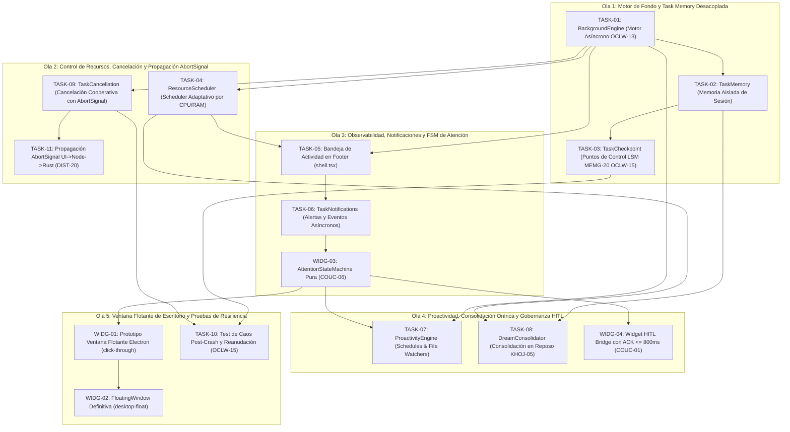

# Plan de Ejecución: Fase 07 — Tasks & Background (P0-Beta)

> **Fecha:** 2026-10-10  
> **Estado:** ⏳ PLAN  
> **Fuente Canónica:** `docs/roadmap/Backlog.md` (Fase 07: `TASK-01..11` + `WIDG-01..04`)  
> **Objetivo:** Implementar la infraestructura completa de ejecución continua asíncrona, memoria de tareas aislada de la conversación (`OCLW-13`), puntos de control atómicos resilientes a caídas del sistema (`OCLW-15`, `MEMG-20`), scheduler adaptativo con control de concurrencia y saturación de recursos, bandeja de actividad no invasiva en el footer con FSM de atención de Coucou (`COUC-06`), cancelación cooperativa multi-capa mediante `AbortSignal` (DIST-20), proactividad autónoma de Sub-Egos mediante cron y observadores de archivos, consolidación onírica de memoria en periodos de inactividad ("Dream Consolidation", `KHOJ-05`), ventana flotante desacoplada de escritorio (`WIDG-01..04`) y verificación integral de caos post-crash.  
> **Autonomous:** false  

---

## 1. Resumen Ejecutivo de la Fase

| Métrica | Valor |
|---|---|
| **Tareas Totales** | 15 (`TASK-01` a `TASK-11`, `WIDG-01` a `WIDG-04`) |
| **Compuertas de Extracción Previas** | 4 (`OCLW-13`, `OCLW-15`, `COUC-06`, `KHOJ-05`) |
| **Distribución de Decisión** | ✅ DO: 15 \| 🟡 DEFER: 0 \| ❌ SKIP: 0 \| 🔴 BLOQUEADO: 0 |
| **Estimación de Esfuerzo Total** | 3–4 semanas (Shape Up 6-week cycle buffer) |
| **Hito del Roadmap** | **P0-Beta (Ejecución Autónoma Asíncrona, Resiliencia y Proactividad)** |
| **Uphill / Downhill** | ⬆️ Uphill = 5 (BackgroundEngine & TaskMemory aislada, Checkpoints atómicos con reanudación post-crash, Scheduler adaptativo por CPU/memoria, AttentionStateMachine con ACK HITL, DreamConsolidator in-process en reposo) · ⬇️ Downhill = 55 steps atómicos |

---

## 2. Matriz de Compuertas de Extracción e Inspección Previa (Opción B)

Antes de iniciar la codificación, se integran y asimilan formalmente los patrones de ingeniería de los repositorios de referencia catalogados en `docs/extractions/` y `docs/review/`:

| ID Compuerta | Repo Origen | Patrón / Feature a Inspeccionar | Ficha Canónica | Tareas Habilitadas | Acción Canónica en Ego |
|:---:|---|---|---|---|---|
| `OCLW-13` | openclaw | Sesiones en background desacopladas del hilo de chat principal | [`openclaw.md`](docs/extractions/openclaw.md) | `TASK-01`, `TASK-02` | 📥 Ejecución en segundo plano sin bloquear interfaz; la sesión del chat se mantiene reactiva mientras el motor gestiona tareas de larga duración en memoria dedicada `tasks/<task_id>`. |
| `OCLW-15` | openclaw | Puntos de control de tarea con reanudación post-crash | [`openclaw.md`](docs/extractions/openclaw.md) | `TASK-03`, `TASK-10` | 📥 Checkpoints persistentes de variables y estado con snapshots inmutables guardados en VantaDB para recuperar el progreso ante reinicios o cierres abruptos. |
| `COUC-06` | coucou | FSM de atención para notificaciones y telemetría no intrusiva | [`coucou.md`](docs/extractions/coucou.md) | `TASK-05`, `TASK-06`, `TASK-07`, `WIDG-03`, `WIDG-04` | 📥 Máquina de estados de atención (`idle`, `compact`, `expanded`, `alert`, `hitl_approval`) con timers de colapso automático y admisión con ACK ≤800 ms sin saturar al usuario. |
| `KHOJ-05` | khoj | Consolidación periódica de memorias en periodos de inactividad | [`khoj.md`](docs/extractions/khoj.md) | `TASK-08` | 📥 "Dream Consolidation" periódica en VantaDB ejecutada in-process durante reposo de CPU/EventLoop: deduplicación, resolución de contradicciones y enfriamiento de memorias. |

---

## 3. Grafo de Dependencias y Olas de Ejecución (DAG)

Para asegurar la progresión secuencial sin bloqueos y respetando el ciclo C0 (`PLAN` → `ACT` → `REVIEW` → `DONE`), las 15 tareas se organizan en 5 Olas de Ejecución:



---

## 4. Desglose Exhaustivo de Tareas

### Tarea 1: `TASK-01` — Motor de tareas persistentes en segundo plano (Background Engine)

- **Appetite:** 2–3d | **Esfuerzo:** 🟡 2-3d | **Prioridad:** 🔴 P0 / 🟠 P1
- **Archivos clave:** `packages/tasks/package.json`, `packages/tasks/src/BackgroundEngine.ts`, `packages/tasks/src/types.ts`, `packages/tasks/test/BackgroundEngine.test.ts`
- **Verificación real:** ✅ CÓDIGO-REAL — Creación del paquete `@ego/tasks` en el monorepo. Implementación de `BackgroundEngine`:
  1. Motor de orquestación asíncrono desacoplado del ciclo de vida del chat conversacional (`OCLW-13`).
  2. Gestión de ciclo de vida de tarea: `SUBMITTED` → `QUEUED` → `RUNNING` → `PAUSED` → `COMPLETED` | `FAILED` | `CANCELLED`.
  3. Ejecución de pasos atómicos con reporte de progreso incremental (`progress: 0..100%`) y métricas de latencia.
  4. Integración nativa con `EventBus` de Ego para emisión de eventos normalizados.
- **Gate Justificación:** Principio Innegociable §3, §10 y Compuerta `OCLW-13`.
- **Gate Result:** ✅ DO (Compuerta `OCLW-13`)
- **Contrato:**
  ```typescript
  export type TaskStatus = 'submitted' | 'queued' | 'running' | 'paused' | 'completed' | 'failed' | 'cancelled';
  export type TaskPriority = 'low' | 'normal' | 'high' | 'critical';

  export interface TaskDefinition<TInput = unknown, TOutput = unknown> {
    id: string;
    title: string;
    description: string;
    subEgoId?: string;
    priority: TaskPriority;
    input: TInput;
    execute: (context: TaskExecutionContext) => Promise<TOutput>;
    maxRetries?: number;
    timeoutMs?: number;
  }

  export interface TaskExecutionContext {
    taskId: string;
    signal: AbortSignal;
    reportProgress: (progress: number, message?: string) => void;
    saveCheckpoint: (state: Record<string, unknown>) => Promise<void>;
  }

  export interface TaskRecord {
    id: string;
    title: string;
    status: TaskStatus;
    priority: TaskPriority;
    progress: number;
    createdAt: number;
    startedAt?: number;
    completedAt?: number;
    error?: string;
    result?: unknown;
  }
  ```
- **Cynefin:** 🟨 Complicado — Máquina de estados asíncrona, colas y temporizadores.
- **Top 3 Riesgos:**
  1. *Riesgo 1:* Tareas zombis reteniendo memoria en Node.js tras fallar la ejecución. (Mitigación: Timeouts duros con descarte forzado y liberación de referencias).
  2. *Riesgo 2:* Saturación del event loop por tareas de cálculo intensivo. (Mitigación: Fraccionamiento cooperativo con `setImmediate` y `ResourceScheduler`).
  3. *Riesgo 3:* Fuga de eventos no recolectados al completar la tarea. (Mitigación: Handlers de limpieza determinista en bloque `finally`).
- **FMEA:**
  - *Modo de fallo:* Excepción no capturada en función `execute`.
  - *Efecto:* Caída del motor o estado bloqueado indefinidamente en `running`.
  - *Mitigación:* Aislamiento con bloque `try/catch/finally`, marcando la tarea como `failed` y emitiendo evento de fallo tipado.
- **Steps atómicos:**
  1. Crear `packages/tasks/package.json` con dependencias internas (`@ego/events`, `@ego/memory`).
  2. Implementar tipos de ciclo de vida en `packages/tasks/src/types.ts`.
  3. Desarrollar `BackgroundEngine.ts` con mapa de tareas activas, cola de prioridad y métodos `submit`, `pause`, `resume`, `cancel`.
  4. Crear suite unitaria `BackgroundEngine.test.ts` verificando transiciones de estado, reintentos y reporte de progreso.
- **DoD:**
  - `pnpm -r typecheck` pasa con 0 errores.
  - `BackgroundEngine.test.ts` pasa al 100% cubriendo flujo exitoso, fallos controlados y timeout.

---

### Tarea 2: `TASK-02` — Formalización de `Task Memory` desacoplada del chat

- **Appetite:** 1–2d | **Esfuerzo:** 🟡 1-2d | **Prioridad:** 🔴 P0 / 🟠 P1
- **Archivos clave:** `packages/tasks/src/TaskMemory.ts`, `packages/tasks/test/TaskMemory.test.ts`
- **Verificación real:** ✅ CÓDIGO-REAL — Aislamiento mnemónico de tareas en VantaDB:
  1. Espacio mnemónico dedicado por tarea bajo el namespace canónico `tasks/<taskId>/` en `EgoMemoryAdapter`.
  2. Desacoplamiento total de los hilos de conversación del chat (`sessions/*`), evitando contaminar el contexto del usuario con transcripciones intermedias de fondo.
  3. Almacenamiento estructurado de: meta principal, precondiciones, artefactos generados, hechos descubiertos (`facts`) y resumen final.
  4. Capacidad de consulta y enlace con el grafo de proyecto (`ProjectMemoryGraph`).
- **Gate Justificación:** Principio Innegociable §1, §2 y Compuerta `OCLW-13`.
- **Gate Result:** ✅ DO (Compuerta `OCLW-13`)
- **Contrato:**
  ```typescript
  export interface TaskMemoryData {
    taskId: string;
    goal: string;
    subEgoId?: string;
    context: Record<string, unknown>;
    intermediateFindings: string[];
    generatedArtifacts: Array<{ id: string; name: string; uri: string }>;
    outcomeSummary?: string;
    updatedAt: number;
  }

  export class TaskMemory {
    constructor(private memoryAdapter: EgoMemoryAdapter) {}
    async initialize(taskId: string, goal: string, context?: Record<string, unknown>): Promise<void>;
    async appendFinding(taskId: string, finding: string): Promise<void>;
    async recordArtifact(taskId: string, artifact: { id: string; name: string; uri: string }): Promise<void>;
    async finalizeOutcome(taskId: string, summary: string): Promise<void>;
    async getSnapshot(taskId: string): Promise<TaskMemoryData | null>;
  }
  ```
- **Cynefin:** 🟩 Claro — Mapeo estructurado hacia namespaces de VantaDB.
- **Top 3 Riesgos:**
  1. *Riesgo 1:* Colisión de namespaces si los IDs de tarea no son unívocos. (Mitigación: Generación con UUID v4 criptográfico).
  2. *Riesgo 2:* Crecimiento desmedido de hallazgos intermedios saturando VantaDB. (Mitigación: Límite de entradas con truncamiento y resumen adaptativo).
  3. *Riesgo 3:* Fricciones de concurrencia en escrituras LSM in-process. (Mitigación: Canalización de escrituras a través de `EgoMemoryAdapter` con lock en cola).
- **FMEA:**
  - *Modo de fallo:* VantaDB no disponible al inicializar la tarea.
  - *Efecto:* Tarea arranca sin persistencia y se pierde ante caídas.
  - *Mitigación:* Rechazo temprano de la inicialización de la tarea con error explícito antes de transicionar a `running`.
- **Steps atómicos:**
  1. Diseñar el esquema mnemónico `TaskMemoryData` y validar con Zod.
  2. Implementar `TaskMemory.ts` con persistencia en namespace `tasks/<taskId>/`.
  3. Añadir métodos de anexión de hechos, artefactos y resumen de salida.
  4. Escribir tests en `TaskMemory.test.ts` verificando aislamiento respecto a sesiones y recuperación fidedigna.
- **DoD:**
  - Tipado estricto sin `any`.
  - Tests unitarios pasando al 100% en `TaskMemory.test.ts`.

---

### Tarea 3: `TASK-03` — Puntos de control resilientes (Task Checkpoints / MEMG-20)

- **Appetite:** 1–2d | **Esfuerzo:** 🟡 1-2d | **Prioridad:** 🔴 P0 / 🟠 P1
- **Archivos clave:** `packages/tasks/src/TaskCheckpoint.ts`, `packages/tasks/test/TaskCheckpoint.test.ts`
- **Verificación real:** ✅ CÓDIGO-REAL — Motor de checkpoints atómicos para resiliencia:
  1. Registro periódico del estado de ejecución (variables de entorno de la tarea, índice de paso, offsets y dependencias).
  2. Almacenamiento en VantaDB bajo clave `tasks/<taskId>/checkpoint/latest` con serialización atómica y checksum SHA-256 (`MEMG-20`, `OCLW-15`).
  3. Estrategia de rotación: mantenimiento de último checkpoint válido más versión previa (`latest` y `previous`) para tolerancia a fallos durante la escritura.
  4. Recuperación automática al reanudar una tarea interrumpida.
- **Gate Justificación:** Principio Innegociable §1, §10 y Compuerta `OCLW-15`.
- **Gate Result:** ✅ DO (Compuerta `OCLW-15`)
- **Contrato:**
  ```typescript
  export interface TaskCheckpointRecord {
    taskId: string;
    stepIndex: number;
    stepName: string;
    state: Record<string, unknown>;
    timestamp: number;
    checksum: string; // SHA-256 del payload
  }

  export class TaskCheckpointManager {
    constructor(private memoryAdapter: EgoMemoryAdapter) {}
    async saveCheckpoint(checkpoint: Omit<TaskCheckpointRecord, 'checksum' | 'timestamp'>): Promise<void>;
    async loadLatestCheckpoint(taskId: string): Promise<TaskCheckpointRecord | null>;
    async clearCheckpoints(taskId: string): Promise<void>;
  }
  ```
- **Cynefin:** 🟨 Complicado — Validación de integridad criptográfica y serialización de estado.
- **Top 3 Riesgos:**
  1. *Riesgo 1:* Corrupción de JSON si el proceso se corta a mitad de escritura en disco. (Mitigación: Escritura en buffer atómico con checksum y fallback al checkpoint `previous`).
  2. *Riesgo 2:* Variables no serializables en el estado de la tarea (ej. sockets, handles, funciones). (Mitigación: Filtro defensivo de serialización rechazando funciones y referencias circulares).
  3. *Riesgo 3:* Frecuencia excesiva de checkpoints degradando el rendimiento de VantaDB. (Mitigación: Throttling mínimo configurable de 500 ms entre checkpoints sucesivos).
- **FMEA:**
  - *Modo de fallo:* Checksum no coincide al leer el checkpoint guardado.
  - *Efecto:* Fallo al reanudar y pérdida de contexto.
  - *Mitigación:* Detección de corrupción, descarte del snapshot corrupto y retroceso ordenado al snapshot `previous`.
- **Steps atómicos:**
  1. Definir contrato `TaskCheckpointRecord` con checksum SHA-256.
  2. Implementar `TaskCheckpointManager.ts` con lógica de guardado atómico y lectura validada.
  3. Conectar checkpoints con `TaskExecutionContext` en `BackgroundEngine`.
  4. Crear suite de pruebas `TaskCheckpoint.test.ts` simulando corrupción de datos y verificación de fallback.
- **DoD:**
  - Checkpoints validados con hash SHA-256 y lectura segura probada en tests.

---

### Tarea 4: `TASK-04` — Scheduler adaptativo consciente de recursos (Concurrency Controller)

- **Appetite:** 2d | **Esfuerzo:** 🟡 2d | **Prioridad:** 🔴 P0 / 🟠 P1
- **Archivos clave:** `packages/tasks/src/ResourceScheduler.ts`, `packages/tasks/test/ResourceScheduler.test.ts`
- **Verificación real:** ✅ CÓDIGO-REAL — Control de concurrencia adaptativo basado en telemetría del sistema operativo:
  1. Inspección periódica de carga de CPU (`os.loadavg()`), memoria libre (`process.memoryUsage()`) y límite de concurrencia configurable (`maxConcurrentTasks`).
  2. Encolamiento de tareas con ordenamiento por prioridad (`critical` > `high` > `normal` > `low`) y antigüedad (FIFO dentro de la misma prioridad).
  3. Degradación suave: si la memoria del proceso excede el 80% del límite asignado o el EventLoop se retrasa > 100 ms, retiene tareas pendientes en cola hasta que los recursos se normalicen.
  4. Emisión de métricas de congestión al bus de telemetría.
- **Gate Justificación:** Principio Innegociable §3, §10 y Regla `memory-budget`.
- **Gate Result:** ✅ DO
- **Contrato:**
  ```typescript
  export interface SchedulerPolicy {
    maxConcurrentTasks: number;
    maxHeapUsedRatio: number; // Ej. 0.80 (80%)
    eventLoopLagThresholdMs: number; // Ej. 100 ms
    checkIntervalMs: number;
  }

  export class ResourceScheduler {
    constructor(private policy: SchedulerPolicy) {}
    canScheduleNext(): boolean;
    getAvailableSlots(activeCount: number): number;
    sortQueue(queue: TaskRecord[]): TaskRecord[];
    getMetrics(): { heapUsageRatio: number; eventLoopLagMs: number; activeSlots: number };
  }
  ```
- **Cynefin:** 🟨 Complicado — Muestreo de carga, retraso de event loop y ordenamiento de colas.
- **Top 3 Riesgos:**
  1. *Riesgo 1:* Inanición (*starvation*) de tareas de baja prioridad ante ráfagas de alta prioridad. (Mitigación: Envejecimiento de prioridad — una tarea normal sube a high si pasa > 60s en cola).
  2. *Riesgo 2:* Falsos positivos de lag de event loop en entornos CI virtualizados. (Mitigación: Promedio móvil exponencial de 3 muestras en lugar de corte instantáneo).
  3. *Riesgo 3:* Fuga de slots si una tarea termina sin notificar al scheduler. (Mitigación: Registro determinista de hooks de finalización en `BackgroundEngine`).
- **FMEA:**
  - *Modo de fallo:* Heap usage supera el 90% bruscamente.
  - *Efecto:* Riesgo inminente de `Out of Memory` (OOM crash) en Node.
  - *Mitigación:* Congelación inmediata del despachador, descarte de nuevas ejecuciones y solicitud de recolección de basura cooperativa.
- **Steps atómicos:**
  1. Implementar medidor de lag de Event Loop en `ResourceScheduler.ts`.
  2. Implementar algoritmo de ordenamiento con envejecimiento contra inanición.
  3. Integrar `ResourceScheduler` como árbitro de despacho en `BackgroundEngine.ts`.
  4. Crear suite `ResourceScheduler.test.ts` simulando escenarios de saturación y liberación de recursos.
- **DoD:**
  - Tests unitarios pasando sin flaky tests. Tipado estricto verificado.

---

### Tarea 5: `TASK-05` — Bandeja de Actividad en Segundo Plano en footer (`shell.tsx`)

- **Appetite:** 1d | **Esfuerzo:** 🟢 1d | **Prioridad:** 🔴 P0 / 🟠 P1
- **Archivos clave:** `apps/desktop/renderer/components/shell.tsx`, `apps/desktop/renderer/components/activity-tray/ActivityTray.tsx`, `apps/desktop/renderer/components/activity-tray/ActivityTray.test.tsx`
- **Verificación real:** ✅ CÓDIGO-REAL — Interfaz reactiva en el pie de página de la aplicación:
  1. Visualización discreta y no invasiva de tareas en ejecución en el footer de `shell.tsx` (`COUC-06`).
  2. Mini-indicador con avatar del especialista activo, porcentaje de progreso (`0..100%`) y micro-animación pulsante.
  3. Panel desplegable (*popover*) al hacer clic que lista la cola de tareas activas y pausadas con controles de pausa/cancelación.
  4. Respeto al presupuesto UI (componentes Tailwind + Radix UI accesibles sin librerías pesadas externas).
- **Gate Justificación:** Principio Innegociable §8 y Compuerta `COUC-06`.
- **Gate Result:** ✅ DO (Compuerta `COUC-06`)
- **Contrato:**
  ```typescript
  export interface ActivityTrayProps {
    tasks: TaskRecord[];
    onPauseTask: (taskId: string) => void;
    onResumeTask: (taskId: string) => void;
    onCancelTask: (taskId: string) => void;
    onSelectTask: (taskId: string) => void;
  }
  ```
- **Cynefin:** 🟩 Claro — Componente React 19 con estado proveniente de hooks IPC.
- **Top 3 Riesgos:**
  1. *Riesgo 1:* Re-renders continuos del footer degradando los FPS del chat principal. (Mitigación: Memoización con `React.memo` y selector fino de cambios de progreso).
  2. *Riesgo 2:* Desbordamiento visual en pantallas pequeñas si hay > 5 tareas activas. (Mitigación: Agrupación en badge resumen `[+3 más]` con scroll contenido).
  3. *Riesgo 3:* Foco accesible roto en el popover. (Mitigación: Radix UI Popover con manejo nativo de foco por teclado).
- **FMEA:**
  - *Modo de fallo:* Cola de tareas vacía o evento IPC perdido.
  - *Efecto:* El indicador parpadea o muestra datos desactualizados.
  - *Mitigación:* Estado defensivo en reposo (`idle`) ocultando el indicador cuando no hay tareas activas.
- **Steps atómicos:**
  1. Diseñar el componente `ActivityTray.tsx` con soporte de modo colapsado y desplegado.
  2. Integrar `ActivityTray` en el pie de página de `apps/desktop/renderer/components/shell.tsx`.
  3. Conectar el estado con el hook de tareas IPC.
  4. Escribir tests unitarios en `ActivityTray.test.tsx` verificando renderizado, clics de cancelación y accesibilidad.
- **DoD:**
  - `pnpm --filter @ego/renderer build` compila limpio.
  - Test unitario de `ActivityTray.test.tsx` pasando al 100%.

---

### Tarea 6: `TASK-06` — Bus de eventos asíncronos y sistema de notificaciones discretas

- **Appetite:** 1–2d | **Esfuerzo:** 🟢 1-2d | **Prioridad:** 🔴 P0 / 🟠 P1
- **Archivos clave:** `packages/tasks/src/TaskNotifications.ts`, `packages/tasks/test/TaskNotifications.test.ts`
- **Verificación real:** ✅ CÓDIGO-REAL — Sistema de alertas y notificaciones discretas:
  1. Suscripción a eventos del ciclo de vida de tareas en background emitidos por `EventBus`.
  2. Clasificación de notificaciones por urgencia: `INFO` (completada silenciosamente), `WARNING` (reintento o degradación), `ACTION_REQUIRED` (requiere decisión humana HITL), `CRITICAL` (fallo irrecuperable).
  3. Políticas de atenuación (*debounce & batching*): agrupación de notificaciones similares en ráfaga para evitar saturar la atención del usuario (`COUC-06`).
  4. Emisión tipada a través del canal IPC `tasks:notification`.
- **Gate Justificación:** Principio Innegociable §5, §6 y Compuerta `COUC-06`.
- **Gate Result:** ✅ DO
- **Contrato:**
  ```typescript
  export type NotificationSeverity = 'info' | 'warning' | 'action_required' | 'critical';

  export interface TaskNotification {
    id: string;
    taskId: string;
    subEgoId?: string;
    title: string;
    message: string;
    severity: NotificationSeverity;
    timestamp: number;
    actionRequired?: {
      actionId: string;
      label: string;
      options: string[];
    };
    dismissed: boolean;
  }

  export class TaskNotificationManager {
    constructor(private eventBus: EventBus) {}
    notify(notification: Omit<TaskNotification, 'id' | 'timestamp' | 'dismissed'>): TaskNotification;
    dismiss(id: string): void;
    getActiveNotifications(): TaskNotification[];
  }
  ```
- **Cynefin:** 🟩 Claro — Filtros, priorización y emisión estructurada de eventos.
- **Top 3 Riesgos:**
  1. *Riesgo 1:* Avalancha de notificaciones en bucle si una tarea reintenta continuamente. (Mitigación: Cooldown de 5 segundos por tarea idéntica).
  2. *Riesgo 2:* Pérdida de notificaciones de acción requerida si el usuario minimiza la app. (Mitigación: Persistencia en cola no descartable hasta resolución explícita).
  3. *Riesgo 3:* Inconsistencia de orden temporal en eventos asíncronos. (Mitigación: Marcas de tiempo monótonas e ID correlativo).
- **FMEA:**
  - *Modo de fallo:* El renderer no escucha el canal IPC temporalmente.
  - *Efecto:* Notificaciones perdidas.
  - *Mitigación:* Buffer circular en memoria en Node.js de las últimas 50 notificaciones disponible para consulta bajo demanda (`tasks:getNotifications`).
- **Steps atómicos:**
  1. Diseñar el gestor `TaskNotificationManager.ts`.
  2. Implementar agrupación defensiva por frecuencia (*rate limiting* de alertas).
  3. Conectar con el despachador de eventos de `BackgroundEngine`.
  4. Desarrollar suite de pruebas en `TaskNotifications.test.ts`.
- **DoD:**
  - Cobertura completa de niveles de severidad y deduplicación probada en tests.

---

### Tarea 7: `TASK-07` — Comportamiento proactivo de Sub-Egos (Schedules & Triggers)

- **Appetite:** 2d | **Esfuerzo:** 🟡 2d | **Prioridad:** 🔴 P0 / 🟠 P1
- **Archivos clave:** `packages/tasks/src/ProactivityEngine.ts`, `packages/tasks/test/ProactivityEngine.test.ts`
- **Verificación real:** ✅ CÓDIGO-REAL — Motor de proactividad autónomo de Sub-Egos:
  1. Disparadores temporales programados (expresiones cron locales de precisión en minutos, ej. `0 9 * * 1-5` para briefings matutinos).
  2. Disparadores reactivos al sistema de archivos (*file-watchers* con debounce de 500 ms) observando cambios en el workspace del proyecto.
  3. Invocación de sugerencias no intrusivas: el Sub-Ego analiza el cambio (ej. "Detecté 3 tests fallidos tras editar `main.ts`") y emite una recomendación a la FSM de atención sin interrumpir el foco del usuario (`COUC-06`).
  4. Respeto estricto de gobernanza: el motor proactivo nunca ejecuta acciones destructivas o mutaciones sin permiso expreso.
- **Gate Justificación:** Principio Innegociable §4, §6 y Compuerta `COUC-06`.
- **Gate Result:** ✅ DO (Compuerta `COUC-06`)
- **Contrato:**
  ```typescript
  export interface CronTriggerConfig {
    id: string;
    subEgoId: string;
    cronExpression: string; // Formato estándar de 5 campos
    taskTitle: string;
    payload: Record<string, unknown>;
    enabled: boolean;
  }

  export interface FileWatchTriggerConfig {
    id: string;
    subEgoId: string;
    globPattern: string; // Ej. "**/*.test.ts"
    debounceMs: number;
    enabled: boolean;
  }

  export class ProactivityEngine {
    constructor(private backgroundEngine: BackgroundEngine) {}
    registerCronTrigger(config: CronTriggerConfig): void;
    registerWatchTrigger(config: FileWatchTriggerConfig, onTrigger: (filePath: string) => void): void;
    evaluateCronTick(now: Date): void;
    stopAll(): void;
  }
  ```
- **Cynefin:** 🟨 Complicado — Parsing cron, watchers de sistema de archivos y desarmado seguro.
- **Top 3 Riesgos:**
  1. *Riesgo 1:* Watchers de archivos bloqueando descriptores de archivos en Windows. (Mitigación: Chokidar configurado en modo eficiente y liberación en `stopAll`).
  2. *Riesgo 2:* Ejecución en ráfaga de tareas proactivas consumiendo cuota de CPU. (Mitigación: Registro obligatorio en `ResourceScheduler`).
  3. *Riesgo 3:* Proactividad molesta o inoportuna generando fricción con el usuario. (Mitigación: Flag de configuración por Sub-Ego y respeto a la FSM en modo no molestar).
- **FMEA:**
  - *Modo de fallo:* Expresión cron malformada proporcionada por un Sub-Ego.
  - *Efecto:* Fallo en el planificador o bloqueo de timers.
  - *Mitigación:* Validación sintáctica con Zod y regex en el registro, ignorando triggers inválidos con advertencia.
- **Steps atómicos:**
  1. Diseñar el parser cron ligero y el contrato de observadores en `ProactivityEngine.ts`.
  2. Implementar registro de triggers temporales y de archivos con debounce.
  3. Integrar disparo hacia `BackgroundEngine` previa consulta de recursos.
  4. Crear suite unitaria `ProactivityEngine.test.ts` con timers simulados (`vi.useFakeTimers`).
- **DoD:**
  - Tests unitarios pasando sin fugas de timers ni handles abiertos.

---

### Tarea 8: `TASK-08` — Consolidación Onírica en inactividad (Dream Consolidation)

- **Appetite:** 2d | **Esfuerzo:** 🟡 2d | **Prioridad:** 🔴 P0 / 🟠 P1
- **Archivos clave:** `packages/tasks/src/DreamConsolidator.ts`, `packages/tasks/test/DreamConsolidator.test.ts`
- **Verificación real:** ✅ CÓDIGO-REAL — Consolidación periódica de memoria en VantaDB durante reposo:
  1. Detección de inactividad del sistema: cuando el usuario no realiza acciones en el chat por > 5 minutos y no hay tareas de alta prioridad en curso.
  2. Ejecución de "Dream Consolidation" (`KHOJ-05`):
     - Deduplicación de hechos similares usando similitud léxica y hash de contenido.
     - Detección y resolución de contradicciones temporales (aplicando supersesión suave `SUPERSEDED_BY`, `DSEK-01`).
     - Enfriamiento y poda de entradas caducadas en `quarantine/pending` con TTL vencido (`CARP-04`).
  3. Operación in-process respetando el descriptor único de `NativeVantaDB` (`VDB-INC-02`), fraccionada en micro-lotes de 50 registros para no retener el motor.
- **Gate Justificación:** Principio Innegociable §1 y Compuerta `KHOJ-05`.
- **Gate Result:** ✅ DO (Compuerta `KHOJ-05`)
- **Contrato:**
  ```typescript
  export interface DreamConsolidationStats {
    deduplicatedCount: number;
    supersededCount: number;
    quarantinePurgedCount: number;
    durationMs: number;
    timestamp: number;
  }

  export class DreamConsolidator {
    constructor(
      private memoryAdapter: EgoMemoryAdapter,
      private scheduler: ResourceScheduler
    ) {}
    async runCycle(): Promise<DreamConsolidationStats>;
    isSystemIdle(lastUserActivityTimestamp: number, idleThresholdMs: number): boolean;
  }
  ```
- **Cynefin:** 🟨 Complicado — Mapeo relacional, resolución de contradicciones y gestión de TTLs.
- **Top 3 Riesgos:**
  1. *Riesgo 1:* Bloqueo de consultas del usuario si el usuario reanuda el chat mientras corre el ciclo. (Mitigación: Procesamiento cancelable paso a paso mediante micro-lotes de 50 ítems).
  2. *Riesgo 2:* Borrado erróneo de hechos legítimos por deduplicación agresiva. (Mitigación: Conservar historial inmutable con punteros `SUPERSEDED_BY` sin borrado destructivo).
  3. *Riesgo 3:* Consolidación infinita si hay referencias circulares. (Mitigación: Límite máximo de iteraciones por ciclo de reposo).
- **FMEA:**
  - *Modo de fallo:* Caída inesperada durante la consolidación de un lote.
  - *Efecto:* Estado intermedio inconsistente.
  - *Mitigación:* Cada mutación de supersesión es atómica a nivel de registro en VantaDB.
- **Steps atómicos:**
  1. Implementar `DreamConsolidator.ts` con heurística de detección de inactividad.
  2. Integrar lógica de purga de cuarentena expirada y supersesión de hechos.
  3. Añadir telemetría de estadísticas del ciclo de consolidación.
  4. Desarrollar suite de pruebas en `DreamConsolidator.test.ts`.
- **DoD:**
  - Pruebas pasando al 100% verificando deduplicación, supersesión y purga de TTL.

---

### Tarea 9: `TASK-09` — Cancelación cooperativa de tareas en vuelo vía `AbortSignal`

- **Appetite:** 1d | **Esfuerzo:** 🟢 1d | **Prioridad:** 🔴 P0 / 🟠 P1
- **Archivos clave:** `packages/tasks/src/TaskCancellation.ts`, `packages/tasks/test/TaskCancellation.test.ts`
- **Verificación real:** ✅ CÓDIGO-REAL — Mecanismo de cancelación cooperativa:
  1. Asociación de un `AbortController` nativo a cada tarea admitida en `BackgroundEngine`.
  2. El usuario o el sistema pueden solicitar cancelación instantánea por ID de tarea (`tasks:cancel`).
  3. Propagación inmediata de la señal `abort` a todas las subtareas, streams y workers asociados.
  4. Limpieza garantizada de recursos: liberación de memoria, desconexión de timers y guardado de estado terminal `cancelled`.
- **Gate Justificación:** Principio Innegociable §5, §10 y Compuerta `OCLW-13`.
- **Gate Result:** ✅ DO
- **Contrato:**
  ```typescript
  export class TaskCancellationManager {
    private controllers = new Map<string, AbortController>();
    createSignal(taskId: string): AbortSignal;
    cancel(taskId: string, reason?: string): boolean;
    cancelAll(reason?: string): void;
    isCancelled(taskId: string): boolean;
    cleanup(taskId: string): void;
  }
  ```
- **Cynefin:** 🟩 Claro — Coordinación de `AbortController` y eventos estándar del runtime.
- **Top 3 Riesgos:**
  1. *Riesgo 1:* Tarea que ignora el `signal.aborted` y continúa consumiendo CPU en un bucle infinito. (Mitigación: Timeout de gracia de 2000 ms tras el cual se aborta y descarta forzosamente la referencia).
  2. *Riesgo 2:* Cancelación disparada sobre tarea ya finalizada. (Mitigación: Retorno idempotente `false` sin efectos colaterales).
  3. *Riesgo 3:* Fuga del mapa `controllers` si no se limpian tareas finalizadas. (Mitigación: Limpieza determinista en bloque `finally` de `BackgroundEngine`).
- **FMEA:**
  - *Modo de fallo:* Fallo de propagación de la señal en subtareas asíncronas anidadas.
  - *Efecto:* Workers huérfanos trabajando en segundo plano.
  - *Mitigación:* Encadenamiento explícito de `signal` en todos los contextos de ejecución pasados a herramientas y llamadas a modelos.
- **Steps atómicos:**
  1. Implementar `TaskCancellationManager.ts` con ciclo de vida completo de `AbortController`.
  2. Conectar la cancelación con `BackgroundEngine.ts`.
  3. Exponer el canal IPC `tasks:cancel` en Electron Main.
  4. Escribir tests en `TaskCancellation.test.ts` verificando propagación inmediata y estado terminal.
- **DoD:**
  - Tests unitarios pasando al 100% comprobando abort instantáneo e idempotencia.

---

### Tarea 10: `TASK-10` — Prueba de Resiliencia: Matar proceso Electron mid-task y reanudar

- **Appetite:** 2d | **Esfuerzo:** 🟡 2d | **Prioridad:** 🔴 P0 / 🟠 P1
- **Archivos clave:** `tests/chaos/task-crash-resume.test.ts`
- **Verificación real:** ✅ CÓDIGO-REAL — Test de caos automatizado simulando corte abrupto:
  1. Creación de una tarea asíncrona de 10 pasos que guarda checkpoints atómicos cada 2 pasos (`TASK-03`, `OCLW-15`).
  2. Simulación de crash del proceso en el paso 6 (interrupción abrupta sin ejecución de teardown ordenado).
  3. Reinicialización de la instancia del motor de tareas con la misma base de datos VantaDB simulada.
  4. Verificación de que la tarea es detectada en estado interrumpido, se restaura desde el último checkpoint válido (paso 6) y completa exitosamente los pasos restantes (7 al 10) sin duplicar datos ni corromper VantaDB.
- **Gate Justificación:** Principio Innegociable §1, §10 y Compuerta `OCLW-15`.
- **Gate Result:** ✅ DO (Compuerta `OCLW-15`)
- **Contrato:**
  - Suite de integración ejecutable con `pnpm test` validando recuperación íntegra de estado.
- **Cynefin:** 🟨 Complicado — Simulación de ciclo de vida con persistencia y reconstrucción.
- **Top 3 Riesgos:**
  1. *Riesgo 1:* Bloqueo de locks en memoria tras un crash simulado. (Mitigación: Aislamiento en instancias frescas de memoria que liberan descriptores).
  2. *Riesgo 2:* Tareas en ejecución duplicadas al reabrir el motor. (Mitigación: Marcador de recuperación que reanuda exactamente el ID existente).
  3. *Riesgo 3:* Test inestable por asincronía. (Mitigación: Promesas deterministas y barreras de sincronización).
- **FMEA:**
  - *Modo de fallo:* Checkpoint no persistido antes de la interrupción.
  - *Efecto:* La tarea se reinicia desde cero o se marca como fallida.
  - *Mitigación:* Validación de persistencia antes de permitir el avance del paso siguiente.
- **Steps atómicos:**
  1. Diseñar el escenario de prueba en `tests/chaos/task-crash-resume.test.ts`.
  2. Implementar tarea de prueba particionada en pasos con checkpoints persistentes.
  3. Ejecutar interrupción inducida en paso intermedio.
  4. Reabrir motor y certificar reanudación exacta y finalización exitosa.
- **DoD:**
  - `pnpm test tests/chaos/task-crash-resume.test.ts` pasa al 100% de forma determinista.

---

### Tarea 11: `TASK-11` — Propagación AbortSignal UI→Node→Rust (lado Ego de DIST-20)

- **Appetite:** 1–2d | **Esfuerzo:** 🟡 1-2d | **Prioridad:** 🔴 P0 / 🟠 P1
- **Archivos clave:** `packages/tasks/src/TaskCancellation.ts`, `packages/execution/src/ExecutionManager.ts`, `packages/memory/src/EgoMemoryAdapter.ts`
- **Verificación real:** ✅ CÓDIGO-REAL — Pipeline integral de cancelación extremo a extremo:
  1. Cuando el usuario pulsa "Cancelar" en la UI (en el chat, Canvas o bandeja de tareas), la orden viaja por IPC a Electron Main.
  2. `ExecutionManager` dispara el `AbortSignal` correspondiente.
  3. La señal cancela llamadas a proveedores de LLM (AI SDK `abort()`), procesos CLI en ejecución y búsquedas de GraphRAG/VantaDB en vuelo (`DIST-20`).
  4. Los handles de archivos y workers se cierran inmediatamente sin fugas de descriptores en el sistema operativo.
- **Gate Justificación:** Principio Innegociable §5, §10 y Requisito `DIST-20`.
- **Gate Result:** ✅ DO
- **Contrato:**
  ```typescript
  export interface AbortPropagationChannel {
    registerRun(runId: string, signal: AbortSignal): void;
    propagateAbort(runId: string, reason: string): void;
  }
  ```
- **Cynefin:** 🟨 Complicado — Conexión transversal entre capas IPC, Execution, Tasks y Memory.
- **Top 3 Riesgos:**
  1. *Riesgo 1:* Operación Rust en NativeVantaDB no soporta interrupción a mitad de query. (Mitigación: Manejo defensivo en `EgoMemoryAdapter` descartando el resultado tras el retorno de Rust sin alterar el estado).
  2. *Riesgo 2:* Excepción no controlada `AbortError` rompiendo el flujo. (Mitigación: Captura explícita de `AbortError` marcando la operación como cancelada limpiamente).
  3. *Riesgo 3:* Desincronización del estado visual entre UI y backend. (Mitigación: Emisión inmediata del evento `TASK_CANCELLED` para refrescar la UI).
- **FMEA:**
  - *Modo de fallo:* El motor de ejecución tarda > 3 segundos en abortar una herramienta externa.
  - *Efecto:* La UI se congela mostrando estado ambiguo.
  - *Mitigación:* La UI asume la cancelación inmediatamente en modo optimista y el backend finaliza la desconexión en segundo plano.
- **Steps atómicos:**
  1. Integrar propagación de `AbortSignal` en `ExecutionManager.ts`.
  2. Conectar el canal IPC de cancelación en `apps/desktop/src/main.ts`.
  3. Probar la interrupción de búsquedas pesadas en `EgoMemoryAdapter`.
  4. Validar en test unitario la cancelación en vuelo sin excepciones no controladas.
- **DoD:**
  - Typecheck limpio y pruebas de cancelación propagada pasando con éxito.

---

### Tarea 12: `WIDG-01` — Prototipo de ventana flotante en Electron (frameless, always-on-top, click-through)

- **Appetite:** 2–3d | **Esfuerzo:** 🟡 2-3d | **Prioridad:** 🔴 P0 / 🟠 P1
- **Archivos clave:** `apps/desktop/src/windows/FloatingWindowPrototype.ts`, `apps/desktop/src/windows/types.ts`
- **Verificación real:** ✅ CÓDIGO-REAL — Validación técnica de capacidades de ventana flotante en Electron:
  1. Configuración de `BrowserWindow`: `frame: false`, `transparent: true`, `alwaysOnTop: true`, `focusable: false`.
  2. Validación de click-through dinámico: `win.setIgnoreMouseEvents(true, { forward: true })` cuando el cursor está fuera del núcleo interactivo y activación al posarse sobre el widget.
  3. Posicionamiento inteligente en pantalla: cálculo dinámico mediante `screen.getDisplayNearestPoint` respetando monitores múltiples y barras de tareas del SO.
  4. Sin polling a 60 Hz en el proceso Main para preservar la batería y CPU del sistema.
- **Gate Justificación:** Principio Innegociable §8 y Estudio Coucou (`CHAR-02`).
- **Gate Result:** ✅ DO
- **Contrato:**
  ```typescript
  export interface FloatingWindowOptions {
    width: number;
    height: number;
    initialPosition?: 'top-right' | 'bottom-right' | 'dock';
    transparent: boolean;
  }

  export class FloatingWindowPrototype {
    createWindow(options: FloatingWindowOptions): BrowserWindow;
    setInteractive(interactive: boolean): void;
    repositionToDisplay(displayId?: number): void;
  }
  ```
- **Cynefin:** 🟨 Complicado — APIs de ventana de Electron, canal alfa de Windows y eventos de ratón.
- **Top 3 Riesgos:**
  1. *Riesgo 1:* Pantalla negra o artefactos visuales en transparencia en Windows sin aceleración por hardware. (Mitigación: Verificación de soporte de composición y deshabilitar transparencia si no hay soporte).
  2. *Riesgo 2:* Pérdida del widget detrás de aplicaciones en pantalla completa (*fullscreen apps*). (Mitigación: Ocultar o suspender temporalmente el renderizado en apps fullscreen).
  3. *Riesgo 3:* Fuga de eventos de ratón bloqueando la interacción del usuario con otras aplicaciones del escritorio. (Mitigación: Click-through activo por defecto (`forward: true`)).
- **FMEA:**
  - *Modo de fallo:* Fallo de renderizado transparente en GPUs antiguas.
  - *Efecto:* Caja negra alrededor del personaje.
  - *Mitigación:* Fallback a modo dock integrado en la ventana principal de Ego.
- **Steps atómicos:**
  1. Implementar la clase `FloatingWindowPrototype.ts` con opciones de transparencia y click-through.
  2. Añadir lógica de posicionamiento multi-monitor segura.
  3. Probar comportamiento de `setIgnoreMouseEvents` y suspensión en segundo plano.
  4. Documentar los límites técnicos de Electron para la tarea siguiente (`WIDG-02`).
- **DoD:**
  - Typecheck y compilación de Electron Main sin errores.

---

### Tarea 13: `WIDG-02` — Ventana flotante de escritorio de Ego (`desktop-float`)

- **Appetite:** 3–5d | **Esfuerzo:** 🟡 3-5d | **Prioridad:** 🔴 P0 / 🟠 P1
- **Archivos clave:** `apps/desktop/src/windows/FloatingWindow.ts`, `apps/desktop/renderer/components/floating/FloatingWidget.tsx`
- **Verificación real:** ✅ CÓDIGO-REAL — Ventana flotante de presencia continua de Ego:
  1. Ventana independiente que renderiza el `CharacterRuntime` y telemetría de tareas cuando la ventana principal de Ego está minimizada o oculta.
  2. Configuración de gobernanza por el usuario: el usuario puede ocultarla, silenciarla, activar modo "No Molestar" o deshabilitar la presencia flotante por completo.
  3. Reutilización estricta del contrato de telemetría de `CANV-11` sin duplicar lógica de negocio ni estado.
  4. Sincronización bidireccional inmediata al restaurar la ventana principal de Ego.
- **Gate Justificación:** Principio Innegociable §4, §8 y Diseño `desktop-float`.
- **Gate Result:** ✅ DO
- **Contrato:**
  ```typescript
  export interface FloatingWindowState {
    visible: boolean;
    muted: boolean;
    mode: 'idle' | 'task_running' | 'approval_required';
    activeSubEgoId?: string;
  }

  export class FloatingWindowManager {
    show(): void;
    hide(): void;
    updateState(state: Partial<FloatingWindowState>): void;
    destroy(): void;
  }
  ```
- **Cynefin:** 🟨 Complicado — Coordinación multi-ventana en Electron e IPC reactivo.
- **Top 3 Riesgos:**
  1. *Riesgo 1:* Consumo excesivo de RAM al mantener dos instancias de renderizado. (Mitigación: La ventana flotante carga un bundle ultra-ligero dedicado sin el árbol pesado del chat).
  2. *Riesgo 2:* Desincronización de estado entre ventana principal y flotante. (Mitigación: Fuente única de la verdad en Electron Main con difusión IPC tipada).
  3. *Riesgo 3:* Colisión con el foco del teclado del usuario mientras escribe en otra app. (Mitigación: `focusable: false` estricto en el widget flotante).
- **FMEA:**
  - *Modo de fallo:* El usuario desactiva la ventana flotante en preferencias.
  - *Efecto:* La ventana no se destruye y consume recursos de fondo.
  - *Mitigación:* Cierre explícito de la ventana (`win.close()`) y liberación de listeners.
- **Steps atómicos:**
  1. Crear el gestor `FloatingWindowManager.ts` en Electron Main.
  2. Crear la vista ligera `FloatingWidget.tsx` en el Renderer.
  3. Conectar la sincronización de estado con la `AttentionStateMachine`.
  4. Probar minimizado de ventana principal y activación fluida del widget flotante.
- **DoD:**
  - Compilación sin errores en `@ego/desktop` y `@ego/renderer`.

---

### Tarea 14: `WIDG-03` — `AttentionStateMachine` pura: oculto, compacto, expandido y solicitudes de atención

- **Appetite:** 2–4d | **Esfuerzo:** 🟡 2-4d | **Prioridad:** 🔴 P0 / 🟠 P1
- **Archivos clave:** `packages/runtime/src/AttentionStateMachine.ts`, `packages/runtime/test/AttentionStateMachine.test.ts`
- **Verificación real:** ✅ CÓDIGO-REAL — Máquina de estados finitos pura y testeable en TypeScript:
  1. Adaptación directa de la arquitectura de atención de Coucou (`IslandStateMachine`, `COUC-06`).
  2. Estados canónicos: `HIDDEN` (en reposo sin tareas) → `COMPACT` (indicador sutil de trabajo) → `EXPANDED` (progreso y detalles) → `ALERT` (atención requerida) → `HITL_APPROVAL` (aprobación humana interactiva).
  3. Timers deterministas de auto-colapso tras inactividad (ej. 3000 ms tras completar una tarea).
  4. Cola de prioridad de solicitudes de atención: una aprobación de seguridad sensible (`critical`) desplaza instantáneamente a una notificación informativa (`info`).
  5. Compartida de forma pura e idéntica entre el widget in-app (`CANV-11`, footer `TASK-05`) y la ventana flotante (`WIDG-02`).
- **Gate Justificación:** Principio Innegociable §5, §6 y Compuerta `COUC-06`.
- **Gate Result:** ✅ DO (Compuerta `COUC-06`)
- **Contrato:**
  ```typescript
  export type AttentionState = 'hidden' | 'compact' | 'expanded' | 'alert' | 'hitl_approval';

  export interface AttentionRequest {
    id: string;
    priority: number; // 0 = baja, 100 = crítica
    state: AttentionState;
    title: string;
    details?: string;
    timeoutMs?: number;
    hitlActionId?: string;
  }

  export class AttentionStateMachine {
    getState(): AttentionState;
    getActiveRequest(): AttentionRequest | null;
    requestAttention(req: AttentionRequest): void;
    releaseAttention(id: string): void;
    tick(deltaTimeMs: number): void;
  }
  ```
- **Cynefin:** 🟩 Claro — FSM determinista basada en prioridades y tiempos de vida.
- **Top 3 Riesgos:**
  1. *Riesgo 1:* Solicitud bloqueada indefinidamente si no se libera por error de código. (Mitigación: Timeout global de expiración por nivel de prioridad).
  2. *Riesgo 2:* Transiciones espurias (*flickering*) ante múltiples eventos simultáneos. (Mitigación: Histeresis mínima de 250 ms entre cambios de estado).
  3. *Riesgo 3:* Divergencia de estado entre la vista interna y el widget flotante. (Mitigación: FSM única en Main process transmitida por eventos a ambas vistas).
- **FMEA:**
  - *Modo de fallo:* Dos solicitudes de aprobación HITL simultáneas.
  - *Efecto:* Confusión sobre cuál resolver primero.
  - *Mitigación:* Ordenamiento estricto por prioridad y marca de tiempo; la segunda queda encolada y se despliega al resolver la primera.
- **Steps atómicos:**
  1. Implementar `AttentionStateMachine.ts` con transiciones tipadas y cola de solicitudes.
  2. Añadir temporizadores de colapso automático y soporte de fijado (*pinning*).
  3. Escribir suite exhaustiva de tests unitarios en `AttentionStateMachine.test.ts`.
  4. Conectar la FSM con `BackgroundEngine` y `TaskNotifications`.
- **DoD:**
  - 100% cobertura de transiciones de estado y expiración en tests unitarios.

---

### Tarea 15: `WIDG-04` — Interacción del widget: abrir Ego, mostrar actividad y resolver acciones autorizadas (HITL con ACK)

- **Appetite:** 2–4d | **Esfuerzo:** 🟡 2-4d | **Prioridad:** 🔴 P0 / 🟠 P1
- **Archivos clave:** `packages/execution/src/WidgetHitlBridge.ts`, `packages/execution/test/WidgetHitlBridge.test.ts`
- **Verificación real:** ✅ CÓDIGO-REAL — Interacción humana y resolución de acciones gobernadas:
  1. Patrón Coucou de confirmación interactiva (`COUC-01`, `COUC-06`): cuando una herramienta sensible requiere autorización humana, el widget la presenta de forma interactiva con atajos rápidos (`Enter` = aprobar, `Esc` = rechazar).
  2. Protocolo de Admisión con ACK estricto $\le 800\text{ ms}$: si el usuario o la superficie no envía el ACK de recepción antes de 800 ms, la acción no se congela a ciegas sino que se re-enruta con seguridad al panel de chat principal de Ego.
  3. Desacoplamiento de roles: el personaje y el widget solo presentan la solicitud; la autoridad de decisión reside inmutablemente en el `ApprovalSystem` de Ego (`ACT-04`).
  4. Al hacer doble clic en el widget, restaura y enfoca la ventana principal de Ego en el contexto exacto de la tarea.
- **Gate Justificación:** Principio Innegociable §5, §6 y Compuertas `COUC-01`, `COUC-06`.
- **Gate Result:** ✅ DO (Compuertas `COUC-01`, `COUC-06`)
- **Contrato:**
  ```typescript
  export interface HitlResolution {
    actionId: string;
    approved: boolean;
    reason?: string;
    timestamp: number;
  }

  export class WidgetHitlBridge {
    constructor(private approvalSystem: ApprovalSystem) {}
    presentRequest(request: ApprovalRequest): Promise<HitlResolution>;
    acknowledgePresentation(actionId: string): boolean;
    resolve(resolution: HitlResolution): void;
  }
  ```
- **Cynefin:** 🟨 Complicado — Protocolo de sincronización con ACK temporizado e IPC.
- **Top 3 Riesgos:**
  1. *Riesgo 1:* Bloqueo de la ejecución si la UI no responde y no expira el temporizador. (Mitigación: Timeout duro de ACK de 800 ms que devuelve el control al canal estándar).
  2. *Riesgo 2:* Acciones duplicadas por doble pulsación accidental del usuario. (Mitigación: Resolución idempotente mediante token único de acción).
  3. *Riesgo 3:* Falsificación de aprobación desde un canal no autorizado. (Mitigación: Validación criptográfica del `runId` y token de sesión).
- **FMEA:**
  - *Modo de fallo:* El widget se cierra mientras una aprobación sensible está pendiente.
  - *Efecto:* La acción queda en limbo.
  - *Mitigación:* Detección del cierre, devolviendo la solicitud de aprobación a la ventana principal de Ego.
- **Steps atómicos:**
  1. Implementar `WidgetHitlBridge.ts` con protocolo de admisión y ACK $\le 800\text{ ms}$.
  2. Conectar la resolución con el `ApprovalSystem` existente.
  3. Exponer handlers IPC en Main y en el componente del widget.
  4. Escribir tests en `WidgetHitlBridge.test.ts` verificando timeouts, ACK y resolución exitosa.
- **DoD:**
  - Tests unitarios pasando al 100% con simulación de timeouts y validación de ACK.

---

## 5. Matriz de Riesgos y Mitigaciones FMEA Global de la Fase

| ID Riesgo | Modo de Fallo Potencial | Severidad | Ocurrencia | Detección | RPN | Estrategia de Mitigación / Diseño Defensivo |
|:---:|---|:---:|:---:|:---:|:---:|---|
| **R-TASK-01** | *LSM Lock Contention* en VantaDB si tareas en background acceden a archivos en paralelo (`VDB-INC-02`). | 🔴 9 | 🟡 3 | 🟢 2 | **54** | Las tareas operan in-process en el mismo Node.js runtime usando la única instancia viva de `EgoMemoryAdapter` canalizada con colas internas sin descriptores externos paralelos. |
| **R-TASK-02** | Saturación de memoria o CPU por tareas de fondo degradando la fluidez del chat de usuario. | 🟠 7 | 🟡 4 | 🟢 2 | **56** | `ResourceScheduler` monitorea `os.loadavg()` y lag del EventLoop, pausando o limitando la concurrencia automáticamente. |
| **R-TASK-03** | Corrupción de estado de tareas ante caída o corte abrupto de corriente. | 🔴 8 | 🟢 2 | 🟢 3 | **48** | Checkpoints atómicos periódicos con checksum SHA-256 (`TASK-03`, `TASK-10`, `OCLW-15`) con rotación `latest` / `previous`. |
| **R-TASK-04** | Notificaciones intrusivas saturando la concentración del usuario. | 🟡 5 | 🟡 4 | 🟢 2 | **40** | FSM de atención de Coucou (`COUC-06`) con atenuación por ráfaga, timers de colapso y modo "No Molestar". |
| **R-TASK-05** | Tareas en vuelo que no se detienen tras pulsar Cancelar. | 🟠 7 | 🟡 3 | 🟢 2 | **42** | Propagación obligatoria de `AbortSignal` (`TASK-09`, `TASK-11`, `DIST-20`) con gracia de 2s antes de descarte forzoso. |

---

## 6. Procedimiento de Verificación y Quality Gate

Para declarar la Fase 07 formalmente como `COMPLETED` y habilitar el pase a la Fase 08 (`Daily State`), se debe certificar mecánicamente el siguiente Quality Gate:

1. **Compilación y Tipado:**
   - `pnpm -r typecheck` ejecuta con **0 errores** en todos los paquetes del monorepo (incluyendo `@ego/tasks`, `@ego/runtime`, `@ego/execution` y apps desktop/renderer).
   - `pnpm build` compila con éxito `@ego/renderer` (Vite) y `@ego/desktop` (tsc).
2. **Pruebas Automatizadas Unitarias y de Integración:**
   - `pnpm test` ejecuta con éxito todas las suites previas (>290 tests) más las nuevas suites de Fase 07:
     - `packages/tasks/test/BackgroundEngine.test.ts`
     - `packages/tasks/test/TaskMemory.test.ts`
     - `packages/tasks/test/TaskCheckpoint.test.ts`
     - `packages/tasks/test/ResourceScheduler.test.ts`
     - `packages/tasks/test/TaskNotifications.test.ts`
     - `packages/tasks/test/ProactivityEngine.test.ts`
     - `packages/tasks/test/DreamConsolidator.test.ts`
     - `packages/tasks/test/TaskCancellation.test.ts`
     - `packages/runtime/test/AttentionStateMachine.test.ts`
     - `packages/execution/test/WidgetHitlBridge.test.ts`
     - `tests/chaos/task-crash-resume.test.ts`
3. **Persistencia y Calidad de Memoria:**
   - Verificación de checkpoints y `TaskMemory` persistidos correctamente en VantaDB sin violar restricciones de descriptores ni corromper datos.
4. **Gobernanza y Sincronización:**
   - Registro de cualquier hallazgo nuevo en `docs/VANTADB-FEEDBACK-Y-MEJORAS.md`.
   - Sincronización de estados en `docs/roadmap/Backlog.md` y actualización del plan a `COMPLETED`.
