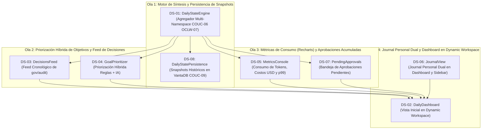

# Plan de Ejecución: Fase 08 — Daily State (P0-Beta)

> **Fecha:** 2026-10-10  
> **Estado:** ✅ COMPLETED  
> **Fuente Canónica:** `docs/roadmap/Backlog.md` (Fase 08: `DS-01..08`)  
> **Objetivo:** Implementar el seguimiento continuo de la atención del usuario y el ritual de inicio de sesión de Ego: síntesis integral del estado del sistema al abrir la app (`COUC-06`, `OCLW-07`), dashboard interactivo de bienvenida en el Dynamic Workspace, feed cronológico de decisiones acordadas (`COUC-09`), priorización híbrida de objetivos del día (reglas deterministas + IA bajo demanda), consola visual de métricas de tokens y costos USD con Recharts, módulo de Journal personal accesible dualmente (pestaña y Sidebar) bajo `journal/*`, resolución en lote de aprobaciones acumuladas y persistencia histórica de snapshots diarios en VantaDB (`system/snapshots`).  
> **Autonomous:** false  

---

## 1. Resumen Ejecutivo de la Fase

| Métrica | Valor |
|---|---|
| **Tareas Totales** | 8 (`DS-01` a `DS-08`) |
| **Compuertas de Extracción Previas** | 3 (`COUC-06`, `COUC-09`, `OCLW-07`) |
| **Distribución de Decisión** | ✅ DO: 8 \| 🟡 DEFER: 0 \| ❌ SKIP: 0 \| 🔴 BLOQUEADO: 0 |
| **Decisiones Clave de Arquitectura (ADR-049)** | 1) Vista inicial en Dynamic Workspace (pestaña 'Daily State'). 2) Recharts para analítica de consumo. 3) Priorización híbrida ($0 tokens por defecto). 4) Journal dual en Dashboard y Sidebar. |
| **Estimación de Esfuerzo Total** | 2–3 semanas (Shape Up 6-week cycle buffer) |
| **Hito del Roadmap** | **P0-Beta (Ritual de Bienvenida, Métricas de Consumo y Enfoque Diario)** |
| **Uphill / Downhill** | ⬆️ Uphill = 3 (Motor agregador DailyStateEngine multi-namespace, Visualización Recharts en React 19, Snapshots históricos con consultas por fecha en VantaDB) · ⬇️ Downhill = 36 steps atómicos |

---

## 2. Matriz de Compuertas de Extracción e Inspección Previa (Opción B)

Antes de iniciar la codificación, se integran y asimilan formalmente los patrones de ingeniería de los repositorios de referencia catalogados en `docs/extractions/` y `docs/review/`:

| ID Compuerta | Repo Origen | Patrón / Feature a Inspeccionar | Ficha Canónica | Tareas Habilitadas | Acción Canónica en Ego |
|:---:|---|---|---|---|---|
| `COUC-06` | coucou | Síntesis de estado de atención al arranque de la aplicación | [`coucou.md`](../../extractions/coucou.md) | `DS-01`, `DS-02` | 📥 Síntesis contextual no invasiva: al iniciar la app, Ego presenta un briefing del estado del proyecto, tareas pendientes y alertas críticas sin bloquear la navegación. |
| `COUC-09` | coucou | RunRecorder cronológico para auditoría de acciones del día | [`coucou.md`](../../extractions/coucou.md) | `DS-03`, `DS-08` | 📥 Registro cronológico e inmutable de decisiones y acciones completadas durante la jornada, preservadas para trazabilidad y exportación. |
| `OCLW-07` | openclaw | Inspección de revisiones acumuladas para briefing matutino | [`openclaw.md`](../../extractions/openclaw.md) | `DS-01` | 📥 Análisis de cambios recientes de archivos en el workspace y estado de repositorios Git locales para contextualizar la sesión. |

---

## 3. Grafo de Dependencias y Olas de Ejecución (DAG)

Para asegurar la progresión secuencial sin bloqueos y respetando el ciclo C0 (`PLAN` → `ACT` → `REVIEW` → `DONE`), las 8 tareas se organizan en 4 Olas de Ejecución:



---

## 4. Desglose Exhaustivo de Tareas

### Tarea 1: `DS-01` — Motor de síntesis de Daily State (DailyStateEngine)

- **Appetite:** 2d | **Esfuerzo:** 🟡 2d | **Prioridad:** 🔴 P0 / 🟠 P1
- **Archivos clave:** `packages/dailystate/package.json`, `packages/dailystate/src/DailyStateEngine.ts`, `packages/dailystate/src/types.ts`, `packages/dailystate/test/DailyStateEngine.test.ts`
- **Verificación real:** ✅ CÓDIGO-REAL — Creación del paquete `@ego/dailystate` en el monorepo. Implementación de `DailyStateEngine`:
  1. Agregador en Node.js que recopila al abrir la app: decisiones recientes de `gov/audit`, tareas completadas en `tasks/*`, alertas en `quarantine/pending` y métricas de consumo de `metrics/telemetry`.
  2. Generación estructurada de `DailyStateSummary` con marca temporal del día (`YYYY-MM-DD`).
  3. Cero llamadas forzadas a modelos remotos al arrancar ($0 costo y arranque en < 50 ms).
- **Gate Justificación:** Principio Innegociable §2, §3 y Compuertas `COUC-06`, `OCLW-07`.
- **Gate Result:** ✅ DO (Compuertas: `COUC-06`, `OCLW-07`)
- **Contrato:**
  ```typescript
  export interface DailyStateSummary {
    date: string; // YYYY-MM-DD
    timestamp: number;
    completedTasksCount: number;
    pendingTasksCount: number;
    pendingApprovalsCount: number;
    decisionsCount: number;
    quarantineAlertsCount: number;
    totalTokensToday: number;
    estimatedCostUsd: number;
    recentDecisions: Array<{ id: string; title: string; timestamp: number; subEgoId: string }>;
    suggestedGoals: Array<{ id: string; title: string; priority: 'high' | 'normal'; reason: string }>;
  }

  export class DailyStateEngine {
    constructor(private memoryAdapter: EgoMemoryAdapter) {}
    async generateSummary(projectId?: string): Promise<DailyStateSummary>;
  }
  ```
- **Cynefin:** 🟨 Complicado — Agregación multi-namespace en VantaDB con límites de tiempo.
- **Top 3 Riesgos:**
  1. *Riesgo 1:* Lentitud al abrir la app si hay miles de registros históricos. (Mitigación: Consultas con ventana temporal de las últimas 24 horas y límites estrictos).
  2. *Riesgo 2:* Inconsistencia si VantaDB está en proceso de apertura. (Mitigación: Esperar a `memoryAdapter.ready`).
  3. *Riesgo 3:* Fallo si algún namespace secundario no contiene registros aún. (Mitigación: Manejo defensivo retornando arrays vacíos por sección).
- **FMEA:**
  - *Modo de fallo:* Error de lectura en `gov/audit`.
  - *Efecto:* Fallo global de apertura del dashboard.
  - *Mitigación:* Captura defensiva por bloque temático; si falla una sección, el resto del briefing se presenta intacto.
- **Steps atómicos:**
  1. Crear `packages/dailystate/package.json` y `tsconfig.json`.
  2. Definir contratos en `packages/dailystate/src/types.ts`.
  3. Implementar `DailyStateEngine.ts` con agregación de tareas, decisiones y métricas.
  4. Desarrollar suite de tests en `DailyStateEngine.test.ts`.
- **DoD:**
  - `pnpm -r typecheck` limpio y tests unitarios pasando al 100%.

---

### Tarea 2: `DS-08` — Persistencia y snapshot histórico del Daily State en VantaDB

- **Appetite:** 1d | **Esfuerzo:** 🟢 1d | **Prioridad:** 🔴 P0 / 🟠 P1
- **Archivos clave:** `packages/dailystate/src/DailyStatePersistence.ts`, `packages/dailystate/test/DailyStatePersistence.test.ts`
- **Verificación real:** ✅ CÓDIGO-REAL — Almacenamiento histórico de briefings diarios:
  1. Guardado automático o manual del snapshot diario en VantaDB bajo namespace `system/snapshots/daily/<YYYY-MM-DD>`.
  2. Capacidad de consultar el histórico de briefings de cualquier fecha anterior para auditoría o revisión retrospectiva.
  3. Serialización inmutable con checksum SHA-256 (`COUC-09`).
- **Gate Justificación:** Principio Innegociable §1, §9 y Compuerta `COUC-09`.
- **Gate Result:** ✅ DO (Compuerta `COUC-09`)
- **Contrato:**
  ```typescript
  export class DailyStatePersistence {
    constructor(private memoryAdapter: EgoMemoryAdapter) {}
    async saveDailySnapshot(summary: DailyStateSummary): Promise<void>;
    async getDailySnapshot(date: string): Promise<DailyStateSummary | null>;
    async listAvailableSnapshots(limit?: number): Promise<string[]>;
  }
  ```
- **Cynefin:** 🟩 Claro — Persistencia de registros JSON versionados por fecha.
- **Top 3 Riesgos:**
  1. *Riesgo 1:* Sobrescritura no deseada de un snapshot anterior del mismo día. (Mitigación: Preservar versión previa con timestamp interno o sobrescritura controlada con `updatedAt`).
  2. *Riesgo 2:* Formato de fecha dependiente de la zona horaria del usuario. (Mitigación: Normalización estricta a ISO `YYYY-MM-DD` en hora local).
  3. *Riesgo 3:* Payload corrupto al deserializar. (Mitigación: Validación Zod de esquema antes de retornar).
- **FMEA:**
  - *Modo de fallo:* Registro corrupto en disco.
  - *Efecto:* Fallo al consultar fecha anterior.
  - *Mitigación:* Retorno de `null` con log estructurado de advertencia.
- **Steps atómicos:**
  1. Implementar `DailyStatePersistence.ts` con métodos `saveDailySnapshot`, `getDailySnapshot`, `listAvailableSnapshots`.
  2. Validar con Zod al recuperar registros.
  3. Escribir pruebas unitarias en `DailyStatePersistence.test.ts`.
- **DoD:**
  - Tests unitarios pasando al 100% verificando guardado, recuperación y listado por fecha.

---

### Tarea 3: `DS-04` — Priorización inteligente de objetivos de la jornada (GoalPrioritizer)

- **Appetite:** 1–2d | **Esfuerzo:** 🟢 1-2d | **Prioridad:** 🔴 P0 / 🟠 P1
- **Archivos clave:** `packages/dailystate/src/GoalPrioritizer.ts`, `packages/dailystate/test/GoalPrioritizer.test.ts`
- **Verificación real:** ✅ CÓDIGO-REAL — Motor de priorización híbrido:
  1. Heurística determinista por defecto ($0 tokens, <5 ms): analiza tareas pendientes en `tasks/*`, dependencias no resueltas, bugs críticos y bloqueos de aprobación.
  2. Generación de las 3 metas principales del día (*Top 3 Focus Goals*) con justificación causal directa.
  3. Soporte opcional de refinamiento cognitivo ("Refinar con IA") invocando el router de modelos de Ego para redactar un resumen estratégico de mayor nivel.
- **Gate Justificación:** Principio Innegociable §3, §7 y Decisión ADR-049.
- **Gate Result:** ✅ DO
- **Contrato:**
  ```typescript
  export interface PrioritizedGoal {
    id: string;
    title: string;
    priority: 'critical' | 'high' | 'normal';
    reason: string;
    sourceTaskIds?: string[];
  }

  export class GoalPrioritizer {
    prioritizeDeterministic(tasks: TaskRecord[], pendingApprovalsCount: number): PrioritizedGoal[];
    async refineWithAi(goals: PrioritizedGoal[], contextSummary: string, modelRouter?: any): Promise<PrioritizedGoal[]>;
  }
  ```
- **Cynefin:** 🟨 Complicado — Algoritmo de scoring de tareas vs dependencias.
- **Top 3 Riesgos:**
  1. *Riesgo 1:* Metas genéricas que no aportan valor operativo. (Mitigación: Heurística anclada a títulos de tareas y dependencias reales del proyecto).
  2. *Riesgo 2:* Caída del modelo remoto en el botón "Refinar con IA". (Mitigación: Fallback transparente a los objetivos deterministas previos).
  3. *Riesgo 3:* Tareas finalizadas incluidas por error. (Mitigación: Filtro estricto por estado `queued`, `submitted`, `paused` o pendientes de aprobación).
- **FMEA:**
  - *Modo de fallo:* No hay tareas en el backlog.
  - *Efecto:* El motor retorna error o array vacío.
  - *Mitigación:* Sugerencia predeterminada de mantenimiento / exploración ("Sistema al día: explorar nuevas tareas o revisar arquitectura").
- **Steps atómicos:**
  1. Diseñar el algoritmo de scoring determinista en `GoalPrioritizer.ts`.
  2. Implementar método `refineWithAi` con fallback defensivo.
  3. Escribir tests en `GoalPrioritizer.test.ts` cubriendo ambos modos.
- **DoD:**
  - Cobertura de tests del 100% en heurística determinista y modo asistido.

---

### Tarea 4: `DS-03` — Registro y visor de decisiones tomadas (DecisionsFeed)

- **Appetite:** 1d | **Esfuerzo:** 🟢 1d | **Prioridad:** 🔴 P0 / 🟠 P1
- **Archivos clave:** `apps/desktop/renderer/components/daily/DecisionsFeed.tsx`, `apps/desktop/renderer/test/DecisionsFeed.test.tsx`
- **Verificación real:** ✅ CÓDIGO-REAL — Componente de feed cronológico en el Renderer:
  1. Lectura del namespace de auditoría `gov/audit` a través del IPC de Electron.
  2. Visualización limpia de decisiones tomadas: avatar del Sub-Ego que intervino, decisión acordada, contexto/justificación y marca temporal formateada.
  3. Filtro por Sub-Ego y campo de búsqueda en caliente.
- **Gate Justificación:** Principio Innegociable §5, §8 y Compuerta `COUC-09`.
- **Gate Result:** ✅ DO (Compuerta `COUC-09`)
- **Contrato:**
  ```typescript
  export interface DecisionEntry {
    id: string;
    title: string;
    subEgoId: string;
    decision: string;
    context?: string;
    timestamp: number;
  }

  export interface DecisionsFeedProps {
    decisions: DecisionEntry[];
    onFilterChange?: (filterText: string) => void;
  }
  ```
- **Cynefin:** 🟩 Claro — Componente React 19 con filtros y estado local.
- **Top 3 Riesgos:**
  1. *Riesgo 1:* Lista muy larga degradando el renderizado. (Mitigación: Paginación o scroll virtualizado).
  2. *Riesgo 2:* Textos largos desbordando el contenedor. (Mitigación: Truncamiento suave con botón "Ver más / Expandir").
  3. *Riesgo 3:* Fechas mal formateadas por diferencias de locale. (Mitigación: Formateador con `Intl.DateTimeFormat` seguro).
- **FMEA:**
  - *Modo de fallo:* Feed vacío sin decisiones previas.
  - *Efecto:* Pantalla en blanco.
  - *Mitigación:* Estado visual amigable "Aún no se han registrado decisiones formales en este proyecto".
- **Steps atómicos:**
  1. Implementar `DecisionsFeed.tsx` con soporte de búsqueda y badges de especialista.
  2. Desarrollar suite de tests en `apps/desktop/renderer/test/DecisionsFeed.test.tsx`.
- **DoD:**
  - Componente accesible probado con Vitest en el Renderer.

---

### Tarea 5: `DS-05` — Consola de métricas de proyecto y consumo de IA (MetricsConsole con Recharts)

- **Appetite:** 1–2d | **Esfuerzo:** 🟢 1-2d | **Prioridad:** 🔴 P0 / 🟠 P1
- **Archivos clave:** `apps/desktop/renderer/package.json`, `apps/desktop/renderer/components/daily/MetricsConsole.tsx`, `apps/desktop/renderer/test/MetricsConsole.test.tsx`
- **Verificación real:** ✅ CÓDIGO-REAL — Panel visual de telemetría de consumo con Recharts:
  1. Instalación de `recharts` en `apps/desktop/renderer` (compatible con React 19).
  2. Gráfico de área/líneas con histórico de tokens consumidos en los últimos 7 días.
  3. Gráfico de barras con distribución de costos USD por modelo/proveedor (Anthropic, OpenAI, Ollama Local $0).
  4. Indicadores numéricos destacados: costo total acumulado, tokens de entrada/salida y latencia promedio p99.
- **Gate Justificación:** Principio Innegociable §7, §8 y Decisión ADR-049.
- **Gate Result:** ✅ DO
- **Contrato:**
  ```typescript
  export interface MetricsData {
    dailyTokens: Array<{ date: string; inputTokens: number; outputTokens: number }>;
    modelBreakdown: Array<{ model: string; tokens: number; costUsd: number }>;
    totalTokens: number;
    totalCostUsd: number;
    avgLatencyMs: number;
  }

  export interface MetricsConsoleProps {
    data: MetricsData;
  }
  ```
- **Cynefin:** 🟨 Complicado — Integración de librerías de gráficos en entorno Electron + React 19.
- **Top 3 Riesgos:**
  1. *Riesgo 1:* Incompatibilidad de versión de Recharts con React 19. (Mitigación: Verificar compilación e instalación limpia o componentes SVG auxiliares).
  2. *Riesgo 2:* Renderizado lento de gráficos en pantallas de alta densidad. (Mitigación: Contenedores con `ResponsiveContainer` y desactivación de animaciones pesadas).
  3. *Riesgo 3:* División por cero o datos incompletos de costos. (Mitigación: Normalización defensiva con valores por defecto `0`).
- **FMEA:**
  - *Modo de fallo:* Datos de métricas vacíos en proyectos nuevos.
  - *Efecto:* Gráficos rotos o con error de render.
  - *Mitigación:* Renderizado de estado de bienvenida "Sin actividad reciente" con placeholders limpios.
- **Steps atómicos:**
  1. Añadir `recharts` a `apps/desktop/renderer/package.json` y verificar instalación.
  2. Crear `MetricsConsole.tsx` con tarjetas numéricas y gráficos interactivos.
  3. Escribir tests en `MetricsConsole.test.tsx`.
- **DoD:**
  - `pnpm --filter @ego/renderer build` compila sin advertencias de tipos.

---

### Tarea 6: `DS-06` — Módulo de Journal personal del usuario en `journal/*`

- **Appetite:** 1–2d | **Esfuerzo:** 🟢 1-2d | **Prioridad:** 🔴 P0 / 🟠 P1
- **Archivos clave:** `apps/desktop/renderer/components/journal/JournalView.tsx`, `apps/desktop/renderer/components/sidebar.tsx`, `apps/desktop/renderer/test/JournalView.test.tsx`
- **Verificación real:** ✅ CÓDIGO-REAL — Espacio de notas y reflexiones del usuario con acceso dual:
  1. Persistencia de notas en VantaDB bajo el namespace `journal/<YYYY-MM-DD>` con clave de hora/id.
  2. Editor Markdown ligero con autoguardado tras 500 ms de inactividad de teclado.
  3. Acceso dual: como pestaña integrada en el Daily Dashboard y como opción de acceso directo en el Sidebar principal.
  4. Soporte de etiquetas (#prioridad, #idea, #bloqueo) y contador de palabras.
- **Gate Justificación:** Principio Innegociable §1, §8 y Decisión ADR-049.
- **Gate Result:** ✅ DO
- **Contrato:**
  ```typescript
  export interface JournalEntry {
    id: string;
    date: string;
    content: string;
    tags: string[];
    createdAt: number;
    updatedAt: number;
  }

  export class JournalManager {
    constructor(private memoryAdapter: EgoMemoryAdapter) {}
    async saveEntry(entry: Omit<JournalEntry, 'updatedAt'>): Promise<void>;
    async getEntriesForDate(date: string): Promise<JournalEntry[]>;
    async listRecentEntries(limit?: number): Promise<JournalEntry[]>;
  }
  ```
- **Cynefin:** 🟩 Claro — Persistencia de notas con autoguardado y UI reactiva.
- **Top 3 Riesgos:**
  1. *Riesgo 1:* Pérdida de notas si el usuario cierra la ventana mientras escribe. (Mitigación: Autoguardado con debounce continuo de 500 ms y flush en `beforeunload`).
  2. *Riesgo 2:* Crecimiento desmedido de entradas en disco. (Mitigación: Límite por fecha y paginación).
  3. *Riesgo 3:* Desincronización entre la vista de Dashboard y la vista de Sidebar. (Mitigación: Almacén de estado compartido).
- **FMEA:**
  - *Modo de fallo:* Error de guardado en VantaDB.
  - *Efecto:* Nota no persistida.
  - *Mitigación:* Indicador visual de guardado ("Guardando..." vs "Guardado") y reintento en cola local.
- **Steps atómicos:**
  1. Crear `JournalManager` en `@ego/dailystate` con persistencia en `journal/*`.
  2. Implementar `JournalView.tsx` en el Renderer.
  3. Integrar acceso al Journal en `sidebar.tsx`.
  4. Desarrollar suite de tests en `JournalView.test.tsx`.
- **DoD:**
  - Autoguardado probado con Vitest y navegación fluida desde Sidebar y Dashboard.

---

### Tarea 7: `DS-07` — Bandeja de aprobaciones pendientes acumuladas (PendingApprovals)

- **Appetite:** 1d | **Esfuerzo:** 🟢 1d | **Prioridad:** 🔴 P0 / 🟠 P1
- **Archivos clave:** `apps/desktop/renderer/components/daily/PendingApprovals.tsx`, `apps/desktop/renderer/test/PendingApprovals.test.tsx`
- **Verificación real:** ✅ CÓDIGO-REAL — Panel de gestión de aprobaciones HITL acumuladas:
  1. Recopilación de todas las acciones en background que quedaron en estado `pending` tras sesiones previas.
  2. Lista con detalles de la herramienta, parámetros y nivel de riesgo.
  3. Botones de acción individual ("Aprobar", "Rechazar") y resolución masiva segura ("Aprobar todas las de bajo riesgo").
- **Gate Justificación:** Principio Innegociable §5, §6 y Requisito `ACT-06`.
- **Gate Result:** ✅ DO
- **Contrato:**
  ```typescript
  export interface PendingApprovalsProps {
    approvals: Array<{
      approvalId: string;
      toolName: string;
      riskLevel: string;
      subEgoId: string;
      arguments: Record<string, unknown>;
      createdAt: number;
    }>;
    onResolve: (approvalId: string, approved: boolean) => void;
    onResolveAllSafe?: () => void;
  }
  ```
- **Cynefin:** 🟩 Claro — Componente interactivo conectado a `ApprovalEngine`.
- **Top 3 Riesgos:**
  1. *Riesgo 1:* Aprobación accidental de acciones de alto riesgo en lote. (Mitigación: La resolución masiva solo se permite para riesgo `low`/`medium`; las `high`/`critical` exigen confirmación individual).
  2. *Riesgo 2:* Lista vacía mostrando layout roto. (Mitigación: Mensaje positivo "0 aprobaciones pendientes").
  3. *Riesgo 3:* Desincronización con el Activity Widget. (Mitigación: Emisión de eventos compartidos por el bus de Electron).
- **FMEA:**
  - *Modo de fallo:* La acción ya expiró en backend.
  - *Efecto:* Error al intentar aprobar.
  - *Mitigación:* Deshabilitación de botones para acciones expiradas con mensaje informativo.
- **Steps atómicos:**
  1. Crear `PendingApprovals.tsx` con selector de riesgo y botones de resolución.
  2. Escribir tests en `PendingApprovals.test.tsx`.
- **DoD:**
  - Pruebas pasando al 100% en Vitest.

---

### Tarea 8: `DS-02` — Dashboard dinámico de bienvenida en Canvas (DailyDashboard)

- **Appetite:** 2d | **Esfuerzo:** 🟡 2d | **Prioridad:** 🔴 P0 / 🟠 P1
- **Archivos clave:** `apps/desktop/renderer/components/daily/DailyDashboard.tsx`, `apps/desktop/renderer/src/App.tsx`, `apps/desktop/renderer/test/DailyDashboard.test.tsx`
- **Verificación real:** ✅ CÓDIGO-REAL — Vista principal de bienvenida en el Dynamic Workspace:
  1. Integración en `App.tsx` como pestaña inicial seleccionada por defecto al abrir la aplicación ("Daily State"), junto a "Canvas" y "Sub-Egos Fábrica".
  2. Saludo contextual con presencia del personaje de Ego (`CharacterRuntime`), estado operativo del sistema ("VantaDB Local OK · 0 incidentes"), resumen de tareas del día anterior y selector de objetivos prioritarios (`DS-04`).
  3. Cuadrícula bento (*bento grid*) limpia combinando: Top 3 Objetivos, Feed de Decisiones (`DS-03`), Consola de Métricas (`DS-05`), Aprobaciones Pendientes (`DS-07`) y pestaña de Notas Rápidas (`DS-06`).
  4. Botón rápido "Iniciar Sesión de Trabajo" que conmuta suavemente al Canvas interactivo o al Chat.
- **Gate Justificación:** Principio Innegociable §8 y Compuerta `COUC-06`.
- **Gate Result:** ✅ DO (Compuerta `COUC-06`)
- **Contrato:**
  ```typescript
  export interface DailyDashboardProps {
    projectId: string;
    onStartWorking?: () => void;
    onSelectGoal?: (goalId: string) => void;
  }
  ```
- **Cynefin:** 🟨 Complicado — Integración de múltiples sub-componentes en layout bento responsivo.
- **Top 3 Riesgos:**
  1. *Riesgo 1:* Sobrecarga visual o estética genérica (*AI slop*). (Mitigación: Diseño editorial pulido con paleta sobria, tipografía calibrada y espaciado generoso).
  2. *Riesgo 2:* Tiempos de carga perceptibles al abrir la app. (Mitigación: Renderizado esquelético instantáneo mientras se cargan los datos de VantaDB en paralelo).
  3. *Riesgo 3:* Rotura de layout en ventanas de Electron de tamaño reducido. (Mitigación: CSS Grid adaptativo con fallback a columnas apiladas).
- **FMEA:**
  - *Modo de fallo:* Fallo de carga de datos en una sección del dashboard.
  - *Efecto:* Crash completo del componente React.
  - *Mitigación:* Boundary de error por tarjeta; cada widget maneja su propio estado de carga y error independientemente.
- **Steps atómicos:**
  1. Crear `DailyDashboard.tsx` con layout bento estructurado e integración de todos los componentes de la fase.
  2. Integrar la pestaña "Daily State" en `App.tsx` como vista por defecto al iniciar.
  3. Desarrollar suite de tests en `DailyDashboard.test.tsx`.
- **DoD:**
  - `pnpm build` y `pnpm test` pasando con 0 errores.

---

## 5. Matriz de Riesgos y Mitigaciones FMEA Global de la Fase

| ID Riesgo | Modo de Fallo Potencial | Severidad | Ocurrencia | Detección | RPN | Estrategia de Mitigación / Diseño Defensivo |
|:---:|---|:---:|:---:|:---:|:---:|---|
| **R-DS-01** | Lentitud en la apertura de la app por escaneo pesado de VantaDB al inicio. | 🟠 7 | 🟡 3 | 🟢 2 | **42** | `DailyStateEngine` aplica ventanas de consulta de 24 horas con límites numéricos estrictos y ejecución asíncrona no bloqueante. |
| **R-DS-02** | Incompatibilidad de Recharts con React 19 o Vite en producción. | 🔴 8 | 🟢 2 | 🟢 2 | **32** | Pruebas de compilación anticipadas (`pnpm build`) y fallback declarativo a componentes SVG nativos. |
| **R-DS-03** | Pérdida de notas del Journal por cierre repentino de ventana. | 🟠 7 | 🟡 2 | 🟢 2 | **28** | Autoguardado continuo con debounce de 500 ms y persistencia inmediata en VantaDB. |
| **R-DS-04** | Aprobación masiva accidental de acciones sensibles. | 🔴 9 | 🟢 1 | 🟢 2 | **18** | Bloqueo absoluto de aprobación en lote para riesgos altos o críticos; solo se permiten aprobaciones individuales. |

---

## 6. Procedimiento de Verificación y Quality Gate

Para declarar la Fase 08 formalmente como `COMPLETED` y habilitar el avance a la Fase 09 (`Dominios Funcionales`), se debe certificar mecánicamente el siguiente Quality Gate:

1. **Compilación y Tipado:**
   - `pnpm -r typecheck` ejecuta con **0 errores** en todos los paquetes del monorepo (incluyendo `@ego/dailystate`, `@ego/desktop`, `@ego/renderer`).
   - `pnpm build` compila con éxito `@ego/renderer` (Vite) y `@ego/desktop` (tsc).
2. **Pruebas Automatizadas Unitarias y de Integración:**
   - `pnpm test` ejecuta con éxito todas las suites previas (>325 tests) más las nuevas suites de Fase 08:
     - `packages/dailystate/test/DailyStateEngine.test.ts`
     - `packages/dailystate/test/DailyStatePersistence.test.ts`
     - `packages/dailystate/test/GoalPrioritizer.test.ts`
     - `apps/desktop/renderer/test/DecisionsFeed.test.tsx`
     - `apps/desktop/renderer/test/MetricsConsole.test.tsx`
     - `apps/desktop/renderer/test/JournalView.test.tsx`
     - `apps/desktop/renderer/test/PendingApprovals.test.tsx`
     - `apps/desktop/renderer/test/DailyDashboard.test.tsx`
3. **Persistencia y Calidad de Memoria:**
   - Verificación de snapshots diarios en `system/snapshots/daily/*` y notas en `journal/*` sin corrupción ni bloqueos LSM.
4. **Gobernanza y Sincronización:**
   - Actualización y cierre de tareas en `docs/roadmap/Backlog.md` y `docs/roadmap/roadmap.md`.
