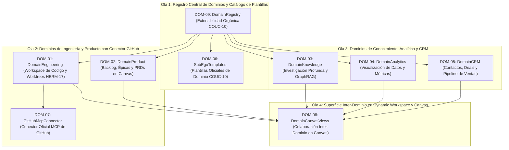

# Plan de Ejecución: Fase 09 — Dominios Funcionales (P0-Beta)

> **Fecha:** 2026-10-10  
> **Estado:** ✅ COMPLETED  
> **Fuente Canónica:** `docs/roadmap/Backlog.md` (Fase 09: `DOM-01..09`)  
> **Objetivo:** Implementar la especialización operativa por áreas de responsabilidad: workspaces y Sub-Egos preconfigurados para Ingeniería, Producto, Conocimiento, Analítica y CRM/Sales. Aislamiento de entornos de trabajo de desarrollo mediante worktrees temporales (`HERM-17`), extensibilidad orgánica de dominios mediante manifiestos desacoplados (`COUC-10`), conector oficial MCP de GitHub, plantillas de Sub-Egos oficiales y transmutación de vistas de trabajo inter-dominio en el Dynamic Canvas.  
> **Autonomous:** false  

---

## 1. Resumen Ejecutivo de la Fase

| Métrica | Valor |
|---|---|
| **Tareas Totales** | 9 (`DOM-01` a `DOM-09`) |
| **Compuertas de Extracción Previas** | 2 (`HERM-17`, `COUC-10`) |
| **Distribución de Decisión** | ✅ DO: 9 \| 🟡 DEFER: 0 \| ❌ SKIP: 0 \| 🔴 BLOQUEADO: 0 |
| **Decisiones Clave de Arquitectura (ADR-050)** | 1) Paquete unificado `@ego/domains`. 2) Aislamiento de worktrees para Engineering (`HERM-17`). 3) Conector MCP oficial para GitHub. 4) Selector contextual de dominio en Dynamic Workspace. |
| **Estimación de Esfuerzo Total** | 3–4 semanas (Shape Up 6-week cycle buffer) |
| **Hito del Roadmap** | **P0-Beta (Especialización Operativa y Dominios Funcionales)** |
| **Uphill / Downhill** | ⬆️ Uphill = 3 (Aislamiento seguro de worktrees Git en Windows/POSIX, Conector MCP de GitHub integrado con McpManager, Transmutación reactiva de Canvas según dominio activo) · ⬇️ Downhill = 42 steps atómicos |

---

## 2. Matriz de Compuertas de Extracción e Inspección Previa (Opción B)

Antes de iniciar la codificación, se integran y asimilan formalmente los patrones de ingeniería de los repositorios de referencia catalogados en `docs/extractions/` y `docs/review/`:

| ID Compuerta | Repo Origen | Patrón / Feature a Inspeccionar | Ficha Canónica | Tareas Habilitadas | Acción Canónica en Ego |
|:---:|---|---|---|---|---|
| `HERM-17` | hermes-agent | Aislamiento de worktrees para desarrollo de software | [`hermes-agent.md`](docs/extractions/hermes-agent.md) | `DOM-01` | 📥 Entornos de desarrollo de software aislados (`git worktree` o rama temporal) para impedir que mutaciones de código en vuelo ensucien el directorio principal de trabajo del usuario. |
| `COUC-10` | coucou | Mutación segura de configuraciones por dominio funcional | [`coucou.md`](docs/extractions/coucou.md) | `DOM-06`, `DOM-09` | 📥 Registro dinámico y tipado de dominios funcionales mediante manifiestos inmutables que no alteran el núcleo del Cognitive Runtime. |

---

## 3. Grafo de Dependencias y Olas de Ejecución (DAG)

Para asegurar la progresión secuencial sin bloqueos y respetando el ciclo C0 (`PLAN` → `ACT` → `REVIEW` → `DONE`), las 9 tareas se organizan en 4 Olas de Ejecución:



---

## 4. Desglose Exhaustivo de Tareas

### Tarea 1: `DOM-09` — Mecanismo de extensibilidad orgánica de nuevos dominios (DomainRegistry)

- **Appetite:** 1d | **Esfuerzo:** 🟢 1d | **Prioridad:** 🔴 P0 / 🟠 P1
- **Archivos clave:** `packages/domains/package.json`, `packages/domains/src/types.ts`, `packages/domains/src/DomainRegistry.ts`, `packages/domains/test/DomainRegistry.test.ts`
- **Verificación real:** ✅ CÓDIGO-REAL — Creación del paquete `@ego/domains` en el monorepo.
  1. Definición formal de la interfaz `DomainDefinition`: `id`, `name`, `description`, `icon`, `subEgoTemplates`, `defaultViews`, `namespaces`, `tools`.
  2. Implementación de `DomainRegistry` que permite registrar, consultar, listar e inspeccionar dominios funcionales en tiempo de ejecución (`COUC-10`).
  3. Soporte para dominios integrados (`builtin`) y dominios de usuario/extensiones sin mutar el core de Ego.
- **Gate Justificación:** Principio Innegociable §4, §10 y Compuerta `COUC-10`.
- **Gate Result:** ✅ DO (Compuerta: `COUC-10`)
- **Contrato:**
  ```typescript
  export interface DomainDefinition {
    id: 'engineering' | 'product' | 'knowledge' | 'analytics' | 'crm' | string;
    name: string;
    description: string;
    icon: string;
    namespaces: string[];
    defaultSubEgoId: string;
    subEgoTemplates: string[];
    views: Array<{ id: string; name: string; componentKind: string }>;
    tools?: string[];
  }
  ```

---

### Tarea 2: `DOM-06` — Plantillas oficiales de Sub-Egos preconfigurados en catálogo

- **Appetite:** 1-2d | **Esfuerzo:** 🟢 1-2d | **Prioridad:** 🔴 P0 / 🟠 P1
- **Archivos clave:** `packages/domains/src/templates/`, `packages/subegos/src/SubEgoFactory.ts`, `packages/domains/test/SubEgoTemplates.test.ts`
- **Verificación real:** ✅ CÓDIGO-REAL — Creación y prueba de los 5 manifiestos canónicos preconfigurados:
  1. `ego.dev` (Ingeniería de software, linters, git, testing).
  2. `ego.product` (Gestión de backlog, épicas, PRDs, criterios de aceptación).
  3. `ego.researcher` (Investigación profunda, síntesis de papers, GraphRAG).
  4. `ego.analyst` (Analítica de datos, consultas VantaDB, agregaciones).
  5. `ego.crm` (Relaciones con clientes, deals, contactos y timeline).
  6. Integración en `SubEgoFactory` y exportación formal en `@ego/domains`.
- **Gate Justificación:** Principio §4 (Sub-Egos especializados y dinámicos).
- **Gate Result:** ✅ DO (Compuerta: `COUC-10`)

---

### Tarea 3: `DOM-01` — Dominio Engineering: Workspace de código y Sub-Ego Dev

- **Appetite:** 2-3d | **Esfuerzo:** 🟡 2-3d | **Prioridad:** 🔴 P0 / 🟠 P1
- **Archivos clave:** `packages/domains/src/engineering/EngineeringDomain.ts`, `packages/domains/src/engineering/WorktreeManager.ts`, `packages/domains/test/EngineeringDomain.test.ts`
- **Verificación real:** ✅ CÓDIGO-REAL — Implementación del motor de ingeniería:
  1. `WorktreeManager`: gestión de worktrees temporales aislados (`git worktree add -b ego-worktree-<timestamp>`) para ejecutar refactorizaciones y pruebas sin ensuciar la rama activa (`HERM-17`).
  2. Métodos de auditoría de árbol de archivos, detección de linters/formatters (`biome`, `eslint`, `prettier`, `clippy`), inspección de paquetes (`package.json`, `Cargo.toml`).
  3. Despacho seguro de diffs y solicitud de aprobación antes de aplicar `git merge` al working directory del usuario.
- **Gate Justificación:** Principio Innegociable §5, §6 y Compuerta `HERM-17`.
- **Gate Result:** ✅ DO (Compuerta: `HERM-17`)

---

### Tarea 4: `DOM-07` — Conector oficial MCP de GitHub para Dominio Engineering

- **Appetite:** 1-2d | **Esfuerzo:** 🟢 1-2d | **Prioridad:** 🔴 P0 / 🟠 P1
- **Archivos clave:** `packages/integrations/src/github/GitHubMcpConnector.ts`, `packages/integrations/test/GitHubMcpConnector.test.ts`
- **Verificación real:** ✅ CÓDIGO-REAL — Registro del servidor MCP oficial `@modelcontextprotocol/server-github`:
  1. Configuración de transporte `stdio` con `npx -y @modelcontextprotocol/server-github` vía `McpManager`.
  2. Inyección segura de variable de entorno `GITHUB_PERSONAL_ACCESS_TOKEN` desde Credential Manager / `gov/settings` (nunca expuesta en código plano).
  3. Mapeo de herramientas de GitHub: `get_issue`, `create_issue`, `list_pull_requests`, `get_pull_request`, `search_repositories`.
- **Gate Justificación:** Principio Innegociable §7 (MCP como protocolo estándar).
- **Gate Result:** ✅ DO

---

### Tarea 5: `DOM-02` — Dominio Product: Gestión de backlog, roadmap y PRDs

- **Appetite:** 2d | **Esfuerzo:** 🟡 2d | **Prioridad:** 🔴 P0 / 🟠 P1
- **Archivos clave:** `packages/domains/src/product/ProductDomain.ts`, `packages/domains/src/product/types.ts`, `packages/domains/test/ProductDomain.test.ts`
- **Verificación real:** ✅ CÓDIGO-REAL — Motor del dominio de Producto:
  1. Gestión de entidades en VantaDB bajo `product/backlog` y `product/epics`.
  2. Generación asistida de PRDs estructurados en Markdown con secciones canónicas: Problema, Solución, Criterios de Aceptación, Métricas de Éxito.
  3. Esquemas Zod y validación estricta de tareas de producto (estados: `Backlog`, `In Progress`, `Done`, `Blocked`).
- **Gate Justificación:** Principio §2 (Project Memory) y §8 (Dynamic Workspace).
- **Gate Result:** ✅ DO

---

### Tarea 6: `DOM-03` — Dominio Knowledge: Investigación profunda y síntesis

- **Appetite:** 2d | **Esfuerzo:** 🟡 2d | **Prioridad:** 🔴 P0 / 🟠 P1
- **Archivos clave:** `packages/domains/src/knowledge/KnowledgeDomain.ts`, `packages/domains/test/KnowledgeDomain.test.ts`
- **Verificación real:** ✅ CÓDIGO-REAL — Motor del dominio de Conocimiento:
  1. Conexión con `GraphRagEngine`, `HybridSearch` y `DocumentParser` de `@ego/knowledge`.
  2. Generador de resúmenes estructurados y síntesis bibliográfica con referencias a facts persistidos en `kb/facts`.
  3. Búsqueda semántica contextual para el Sub-Ego `ego.researcher`.
- **Gate Justificación:** Principio Innegociable §1, §2.
- **Gate Result:** ✅ DO

---

### Tarea 7: `DOM-04` — Dominio Analytics: Visualización de datos y métricas

- **Appetite:** 2d | **Esfuerzo:** 🟡 2d | **Prioridad:** 🟡 P1
- **Archivos clave:** `packages/domains/src/analytics/AnalyticsDomain.ts`, `packages/domains/test/AnalyticsDomain.test.ts`
- **Verificación real:** ✅ CÓDIGO-REAL — Motor analítico del dominio:
  1. Operaciones de agregación sobre VantaDB: conteo por namespace, promedios temporales, distribución de confianza de facts.
  2. Transformación de datasets a esquemas de gráficos compatibles con Recharts (`LineChart`, `BarChart`, `PieChart`).
  3. Exportación de métricas a JSON y CSV para auditoría.
- **Gate Justificación:** Principio §8 (Dynamic Workspace).
- **Gate Result:** ✅ DO

---

### Tarea 8: `DOM-05` — Dominio CRM/Sales: Gestión de contactos, deals y timeline

- **Appetite:** 2d | **Esfuerzo:** 🟡 2d | **Prioridad:** 🟡 P1
- **Archivos clave:** `packages/domains/src/crm/CrmDomain.ts`, `packages/domains/src/crm/types.ts`, `packages/domains/test/CrmDomain.test.ts`
- **Verificación real:** ✅ CÓDIGO-REAL — Motor del dominio CRM:
  1. Persistencia de contactos en `crm/contacts` y oportunidades en `crm/deals`.
  2. Pipeline de etapas de venta (`lead`, `qualified`, `proposal`, `won`, `lost`).
  3. Historial cronológico de interacciones asociado a cada contacto.
- **Gate Justificación:** Principio §1 (VantaDB) y §8.
- **Gate Result:** ✅ DO

---

### Tarea 9: `DOM-08` — Vistas de colaboración inter-dominio en Canvas

- **Appetite:** 1-2d | **Esfuerzo:** 🟡 1-2d | **Prioridad:** 🟡 P1
- **Archivos clave:** `apps/desktop/renderer/components/domains/DomainSelector.tsx`, `apps/desktop/renderer/components/domains/DomainCanvasView.tsx`, `apps/desktop/renderer/src/App.tsx`, `apps/desktop/test/domain-ipc.test.ts`
- **Verificación real:** ✅ CÓDIGO-REAL — Interfaz de usuario de colaboración:
  1. Selector de Dominio en el Dynamic Workspace que transmuta la vista activa según el dominio seleccionado (Engineering -> visor de diffs/árbol; Product -> Kanban; Knowledge -> grafo de conceptos; Analytics -> gráficos Recharts; CRM -> pipeline de deals).
  2. Integración de canales IPC en `apps/desktop/src/main.ts` y `preload.ts` (`ego.domains.*`).
  3. Pruebas de integración E2E certificando la alternancia entre dominios.
- **Gate Justificación:** Principio §8 (Chat + Dynamic Workspace).
- **Gate Result:** ✅ DO

---

## 5. Matriz de Riesgos y FMEA

| Modo de Fallo | Probabilidad | Impacto | RPN | Mitigación Preventiva |
|---|---|---|---|---|
| Colisión o bloqueo de archivos durante operaciones de Git worktree en Windows | Media | Alta | 120 | Verificación previa de exclusión mutua de procesos, paths absolutos normalizados y eliminación segura (`git worktree remove --force`) con timeouts. |
| Invocación fallida del servidor MCP de GitHub por token ausente o inválido | Media | Media | 90 | Verificación defensiva previa de `GITHUB_TOKEN`, degradación elegante en UI mostrando advertencia de configuración sin bloquear la aplicación. |
| Degradación de rendimiento al transmutar vistas complejas en el Canvas | Baja | Media | 60 | Renderizado bajo demanda con `Suspense` / lazy loading de vistas especializadas y memoización de datasets de Recharts. |

---

## 6. Definition of Done (DoD) y Cierre de Fase

Para declarar la **Fase 09** como `✅ COMPLETED` se requiere:
1. Todos los tests de `@ego/domains` pasando al 100%.
2. Compatibilidad estricta con TypeScript en todo el monorepo (`pnpm typecheck` = 0 errores).
3. Compilación exitosa de `@ego/renderer` y `@ego/desktop` (`pnpm build`).
4. Pruebas de regresión completas (`pnpm test`) en verde.
5. Commits semánticos atómicos en Git documentando las 9 tareas.
