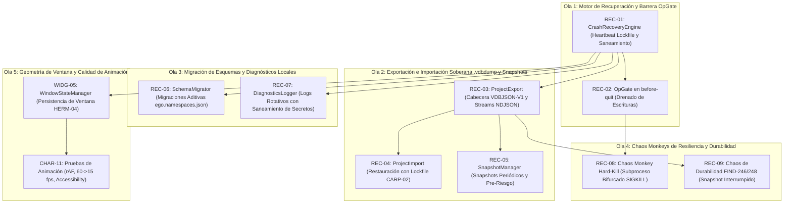

# Plan de Ejecución: Fase 10 — Recovery & Hardening (P0-Beta)

> **Fecha:** 2026-10-10  
> **Estado:** ✅ COMPLETED  
> **Fuente Canónica:** `docs/roadmap/Backlog.md` (Fase 10: `REC-01..09`, `CHAR-11`, `WIDG-05`)  
> **Objetivo:** Implementar la resiliencia extrema, tolerancia total a fallos, cero pérdida de datos en VantaDB Fjall LSM, salvaguarda soberana mediante `.vdbdump`, sistema de snapshots periódicos, migración aditiva de esquemas, barrera de cierre `OpGate`, diagnósticos locales rotativos, pruebas de caos (`hard-kill` y durabilidad contra `FIND-246`/`FIND-248`), compatibilidad y persistencia de geometría de ventana flotante (`window-state`) y certificación de estabilidad de animación.  
> **Autonomous:** false  

---

## 1. Resumen Ejecutivo de la Fase

| Métrica | Valor |
|---|---|
| **Tareas Totales** | 11 (`REC-01` a `REC-09`, `CHAR-11`, `WIDG-05`) |
| **Compuertas de Extracción Previas** | 6 (`DSEK-01`, `DSEK-02`, `DSEK-04`, `CARP-01`, `CARP-02`, `HERM-04`) |
| **Distribución de Decisión** | ✅ DO: 11 \| 🟡 DEFER: 0 \| ❌ SKIP: 0 \| 🔴 BLOQUEADO: 0 |
| **Decisiones Clave de Arquitectura (ADR-051)** | 1) Paquete modular dedicado `@ego/recovery` (`packages/recovery/`). 2) Formato `.vdbdump` comprimido en gzip con manifiesto firmado `VDBJSON-V1` y streams NDJSON por namespace. 3) Heartbeat Lockfile (`ego.lock` con PID + timestamp cada 2s) para detección determinista de Dirty Shutdown y saneamiento seguro de locks huérfanos de Fjall (`VDB-BUG-03`). 4) Chaos Monkey ejecutado en subproceso bifurcado (`fork`) con `SIGKILL`/`taskkill /F` forzoso. 5) Barrera `OpGate` en `before-quit` de Electron con drenado de operaciones. 6) `WindowStateManager` para restauración resiliente de posición y tamaño (`HERM-04`). |
| **Estimación de Esfuerzo Total** | 3–4 semanas (Shape Up 6-week cycle buffer) |
| **Hito del Roadmap** | **P0-Beta (Recovery & Hardening)** |
| **Uphill / Downhill** | ⬆️ Uphill = 3 (Saneamiento determinista de locks de Fjall LSM en Windows sin corrupción, Chaos Monkey en subproceso bifurcado multiplataforma, Integridad atómica de streams NDJSON en exportación .vdbdump) · ⬇️ Downhill = 48 steps atómicos |

---

## 2. Matriz de Compuertas de Extracción e Inspección Previa (Opción B)

Antes de iniciar la codificación, se integran y asimilan formalmente los patrones de ingeniería de los repositorios de referencia catalogados en `docs/extractions/` y `docs/review/`:

| ID Compuerta | Repo Origen | Patrón / Feature a Inspeccionar | Ficha Canónica | Tareas Habilitadas | Acción Canónica en Ego |
|:---:|---|---|---|---|---|
| `DSEK-01` | deepseek-harness | Supersede atómico para resiliencia ante cierres abruptos | [`deepseek-harness.md`](../../extractions/deepseek-harness.md) | `REC-01` | 📥 Detección de dirty shutdown y recuperación atómica sin corrupción en WAL de VantaDB Fjall LSM. |
| `DSEK-02` | deepseek-harness | Reconstrucción de linaje histórico para time-travel recovery | [`deepseek-harness.md`](../../extractions/deepseek-harness.md) | `REC-01` | 📥 Reconstitución de estados previos tras crash utilizando registros secuenciales en `system/snapshots`. |
| `DSEK-04` | deepseek-harness | Migraciones de persistencia aditivas sin schema drop | [`deepseek-harness.md`](../../extractions/deepseek-harness.md) | `REC-03`, `REC-06` | 📥 Retrocompatibilidad absoluta de esquemas y volcados `.vdbdump` sin destrucción de datos existentes. |
| `CARP-01` | career-ops | Contrato de preservación incondicional de datos de usuario | [`career-ops.md`](../../extractions/career-ops.md) | `REC-01`, `REC-03` | 📥 Blindaje absoluto de namespaces y archivos del usuario frente a reinicios o reseteos del sistema. |
| `CARP-02` | career-ops | Exclusión mutua basada en lockfiles para restauraciones | [`career-ops.md`](../../extractions/career-ops.md) | `REC-01`, `REC-04` | 📥 Impedir operaciones concurrentes y escrituras en caliente durante la restauración de datos. |
| `HERM-04` | hermes-agent | Persistencia resiliente de geometría de ventana (`window-state`) | [`hermes-agent.md`](../../extractions/hermes-agent.md) | `REC-01`, `WIDG-05` | 📥 Restauración exacta de tamaño, coordenadas y monitor de la aplicación tras reinicio y crash. |

---

## 3. Grafo de Dependencias y Olas de Ejecución (DAG)

Para asegurar la progresión secuencial sin bloqueos y respetando el ciclo C0 (`PLAN` → `ACT` → `REVIEW` → `DONE`), las 11 tareas se organizan en 5 Olas de Ejecución:

---

## 4. Desglose Detallado de Tareas (Triage Gate)

### Tarea 1: `REC-01` — Motor de recuperación automática ante crashes (Crash Recovery Engine)

- **Appetite:** 2-3d | **Esfuerzo:** 🔴 2-3d | **Prioridad:** 🔴 P1
- **Archivos clave:** `packages/recovery/src/CrashRecoveryEngine.ts`, `packages/recovery/test/CrashRecoveryEngine.test.ts`
- **Verificación real:** ✅ CÓDIGO-REAL — Motor de recuperación:
  1. Detección de Dirty Shutdown mediante `ego.lock` con PID + heartbeat periódico cada 2s.
  2. Si el proceso anterior murió abruptamente sin limpiar el lockfile (`process.kill(pid, 0)` falla o timestamp caducado):
     - Registra evento de auditoría de dirty shutdown en `system/diagnostics`.
     - Realiza snapshot preventivo del WAL antes de iniciar operaciones.
     - Pasa por saneamiento controlado eliminando locks residuales de Fjall LSM (`VDB-BUG-03`).
     - Reconstituye el linaje histórico de sesiones activas (`DSEK-01`, `DSEK-02`, `CARP-01`).
- **Gate Justificación:** Principio innegociable §1 (Memoria local persistente) y §10 (Operación persistente y extensible).
- **Gate Result:** ✅ DO
- **Pre-mortem:**
  - Fallo probable 1: El chequeo de PID en Windows no distinga entre un proceso de Ego y otro proceso del sistema reutilizando el PID. *Mitigación:* Escribir en `ego.lock` el PID junto con la fecha de inicio del proceso y un UUID de sesión único.
  - Fallo probable 2: Fjall retiene descriptores a nivel de driver si un crash ocurre a mitad de sync. *Mitigación:* Verificación de apertura idempotente con reintentos exponenciales cortos (3 intentos con backoff de 100ms).
- **Contrato:** `pnpm --filter @ego/recovery test -- test/CrashRecoveryEngine.test.ts`

---

### Tarea 2: `REC-02` — Barrera de durabilidad `OpGate` en cierre de aplicación

- **Appetite:** 1d | **Esfuerzo:** 🟢 1d | **Prioridad:** 🔴 P1
- **Archivos clave:** `packages/recovery/src/OpGate.ts`, `apps/desktop/src/main.ts`, `apps/desktop/test/op-gate.test.ts`
- **Verificación real:** ✅ CÓDIGO-REAL — Barrera de drenado:
  1. `OpGate` cuenta en tiempo real todas las escrituras activas en `EgoMemoryAdapter`.
  2. Intercepta el evento `before-quit` de Electron:
     - Bloquea la admisión de nuevas operaciones de escritura entrantes.
     - Espera con timeout configurable (ej. 3000ms) a que todas las operaciones en vuelo completen su flush.
     - Invoca `await adapter.close()` de forma ordenada, asegurando que Fjall cierre sus descriptores y libere los locks.
- **Gate Justificación:** Principio §1. Previene `VDB-BUG-03` y corrupción del WAL.
- **Gate Result:** ✅ DO
- **Contrato:** `pnpm --filter @ego/desktop test -- test/op-gate.test.ts`

---

### Tarea 3: `REC-03` — Exportación soberana completa de proyectos a `.vdbdump`

- **Appetite:** 1-2d | **Esfuerzo:** 🟡 1-2d | **Prioridad:** 🔴 P1
- **Archivos clave:** `packages/recovery/src/ProjectExport.ts`, `packages/recovery/test/ProjectExport.test.ts`
- **Verificación real:** ✅ CÓDIGO-REAL — Exportador soberano:
  1. Empaquetado comprimido en gzip (`.vdbdump`) con manifiesto JSON de cabecera firmado (`VDBJSON-V1`).
  2. Streaming por bloques NDJSON para volcar namespaces (`core`, `knowledge`, `tasks`, `gov`, `domains`, etc.) sin riesgo de OOM (`DSEK-04`, `CARP-01`).
  3. Cálculo de checksum SHA-256 por cada namespace y para el archivo total para garantizar verificabilidad criptográfica.
- **Gate Justificación:** Principio §9 (Local-first + soberanía y exportación de datos).
- **Gate Result:** ✅ DO
- **Contrato:** `pnpm --filter @ego/recovery test -- test/ProjectExport.test.ts`

---

### Tarea 4: `REC-04` — Importación y restauración funcional en máquina limpia

- **Appetite:** 1-2d | **Esfuerzo:** 🟡 1-2d | **Prioridad:** 🔴 P1
- **Archivos clave:** `packages/recovery/src/ProjectImport.ts`, `packages/recovery/test/ProjectImport.test.ts`
- **Verificación real:** ✅ CÓDIGO-REAL — Importador y restaurador:
  1. Adquisición de lockfile de restauración exclusiva (`CARP-02`) para impedir escrituras simultáneas.
  2. Validación de cabecera `VDBJSON-V1` y verificación de integridad mediante checksums SHA-256 antes de aplicar mutaciones.
  3. Restauración streaming hacia una instancia de VantaDB, validando idénticos conteos de registros, vectores y aristas.
- **Gate Justificación:** Principio §9. Garantiza portabilidad entre máquinas.
- **Gate Result:** ✅ DO
- **Contrato:** `pnpm --filter @ego/recovery test -- test/ProjectImport.test.ts`

---

### Tarea 5: `REC-05` — Sistema de Snapshots locales periódicos y pre-riesgo

- **Appetite:** 1-2d | **Esfuerzo:** 🟢 1-2d | **Prioridad:** 🟠 P1
- **Archivos clave:** `packages/recovery/src/SnapshotManager.ts`, `packages/recovery/test/SnapshotManager.test.ts`
- **Verificación real:** ✅ CÓDIGO-REAL — Gestor de snapshots:
  1. Snapshots locales automáticos periódicos (rotación configurable, ej. últimos 7 diarios).
  2. Creación de snapshots pre-riesgo obligatorios antes de operaciones críticas (migraciones de esquema, purgas masivas).
  3. Punto de rollback inmediato que permite revertir el estado del proyecto a un snapshot previo.
- **Gate Justificación:** Principio §1 y §10.
- **Gate Result:** ✅ DO
- **Contrato:** `pnpm --filter @ego/recovery test -- test/SnapshotManager.test.ts`

---

### Tarea 6: `REC-06` — Versionado y migración de esquemas en `ego.namespaces.json`

- **Appetite:** 2d | **Esfuerzo:** 🟡 2d | **Prioridad:** 🟠 P1
- **Archivos clave:** `packages/recovery/src/SchemaMigrator.ts`, `packages/recovery/test/SchemaMigrator.test.ts`
- **Verificación real:** ✅ CÓDIGO-REAL — Migrador aditivo de esquemas:
  1. Versionado declarativo del catálogo de namespaces (`schema_version: number`).
  2. Pipeline de migración incremental paso a paso (ej. v1 → v2 → v3) garantizando aditividad sin schema drops (`DSEK-04`).
  3. Ejecución segura con snapshot pre-migración y capacidad de rollback si falla una transformación.
- **Gate Justificación:** Principio §1.
- **Gate Result:** ✅ DO
- **Contrato:** `pnpm --filter @ego/recovery test -- test/SchemaMigrator.test.ts`

---

### Tarea 7: `REC-07` — Sistema de logging rotativo y diagnóstico local

- **Appetite:** 1d | **Esfuerzo:** 🟢 1d | **Prioridad:** 🟡 P1
- **Archivos clave:** `packages/recovery/src/DiagnosticsLogger.ts`, `packages/recovery/test/DiagnosticsLogger.test.ts`
- **Verificación real:** ✅ CÓDIGO-REAL — Logging rotativo y diagnóstico:
  1. Escritura de logs estructurados en disco con rotación automática por tamaño (ej. máx 5MB por archivo, máx 3 archivos).
  2. Saneamiento obligatorio de claves API, tokens o contraseñas mediante regex antes de persistir en disco.
  3. Generador de paquete de diagnóstico anónimo (`exportDiagnosticsBundle`) para soporte técnico.
- **Gate Justificación:** Principio §6 (Gobernanza) y §10 (Extensibilidad y observabilidad).
- **Gate Result:** ✅ DO
- **Contrato:** `pnpm --filter @ego/recovery test -- test/DiagnosticsLogger.test.ts`

---

### Tarea 8: `REC-08` — Test de Resiliencia Integral: Chaos Monkey local de apagado

- **Appetite:** 2d | **Esfuerzo:** 🟡 2d | **Prioridad:** 🟠 P1
- **Archivos clave:** `packages/recovery/test/chaos/hard-kill.test.ts`, `packages/recovery/test/chaos/kill-target-worker.ts`
- **Verificación real:** ✅ CÓDIGO-REAL — Chaos Monkey de interrupción física:
  1. Subproceso Node bifurcado (`fork`) escribiendo concurrentemente en una base de datos VantaDB de prueba.
  2. Terminación forzosa incondicional (`SIGKILL` en POSIX / `taskkill /F /PID` en Windows) a mitad de una ráfaga masiva.
  3. El proceso principal de Vitest abre la base de datos con `CrashRecoveryEngine`, verifica que no hay corrupción irrecuperable en el WAL y valida que las transacciones previamente sincronizadas permanecen intactas.
- **Gate Justificación:** Principio §1 y DoD de Resiliencia.
- **Gate Result:** ✅ DO
- **Contrato:** `pnpm --filter @ego/recovery test -- test/chaos/hard-kill.test.ts`

---

### Tarea 9: `REC-09` — Chaos de durabilidad contra FIND-246/248 (snapshot→kill→restore)

- **Appetite:** 2d | **Esfuerzo:** 🟡 2d | **Prioridad:** 🟠 P1
- **Archivos clave:** `packages/recovery/test/chaos/durability-chaos.test.ts`
- **Verificación real:** ✅ CÓDIGO-REAL — Verificación de resiliencia ante cortes en snapshots:
  1. Inicio de exportación a `.vdbdump` / snapshot local.
  2. Interrupción abrupta en pleno streaming de datos.
  3. Verificación de que el snapshot inconcluso se aísla como `.part` o se limpia automáticamente sin dejar el proyecto en estado inválido.
  4. Registro en `docs/VANTADB-FEEDBACK-Y-MEJORAS.md` de cualquier comportamiento anómalo detectado durante el test.
- **Gate Justificación:** Principio §1 y mitigación de `FIND-246`/`FIND-248`.
- **Gate Result:** ✅ DO
- **Contrato:** `pnpm --filter @ego/recovery test -- test/chaos/durability-chaos.test.ts`

---

### Tarea 10: `WIDG-05` — Compatibilidad de ventana flotante: inicio, restauración y empaquetado por plataforma

- **Appetite:** 2-3d | **Esfuerzo:** 🟡 2-3d | **Prioridad:** 🟠 P1
- **Archivos clave:** `apps/desktop/src/windows/WindowStateManager.ts`, `apps/desktop/test/window-state.test.ts`
- **Verificación real:** ✅ CÓDIGO-REAL — Gestión de geometría y estado de ventanas:
  1. `WindowStateManager` almacena y restaura coordenadas (`x`, `y`), dimensiones (`width`, `height`), pantalla/display y estado maximizado (`HERM-04`).
  2. Detección defensiva de pantallas desconectadas para recolocar la ventana en el viewport visible principal si las coordenadas previas quedaron fuera de pantalla.
  3. Persistencia en `system/window-state` de VantaDB o fallback seguro.
- **Gate Justificación:** Principio §8 (Dynamic Workspace) y compuerta `HERM-04`.
- **Gate Result:** ✅ DO
- **Contrato:** `pnpm --filter @ego/desktop test -- test/window-state.test.ts`

---

### Tarea 11: `CHAR-11` — Pruebas de rendimiento, accesibilidad, memoria y estabilidad de animación

- **Appetite:** 2d | **Esfuerzo:** 🟡 2d | **Prioridad:** 🟠 P1
- **Archivos clave:** `apps/desktop/renderer/components/character/CharacterMotionGuard.ts`, `apps/desktop/test/character-motion.test.ts`
- **Verificación real:** ✅ CÓDIGO-REAL — Auditoría y resiliencia de animaciones:
  1. Respeto incondicional de `prefers-reduced-motion` desactivando bucles rAF no esenciales.
  2. Mecanismo de throttling adaptativo de frame rate (60 fps en foco → 15 fps en fondo o reposo prolongado).
  3. Kill-switch de animación configurable por el usuario.
  4. Tests de ciclo de vida asegurando cancelación rigurosa de `requestAnimationFrame` al desmontar componentes.
- **Gate Justificación:** Principio §8 y estándares de accesibilidad WCAG.
- **Gate Result:** ✅ DO
- **Contrato:** `pnpm --filter @ego/desktop test -- test/character-motion.test.ts`

---

## 5. Matriz de Riesgos y FMEA

| Modo de Fallo | Probabilidad | Impacto | RPN | Mitigación Preventiva |
|---|---|---|---|---|
| Bloqueo irremediable de Fjall LSM en Windows tras kill forzoso (`VDB-BUG-03`) | Media | Crítico | 150 | Verificación del PID con `process.kill(pid, 0)` y eliminación selectiva del archivo `.lock` huérfano previa confirmación de ausencia de proceso vivo. |
| Corrupción parcial de archivos `.vdbdump` por fallo de disco a mitad de escritura | Media | Alta | 120 | Escritura atómica en archivo temporal (`.vdbdump.tmp`) con rename atómico final tras verificar el hash SHA-256. |
| Retraso en el apagado de la aplicación en `before-quit` por escrituras atascadas | Media | Media | 90 | Timeout duro de 3000ms en `OpGate`: si se supera, drena lo posible y fuerza `adapter.close()` registrando advertencia. |
| Incompatibilidad de coordenadas de ventana tras desconectar un monitor secundario | Media | Baja | 60 | Validación de bounds contra `screen.getAllDisplays()` en Electron; recolocar al centro de la pantalla primaria si cae fuera. |

---

## 6. Definition of Done (DoD) y Cierre de Fase

Para declarar la **Fase 10** como `✅ COMPLETED` se requiere:
1. Paquete `@ego/recovery` creado con tests unitarios pasando al 100%.
2. Canales IPC de recuperación integrados en Electron desktop.
3. Tests de Chaos Monkey (`hard-kill` y durabilidad) ejecutados y pasando sin fallos ni corrupción.
4. Compatibilidad estricta con TypeScript en todo el monorepo (`pnpm -r typecheck` = 0 errores).
5. Build general exitoso (`pnpm build`).
6. Suite completa de tests (`pnpm test`) en verde sin regresiones.
7. Actualización obligatoria de `docs/VANTADB-FEEDBACK-Y-MEJORAS.md` con cualquier hallazgo surgido en las pruebas de caos.
8. Commits semánticos en Git documentando las 11 tareas y las compuertas de extracción.
