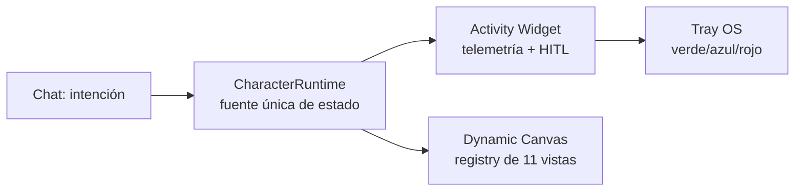

# Design System Canónico de Ego

| Campo | Valor |
| --- | --- |
| Estado | Canónico — fuente vigente de tokens, temas, kit y catálogo |
| Owner | ness-e |
| Fecha | 2026-10-14 |
| Implementación | `apps/desktop/renderer/src/index.css` (tokens) · `components/canvas/DesignSystemProvider.tsx` (temas) · `components/ui-kit/` (kit Radix) · `components/canvas/registry.ts` (catálogo) |
| Decisiones | Owner 2026-10-14 (D12, UI-01..UI-06): dark-only, 4 presets, accent ámbar, Geist, 9 estados |

> **Regla de finalización (ux-ui.md P22):** `Feature DONE = Implementado + Funcional + Usable + Consistente + Estados completos + Accesibilidad básica + Design System`. Nada que use estilos ad-hoc se considera terminado.

## 1. Tokens semánticos (`--ego-*` + Tailwind v4)

Fuente única: `:root` en `index.css` (líneas 12–22) consumido vía `DesignSystemProvider`. Tailwind v4 emite `var(--color-*)` en las utilidades; cada token resuelve con fallback:

| Utilidad Tailwind | Token `--ego-*` | Fallback verificado |
|---|---|---|
| `bg-paper` / `text-ink` | `--ego-color-bg` / `--ego-color-text` | `#0a0a0b` / `#f4f4f5` |
| `bg-panel` / `bg-raised` | `--ego-color-panel` / `--ego-color-raised` | `#111113` / `#17171a` |
| `border-hairline` / `text-faint` | `--ego-color-border` / `--ego-color-muted` | `#26262b` / `#8e8e93` |
| `bg-accent` / `text-accent` (brand) | `--ego-color-brand` | `#f59e0b` (ámbar) |
| `rounded-card` | `--ego-radius` | `8px` (radio real, ver EGO-FIND-11) |
| `font-sans` / `font-mono` | `--font-geist-sans` / `--font-geist-mono` | Geist por import, fallback system-ui (ver EGO-FIND-02) |

Prohibido: `style={{}}` ad-hoc en componentes de producto, hex literales fuera de `index.css`, clases `bg-accent`/`text-accent` fuera del sistema (ver EGO-FIND-10). Excepción: acentos semánticos de estado (emerald/amber/rose/cyan/purple) y hex de Recharts anclados a tokens vía `var(--color-*, fallback)`.

Frameless: `.app-region-drag` en el chrome de ventana; controles interactivos llevan `.app-region-no-drag` (ver EGO-FIND-11, gui-desktop.md regla 4).

## 2. Temas: dark-only, 4 presets funcionales

Decisión owner: **dark-only**. `UserPrefs.theme` (tema claro) queda documentado como futuro, no implementado. Presets en `PRESET_THEMES` (`DesignSystemProvider.tsx:37`):

| Preset | Uso |
|---|---|
| `default-dark` | Base (`DEFAULT_DESIGN_TOKENS`) |
| `midnight-cyan` | Variante fría de alto contraste |
| `emerald-terminal` | Variante terminal verdosa |
| `amber-warm` | Variante cálida sobre el accent ámbar |

`ThemeControl` aplica el preset vía `applyPreset(presetId)`; `index.css` consume `--ego-*`, por lo que el cambio es funcional en toda la app (ver EGO-FIND-11). Contraste: dim `#8a8a92` (AA verificado, ver EGO-FIND-08).

> **FUTURO — tema claro / seguir OS (post-P0, no implementado):** P0 es **dark-only**. `UserPrefs.theme` queda **reservado** como clave futura (tokens light mapeados pero inactivos en P0). `nativeTheme` **no gobierna** el tema en P0. Accent ámbar `#f59e0b` y `dim #8a8a92` son **fijos** del sistema. Seguir al OS queda **diferido a post-P0**. El provider **no debe pisar `--color-dim` sin medir cada preset** (riesgo esmeralda: `emerald-terminal` verdoso puede romper el contraste AA si `dim` se deriva del preset sin medición por preset).

## 3. Kit UI sobre Radix + Zustand (`components/ui-kit/`)

Base: `@radix-ui/react-dialog` + `@radix-ui/react-tabs` (trap de foco, roles y Escape nativos) + `zustand` (store ligero) + `clsx` + `tailwind-merge` + `cva`. Componentes: `Button`, `Input`, `Modal`, `Tabs`, `Badge` (+ `store.ts`, `cva.ts`).

Los 6 modales duplicados migran al `Modal` base; `ModelPicker` (header, proveedor real vía ModelRouter) y `SessionPicker` (sidebar, sesiones VantaDB) se montan, no se borran; `SplitPane` dimensiona el layout en `App.tsx:61`.

### 9 estados obligatorios por componente (ver EGO-FIND-12)

Todo componente del kit soporta contractualmente: `default`, `hover`, `active`, `focus`, `disabled`, `loading`, `error`, `empty`, `overflow`. Sin los 9, el componente no entra al catálogo.

## 4. Catálogo honesto: 11 implementados vs 13 aspiracionales

Verificado en `components/canvas/registry.ts:39-51` (props inferidos por Zod vía `CanvasPropsSchema`, ver EGO-FIND-13): **11 renderers implementados**: `table`, `card`, `form`, `chart`, `board`, `editor`, `diff`, `terminal`, `record_view`, `query_view`, `relation_view`.

El inventario histórico citaba 24 (ver EGO-FIND-16). Doctrina honesta: los **13 restantes son aspiracionales** — ningún Sub-Ego puede componer un tipo fuera del `ComponentRegistry`; la ampliación del catálogo exige vista tipada + entrada en el registry + sus 9 estados. Mermaid: **NO implementado en el renderer** (cero dependencia `mermaid` en `package.json`, cero imports en `apps/`, cero entrada en el registry; verificado 2026-10-15, cierra EGO-FIND-16). `LazyTelemetryChart` (`DomainCanvasView.tsx:25`) es lazy de recharts (`DomainCharts.js`), no de mermaid — la mención anterior que los equiparaba queda corregida. Un futuro tipo `mermaid` exigiría vista tipada + entrada en el registry + sus 9 estados + chunk lazy propio.

## 5. Rendimiento: lazy + windowing + skeletons + anti-shift

- `React.lazy` para charts/dominios (`LazyTelemetryChart` verificado en `DomainCanvasView.tsx:25`; código partido por vendor en `vite.config.ts:19-36`). Mermaid fuera del bundle: sin dependencia ni chunk (ver §4).
- `virtua` para windowing en chat/tablas/sidebar.
- Skeletons con altura reservada (no texto plano "Procesando…", no layout shift; ver EGO-FIND-15).
- `ErrorBoundary` global en `main.tsx` + `MessageRenderBoundary` por mensaje (patrón Hermes adaptado).
- `focus-visible` global + `dim #8a8a92` + labels en icon-buttons (ver EGO-FIND-07/08; axe bloquea CI, snapshots visuales advisory 2 semanas por decisión owner).

## 6. Mapa de superficies (D6/D7/D8)

4 superficies canónicas (ver `workspace-dinamico.md`, `mascota.md`): App Header (icono/estado 28–36px), Chat/Conversation River (orador 32–48px), Activity Widget (ejecución/HITL 40–90px), Dynamic Canvas (trabajo 48–120px). Widget **≠** Tray: el Widget es telemetría+HITL in-app; el Tray es icono OS con código de color (verde idle / azul pensando / rojo HITL, mínimo útil: click restaura, menú Mostrar/Salir, tooltip estado).

> Nota mermaid: los diagramas `mermaid` de los docs son texto de especificación y no se renderizan en la app (sin visor mermaid en el renderer, ver §4). Si el visor de docs no soporta mermaid, el texto del bloque sigue siendo la especificación.

## 7. Contraste: tokens fijos y 7 combinaciones prohibidas (T-contraste 2026-10-14)

Tokens fijos del sistema (ver `index.css` `:root` + `@theme`): `--ego-color-border-strong #52525b`, `--ego-color-focus-ring #f59e0b`, `--ego-color-text-on-brand #0a0a0b`, `--ego-color-dim #8a8a92` (el provider **no** los deriva del preset sin medir; ver §2 FUTURO).

Medición WCAG (luminancia relativa, cálculo determinista 2026-10-14):

| Par | Ratio | Veredicto |
|---|---|---|
| dim `#8a8a92` sobre paper `#0a0a0b` | ≈5.8:1 | ✅ AA texto (≥4.5:1) |
| dim `#8a8a92` sobre panel `#111113` | ≈5.5:1 | ✅ AA texto |
| focus-ring `#f59e0b` sobre paper `#0a0a0b` | ≈9.2:1 | ✅ UI ≥3:1 |
| text-on-brand `#0a0a0b` sobre ámbar `#f59e0b` | ≈9.2:1 | ✅ AA texto |
| border-strong `#52525b` sobre panel `#111113` | ≈2.4:1 | ⚠️ NO alcanza 3:1 como color único → siempre con 2º indicador (grosor, foco, icono error) |
| border-strong `#52525b` sobre paper `#0a0a0b` | ≈2.6:1 | ⚠️ idem |
| Referencia que SÍ pasa UI 3:1 sobre `#111113`: `#63636b` ≈3.2:1, `#71717a` ≈3.9:1 | — | alternativa donde se exija identificación 3:1 con color único |

Combinaciones prohibidas (7):

| # | Prohibido | Por qué | Reemplazo canónico |
|---|---|---|---|
| 1 | Texto `dim` legacy `#55555c` / `text-dim` con `opacity-*` sobre panel | ≈2.6:1, bajo AA | `text-dim` fijo `#8a8a92` sólido, sin opacity |
| 2 | `placeholder:` con `opacity-*` o `/60` (`placeholder:text-dim/60`) | hunde el placeholder bajo AA | `placeholder:text-faint` sólido (`Input.tsx`, `DomainCanvasView.tsx`) |
| 3 | `Badge tone=dim` con `opacity-70` | atenúa texto+borde bajo AA | `dim: border-hairline/60 bg-panel text-faint` sin opacity (`Badge.tsx`) |
| 4 | `border-hairline` (`#26262b` ≈1.1:1) como ÚNICO indicador de input | indistinguible del fondo | borde base `border-strong` + `focus-within:border-brand` + icono error (`Input.tsx`) |
| 5 | Strokes/tooltips con hex literal sin token (`#262626`, `#737373`, `#10b981`, `#171717`, `#a3a3a3`) | no tematizan, divergen del sistema | `var(--color-hairline, #262626)`, `var(--color-dim, #737373)`, `var(--color-success, #10b981)`, `var(--color-raised, #171717)`, `var(--color-faint, #a3a3a3)` (`DomainCharts.tsx`, `DomainCanvasView.tsx:542`, `ChartView.tsx`) |
| 6 | Derivar `--color-dim` / `--ego-color-dim` de `muted` del preset sin medir | `emerald-terminal` verdoso rompería el AA silenciosamente | dim FIJO `#8a8a92`; el provider escribe fijos y nunca `c.muted → dim` (`DesignSystemProvider.tsx`) |
| 7 | Texto sobre brand sin `text-on-brand` (blanco `#fff` sobre ámbar ≈2.1:1) | bajo AA | `--ego-color-text-on-brand #0a0a0b` (`--color-on-brand`, ≈9.2:1) |

Nota honesta de medición: `border-strong #52525b` **no** alcanza 3:1 sobre los paneles oscuros (≈2.4:1); se conserva el valor especificado como borde decorativo/interactivo **pareado** (grosor + foco + icono), nunca como único medio de identificación. Donde WCAG 1.4.11 exija 3:1 con color único, usar `dim` o subir a `#71717a`.
