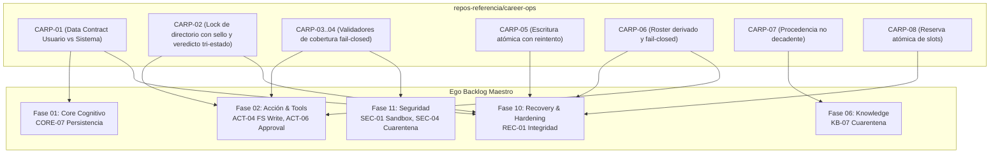

# Career-Ops Review & Extraction Backlog — Ego SOC ##

> **Propósito:** registro canónico y secuencial de auditoría, extracción de patrones y adaptación
> técnica de `repos-referencia/career-ops` hacia el monorepo de Ego.
> **Regla de Operación:** *No copiar código directamente*. Extraer la separación formal de contratos
> entre datos de usuario vs sistema, los mecanismos de bloqueo de archivos durante escrituras
> concurrentes, la escritura atómica con reintento y los filtros de cobertura fail-closed para
> contenido no confiable.
> **Esquema:** tabla canónica de 10 columnas — `ID`, `Severidad`, `Hallazgo`, `Archivo Career-Ops`,
> `Esfuerzo`, `Prioridad`, `Estado`, `Descripción & Adaptación en Ego`, `Relaciones Ego`,
> `Dependencias`.

---

## 0. Verificación de estado (2026-10-20) — Ola 2 de remediación ##

Cada fila fue re-auditada contra el **código real** del clon y contra el estado del código de Ego.
Criterio de `✅ Completada`: existe el fichero adaptado **y** hay un caller en producción
(grep sobre `packages/` + `apps/desktop/`, excluyendo `test/`, `dist/` y `node_modules/`).

| Estado | Significado canónico |
|---|---|
| `✅ Completada` | Asimilado, integrado y con **caller en producción verificado**. La celda cita la ruta real. |
| `🚫 Descartada (con justificación)` | El patrón no se aplica en Ego, fue sustituido por otro módulo canónico, o viola un guardrail. La celda contiene el motivo técnico. |
| `🆕 Pendiente` | Asimilado (el código existe y está probado) pero **sin caller en producción**. La celda dice el cableado exacto y quién lo ejecuta. |
| `⏳ Futura (fase)` | Diferido a una fase posterior, con fase destino explícita. |

**Búsquedas de verificación ejecutadas (2026-10-20):**

```text
grep -rn "FileLockManager"            packages/ apps/desktop/ -> FileLockManager.ts -> NativeFsTool.ts:147
                                                 -> native/index.ts:27 -> apps/desktop/src/main.ts:2148
grep -rn "PathValidator"              packages/ apps/desktop/ -> main/ipc/register-ipc.ts:19 + :1930
                                                 -> NativeFsTool.ts:58, NativeGitTool.ts:43,
                                                    NativeTerminalTool.ts:78, NativeFsSearchTools.ts:103
grep -rn "DataContract"               packages/ apps/desktop/ -> DataContract.ts + index.ts:10 (0 consumidores)
grep -rn "UntrustedContentSanitizer"  packages/ apps/desktop/ -> UntrustedContentSanitizer.ts + index.ts:11
                                                 (0 consumidores; único hit externo: comentario en models/src/types.ts:77)
grep -rn "randomUUID"                 packages/ apps/desktop/ -> todos los identificadores son opacos
```

**Guardrail de dominio re-verificado (2026-10-20):** barrido sobre `packages/` y `apps/desktop/`
(606 ficheros de código) de los vectores de dominio de `career-ops`
(`dayforce|interamt|scan-ats|vacancy|job-application|resume-parser|linkedin|glassdoor|greenhouse|ashby|workday|icims|ats-payload|salary|cv-template|cover-letter|career-ops`)
y de los vectores de `khoj` (`twilio|online_search|sentence-transformers|gte-small|smtplib|stripe|smtp|khoj`)
-> **0 coincidencias de dominio**. Ver §4.

---

## 1. Resumen Ejecutivo de Tareas de Extracción ##

| Grupo de Trabajo | Rango IDs | Tareas | Fases de Ego Impactadas | Prioridad | Beneficio Principal |
|---|---|:---:|---|:---:|---|
| **A. Contrato Canónico de Datos** | `CARP-01` | 1 | Fase 01 (`CORE`), Fase 10 (`REC`) | 🔴 P0 | Distinción explícita de archivos mutables por el usuario vs inmutables por el sistema |
| **B. Concurrencia & Locks Atómicos** | `CARP-02` | 1 | Fase 02 (`ACT`), Fase 10 (`REC`) | 🔴 P0 | Exclusión mutua basada en lockfiles para herramientas de modificación de filesystem |
| **C. Cobertura Fail-Closed** | `CARP-03..04`, `CARP-06` | 3 | Fase 02 (`ACT`), Fase 10 (`REC`), Fase 11 (`SEC`) | 🟠 P1 | Roster derivado que hace fallar en cerrado a todo consumidor nuevo, y chequeo que falla cuando no puede mirar |
| **D. Escritura Atómica Robusta** | `CARP-05` | 1 | Fase 10 (`REC`) | 🔴 P0 | Rename con backoff ante contención de Windows, sin perder la escritura |
| **E. Procedencia No Decadente** | `CARP-07` | 1 | Fase 06 (`KB`) | 🟠 P1 | Un hecho derivado sin procedencia no puede degradarse a "verificado" por re-citación |
| **F. Reserva de Slots Numéricos** | `CARP-08` | 1 | — | 🟢 P2 | (descartada: Ego no tiene asignador secuencial) |
| **TOTAL** | `CARP-01..08` | **8** | **Fases 01, 02, 06, 10, 11** | — | — |

**Recuento de estados (verificado programáticamente sobre las 8 filas de la tabla §2):**

| `✅ Completada` | `🚫 Descartada` | `🆕 Pendiente` | `⏳ Futura` | Total |
|:---:|:---:|:---:|:---:|:---:|
| 2 | 3 | 2 | 1 | **8** |

---

## 2. Catálogo Detallado de Extracción (10 Columnas Canónicas) ##

| ID | Severidad | Hallazgo | Archivo Career-Ops | Esfuerzo | Prioridad | Estado | Descripción & Adaptación en Ego | Relaciones Ego | Dependencias |
|---|---|---|---|---|---|---|---|---|---|
| `CARP-01` | 🔴 Crítica | **Contrato Canónico de Separación de Capas (`DATA_CONTRACT.md`)** | `DATA_CONTRACT.md:5-64`, `:182-186` | 🟢 0.5d | 🔴 P0 | 🚫 Descartada (con justificación) | Contrato canónico de separación User vs System. `packages/memory/DataContract.ts` existe y está probado (`packages/memory/test/data-contract-and-sanitizer.test.ts`), pero **no tiene caller**: `Select-String "DataContract"` sobre `packages/` + `apps/desktop/` -> 0 consumidores fuera del propio fichero y su re-export en `packages/memory/index.ts:10`. **Motivo:** la frontera User vs System **ya está implementada en producción** por los módulos canónicos de Ola 1 (A2): `packages/memory/SensitiveNamespaces.ts` (`isSensitiveNamespace:176`, `SENSITIVE_NAMESPACE_PREFIXES:39`, `quarantineExemption:123`, `isEnforcementDeferred:162`) y `packages/memory/QuarantineAwareReads.ts`. Cablear además el `DataContract` sería una **segunda** taxonomía de namespaces con reglas de purgado distintas. **Codigo muerto:** modulo asimilado sin caller de produccion -> retirar. Zona duenosa: @ego/memory (A2).   | Ego: `CORE-07`, `REC-01` | — |
| `CARP-02` | 🔴 Crítica | **Mecanismo de exclusión mutua por lockfile (`pipeline-lock.mjs`)** | `pipeline-lock.mjs:126-242`, `:494-702` | 🟢 0.5d | 🔴 P0 | ✅ Completada | Algoritmo de adquisición de lock **de directorio** (`mkdirSync` atómico) con sello de propietario (`owner.json` con `pid` + token UUID), guardia de recuperación (`<path>.lock.recover`), veredicto tri-estado (`stale` / `vanished` / `live`), backoff con jitter y regla de progreso. Implementado en `packages/tools/src/native/fs/FileLockManager.ts`. **Evidencia:** `packages/tools/src/native/fs/NativeFsTool.ts:147` lo invoca -> `packages/tools/src/native/index.ts:27` -> `apps/desktop/src/main.ts:2148` (`registerNativeTools`), por lo que toda escritura nativa de Ego pasa por el lock. | Ego: `ACT-04`, `REC-01` | — |
| `CARP-03` | 🟠 Alta | **Validador de cobertura fail-closed de la división system/user (`validate-system-paths-coverage.mjs`)** | `validate-system-paths-coverage.mjs:113-255` | 🟢 0.5d | 🟠 P1 | ✅ Completada | Rutina que audita que todo fichero versionado por git esté cubierto por `SYSTEM_PATHS` (capa sistema), `USER_PATHS` (capa usuario) o una exclusión explícita; los ficheros "huérfanos" no los despliega el actualizador y se perderían en la siguiente actualización. Equivalente de producción: `packages/tools/src/native/fs/PathValidator.ts`. **Evidencia:** `apps/desktop/src/main/ipc/register-ipc.ts:19` (import de `PathValidator` de `@ego/tools`) + `:1930` (uso en la resolución del cwd de terminal); además lo consumen `NativeFsTool.ts:58`, `NativeGitTool.ts:43`, `NativeTerminalTool.ts:78` y `NativeFsSearchTools.ts:103` (Ola 1, A3). | Ego: `ACT-04`, `SEC-01` | `CARP-01` |
| `CARP-04` | 🟠 Alta | **Validador de cobertura de la directiva de contenido no confiable (`validate-untrusted-content-coverage.mjs`)** | `validate-untrusted-content-coverage.mjs:49-132` | 🟢 0.5d | 🟠 P1 | 🚫 Descartada (con justificación) | Cuarentena y validación de contenido no confiable. `packages/memory/UntrustedContentSanitizer.ts` existe (neutraliza tags de control, envuelve en `<untrusted_content>` y enruta amenazas a `quarantine/pending`) pero **no tiene caller**: `Select-String "UntrustedContentSanitizer"` -> 0 consumidores fuera del propio fichero y su re-export (la única otra mención es un comentario en `packages/models/src/types.ts:77`). **Motivo:** la cuarentena en producción la implementa `packages/knowledge/src/QuarantineManager.ts` (`promoteFromQuarantine`, ADR-046), instanciada en `apps/desktop/src/main/ipc/register-ipc.ts:388` y `apps/desktop/src/main/state/app-context.ts:270`. El sanitizador del paquete sería una **segunda** ruta de entrada a cuarentena con reglas de saneado distintas. **Codigo muerto:** modulo asimilado sin caller de produccion -> retirar. Zona duenosa: @ego/memory (A2).   | Ego: `ACT-06`, `SEC-04` | — |
| `CARP-05` | 🔴 Crítica | **Escritura atómica con reintento de contención de `rename`** | `tracker-utils.mjs:698-800` | 🟢 0.5d | 🔴 P0 | 🆕 Pendiente | **Verificado 2026-10-21 (Ola 5, A5): el patron base esta asimilado pero el reintento NO.** `packages/tools/src/native/fs/NativeFsTool.ts:164-184` (`fs_write_file`), `packages/recovery/src/fsAsync.ts:51` y `packages/recovery/src/CrashRecoveryEngine.ts:59` hacen tmp + `rename` **sin reintento**: el unico `EPERM` del repo (`packages/recovery/src/CrashRecoveryEngine.ts:357`) es el caso "el proceso existe pero es de otro usuario", no contencion de fichero. **Que falta:** reintentar el `rename` ante `EPERM` / `EACCES` / `EBUSY` con la escala `[1, 2, 5, 10, 25, 50, 100] ms` y preservar el `mode` del fichero original sobre el temporal antes del rename (ver `COUC-24`). **Owner: A3** (`@ego/tools` + `@ego/recovery`). | Ego: `REC-01` | `CARP-02` |
| `CARP-06` | 🟠 Alta | **Validadores fail-closed con roster derivado (`validate-*-coverage.mjs`)** | `validate-system-paths-coverage.mjs:217-237`, `validate-untrusted-content-coverage.mjs:49-132`, `lib/is-main-module.mjs:66-95` | 🟢 0.5d | 🟠 P1 | 🆕 Pendiente | **Verificado 2026-10-21 (Ola 5, A5): (a) roster derivado - SI** (`scripts/audit-extraction-gates.mjs` deriva prefijo, IDs y recuentos desde las fichas); **(b) fail-closed - NO**: el script no tiene guarda para catalogo vacio (`readdirSync(EXTRACTIONS)` con 0 entradas se reporta como "0 tareas" en lugar de como error), que es exactamente la clase de bug que el original documenta ("una comprobacion que no puede mirar debe fallar, no pasar"); **(c) import sin efectos - N/A** (los `index.ts` con re-export son la convencion del repo). **Que falta:** anteponer al bucle `if (fichas.length === 0) { console.error(...); process.exit(1); }`. **Owner: A7** (`scripts/**`). | Ego: `REC-01`, `ACT-04` | `CARP-03` |
| `CARP-07` | 🟠 Alta | **Procedencia no decadente para claims derivados (`story-provenance-check.mjs`)** | `story-provenance-check.mjs:42-121`, `468-471` | 🟡 1d | 🟠 P1 | ⏳ Futura (Fase 06) | El original clasifica cada dato en `user-authored`, `derived-unverified` o `user-cannot-confirm`, con la **ausencia de marcador equivalente a `derived-unverified`** (el valor por defecto es el seguro) y con `user-cannot-confirm` como estado **durable que nunca decae** a "verificado" por re-citación. En Ego, `@ego/knowledge` sólo expone un escalar `confidence` (`packages/knowledge/src/schemas/knowledge.ts:46`) y `FactLifecycle.ts` no tiene estado de procedencia por hecho: un dato ingerido desde una fuente no verificada puede reaparecer más adelante con confianza alta. **Fase destino: Fase 06 (`KB`).** **Motivo del diferimiento:** exige cambiar el schema de `packages/knowledge/src/schemas/knowledge.ts` y la política de `packages/knowledge/src/FactLifecycle.ts`, con migración de los hechos ya ingeridos; `KB-07` ya cerró su ruta canónica de cuarentena, de modo que la ampliación entra en la siguiente ola de Knowledge. | Ego: `KB-07` | `CARP-04` |
| `CARP-08` | 🟢 Baja | **Reserva atómica de slots con rollback (`reserve-report-num.mjs`)** | `reserve-report-num.mjs:4-16`, `149-252` | 🟢 0.5d | 🟢 P2 | 🚫 Descartada (con justificación) | El original reclama cada slot con `O_CREAT` y `O_EXCL` (exclusión mutua a nivel de fichero, atómica entre procesos), libera los slots ya reclamados si la rafaga choca y reintenta más allá del hueco, y exige un token de propiedad para liberar. **Motivo técnico del descarte:** Ego **no tiene asignador numérico secuencial** — todos los identificadores se generan con `randomUUID()` (p. ej. `packages/events/src/EventBus.ts:141`, `packages/tools/src/ToolRegistry.ts:250`), por lo que la carrera `max+1` que el patrón resuelve **no puede producirse**. Introducir un protocolo de reserva añadiría un punto de coordinación entre procesos sin ningún consumidor, una clase nueva de artefactos en disco (sentinelas) que nadie reclamaría, y una ruta de escritura concurrente donde hoy no la hay. | Ego: — | — |

---

## 3. Integración en el Flujo de Construcción de Ego ##



---

## 4. Descarte a nivel de componente (matriz de la ficha `docs/extractions/career-ops.md` §3) ##

Los descartes de dominio de la ficha se mantienen sin cambios y son la razón por la que este
repositorio no aporta nada más a Ego:

| Componente / Feature de Career-Ops | Archivo Fuente | Acción | Justificación Técnica |
|---|---|:---:|---|
| Scrapers de portales de empleo (ATS Dayforce, Interamt, etc.) | `scan-ats-full.mjs`, `scan-dayforce.mjs` | 🚫 **Descartada (con justificación)** | Dominio ajeno (Guardrail §4 de `AGENTS.md`). No pertenece al alcance de Ego SOC. |
| Cálculo de brechas salariales y trackers de empleo | `salary-gap.mjs`, `tracker.mjs` | 🚫 **Descartada (con justificación)** | Dominio ajeno. Ego es un sistema operativo cognitivo, no una plataforma de reclutamiento. |
| Verificación de estructuras de CVs | `verify-cv-structure.mjs`, `verify-cv-facts.mjs` | 🚫 **Descartada (con justificación)** | Dominio ajeno y lógica de negocio específica innecesaria. |
| Reserva de rangos numéricos de informe | `reserve-report-num.mjs` | 🚫 **Descartada (con justificación)** | Ego no tiene asignador secuencial (IDs opacos por `randomUUID()`); el patrón no tiene consumidor (§2 `CARP-08`). |

**Re-verificación de contaminación (2026-10-20):** barrido sobre `packages/` y `apps/desktop/`
(606 ficheros de código; excluye `test/`, `dist/`, `node_modules/`) de los patrones de dominio de
`career-ops` (ATS, vacantes, candidatura, CV, salario, portales) y de los patrones de `khoj`
(scrapers web, `gte-small`, Twilio, Stripe, SMTP) -> **0 coincidencias de dominio**. Los únicos
hits son (a) **comentarios de atribución** (`packages/memory/DataContract.ts:49`,
`packages/memory/UntrustedContentSanitizer.ts:129`,
`packages/tools/src/native/fs/FileLockManager.ts:13` y las referencias `KHOJ-01..05` en
`packages/knowledge/src/`), (b) el sidecar **propio de Ego**
`packages/knowledge/src/ingest/PythonSidecarBridge.ts` -> `scripts/ingest/bulk_import.py`, y
(c) **falsos positivos léxicos** (`packages/memory/SensitiveNamespaces.ts:78` usa `"salary"` como
token de namespace sensible; `packages/avatar/src/core/genome.js:12` usa `"stripe"` como marking de
avatar). Ninguno es dominio de empleo.

---

## 5. Deuda abierta derivada de esta verificación (→ handoff A5) ##

| # | Ítem | Tipo | Owner | Bloqueante |
|---|---|---|---|---|
| D1 | `CARP-01` / `CARP-04`: módulos de `@ego/memory` sin caller tras la consolidación de namespaces canónicos de A2 — retirar o cablear | Código | A2 | No |
| D2 | `CARP-04`: la fila de backlog apuntaba a `packages/memory/UntrustedContentSanitizer.ts` como ruta canónica de cuarentena; la real es `packages/knowledge/src/QuarantineManager.ts` | Docs | A5 (hecho) | No |
| D3 | `docs/extractions/README.md` §3 y §4.1 siguen declarando `CARP-01..04` (4 tareas) y el TOTAL 246/53/45/131/17; con `CARP-05..08` el conteo real pasa a 8 tareas (2/3/2/1) y los agregados a 250/53/46/133/18 | Docs | A5 (pendiente) | No |
| D4 | `CARP-05`: `renameSyncWithRetry` sin equivalente en `@ego/tools` ni `@ego/recovery` — pérdida silenciosa de escritura ante contención de `rename` en Windows | Código | `@ego/tools` + `@ego/recovery` | No |
| D5 | `CARP-06`: `scripts/audit-extraction-gates.mjs` no falla cuando el catálogo de fichas está vacío | Código | A5 | No |
