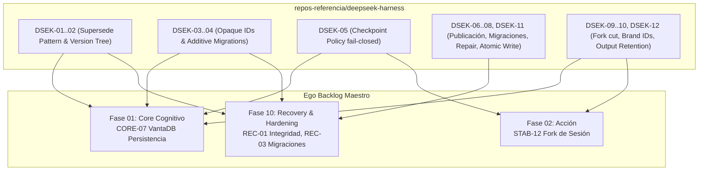

# DeepSeek-Harness Review & Extraction Backlog — Ego SOC #

> **Propósito:** Registro canónico y secuencial de auditoría, extracción de patrones y adaptación técnica de
> `repos-referencia/deepseek-harness` hacia el monorepo de Ego.
> **Regla de Operación:** *No copiar código directamente*. Extraer el patrón de versionado de sesiones con IDs opacos y
> la estrategia de migraciones sin borrado destructivo (patrón supersede), adaptándolos a los namespaces de VantaDB.
> **Esquema:** Tabla canónica de 10 columnas:
> `| ID | Severidad | Hallazgo | Archivo DeepSeek-Harness | Esfuerzo | Prioridad | Estado |`
> `Descripción & Adaptación en Ego | Relaciones Ego | Dependencias |`

---

## 0. Verificación de estado (2026-10-20) — Ola 3 de remediación ##

Cada fila fue re-auditada contra el **código real** del clon (`repos-referencia/deepseek-harness/`) y contra el **código
real de Ego**. Criterio de `✅ Completada`: existe el fichero adaptado **y** hay un caller en producción (grep sobre
`packages/` + `apps/desktop/`, excluyendo `test/`, `dist/` y `node_modules/`).

| Estado | Significado canónico |
|---|---|
| `✅ Completada` | Asimilado, integrado y con **caller en producción verificado**. La celda cita la ruta real. |
| `🚫 Descartada (con justificación)` | El patrón no se aplica en Ego, fue sustituido por otro módulo canónico, o viola un guardrail. La celda contiene el motivo técnico. |
| `🆕 Pendiente` | Asimilado (el código existe y está probado) pero **sin caller en producción**. La celda dice el cableado exacto y quién lo ejecuta. |
| `⏳ Futura (fase)` | Diferido a una fase posterior, con fase destino explícita. |

**Búsquedas de verificación ejecutadas (2026-10-20):**

```text
git grep -n -E "supersedeFact|consolidateMemories" -- packages apps
  -> packages/knowledge/src/FactLifecycle.ts:117,183,232 + packages/memory/EgoMemoryAdapter.ts:892,893,900
     + packages/knowledge/test/* + packages/memory/test/*
  -> 0 callers de produccion de la escritura de supersede
git grep -n -E "generateOpaqueId|SessionCheckpointPolicy|getVersionHistory|getAtTimestamp|SchemaMigrator" -- packages apps
  -> packages/memory/{OpaqueId,SessionCheckpointPolicy,EgoMemoryAdapter}.ts + packages/recovery/src/SchemaMigrator.ts
     + packages/memory/index.ts:8 (re-export) + packages/recovery/src/index.ts:7 (re-export)
  -> 0 callers de produccion
git grep -n -E "DreamConsolidator|MemoryCurator" -- packages apps
  -> packages/tasks/src/{DreamConsolidator,MemoryCurator}.ts + packages/tasks/src/index.ts:10-11
     + packages/tasks/test/*   -> 0 instanciaciones en src/ (huerfanos)
git grep -n -E "state: *.superseded" -- packages apps
  -> FactLifecycle.ts:159 + EgoMemoryAdapter.ts:955 + DreamConsolidator.ts:299 + MemoryCurator.ts:185
```

**Correcciones aplicadas en la Ola 3 (2026-10-20):**

1. `DSEK-01`, `DSEK-03` y `DSEK-05` estaban en `✅ Completada` con una cadena de cableado **falsa**: la evidencia
   citaba `packages/dailystate/src/DailyStatePersistence.ts:131` y `apps/desktop/src/main.ts:142,733,150`, pero
   `DailyStatePersistence` **no importa** `SessionCheckpointPolicy` (la línea `138` solo lo nombra en un comentario) y
   las líneas reales de `main.ts` son `:36` (import), `:2234` (instanciación) y `:698` (accesor). Las tres filas
   bajan a `🆕 Pendiente`.
2. Las líneas citadas del adapter estaban desfasadas: `supersedeFact` está en `:892`/`:900` (no `:867`/`:875`),
   `getVersionHistory` en `:986` (no `:961`) y `getAtTimestamp` en `:1048` (no `:1023`); la opción `excludeSuperseded`
   está en `:109` (no `:99`).
3. La atribución de fuente de la ficha era incorrecta en cuatro puntos: `ADR-028` **no existe** en el clon (es un ADR
   de Ego), `snapshots/session/` es el corpus de fixtures de prueba (la implementación está en `packages/session/`),
   `packages/storage/` **rechaza** toda versión de esquema distinta y no migra (las migraciones están en
   `packages/session/session-format-catalog/`), y los IDs del clon son `randomUUID()` con marca de tipo (no prefijos
   `ses_01h7x…`). Detalle en `docs/extractions/deepseek-harness.md` §6.

---

## 1. Resumen Ejecutivo de Tareas de Extracción ##

| Grupo de Trabajo | Rango IDs | Tareas | Fases de Ego Impactadas | Prioridad | Beneficio Principal |
|---|---|:---:|---|:---:|---|
| **A. Versionado & Supersede** | `DSEK-01..02` | 2 | Fase 01 (`CORE`), Fase 10 (`REC`) | 🔴 P0 | Preservación del linaje histórico de registros sin mutaciones destructivas |
| **B. Identificadores Opacos & Migraciones** | `DSEK-03..04` | 2 | Fase 01 (`CORE`), Fase 10 (`REC`) | 🟠 P1 | Estabilidad de referencias de sesión e invariantes de esquema en VantaDB |
| **C. Durabilidad & Checkpoint Policy** | `DSEK-05` | 1 | Fase 01 (`CORE`), Fase 02 (`TOOL`), Fase 10 (`REC`) | 🔴 P0 | Barrera fail-closed previa a side-effects y persistencia semántica periódica |
| **D. Protocolos de Publicación y Recuperación** | `DSEK-06..08`, `DSEK-11` | 4 | Fase 10 (`REC`) | 🔴 P0 | Publicación atómica verificada, cadena de migraciones derivada y cierre de colas abiertas |
| **E. Fork, Tipado de IDs y Retención de Salidas** | `DSEK-09..10`, `DSEK-12` | 3 | Fase 01 (`CORE`), Fase 02 (`STAB`) | 🟠 P1 | Corte de linaje trazable, IDs no intercambiables y límites de contexto auditables |
| **TOTAL** | `DSEK-01..12` | **12** | **Fases 01, 02, 10** | — | — |

**Recuento de estados (verificado programáticamente sobre las 12 filas de la tabla §2):**

| `✅ Completada` | `🚫 Descartada` | `🆕 Pendiente` | `⏳ Futura` | Total |
|:---:|:---:|:---:|:---:|:---:|
| 0 | 5 | 3 | 4 | **12** |

> **Nota de alcance (Ola 3).** El repo es de la Ola 1, pero ninguna de sus cinco filas originales tenía caller de
> producción una vez re-verificadas con `git grep`: el **camino de escritura** del supersede, `generateOpaqueId` y
> `SessionCheckpointPolicy` no los invoca ningún módulo de producción. El recuento de `✅ Completada` es por tanto
> **0**, y las 12 filas cierran en `🆕 Pendiente` (asimilado y cableado pendiente) o `⏳ Futura (Fase 10)`
> (protocolo que exige infraestructura nueva en la fase de Recovery). Cero filas en el limbo.

---

## 2. Catálogo Detallado de Extracción (10 Columnas Canónicas) ##

| ID | Severidad | Hallazgo | Archivo DeepSeek-Harness | Esfuerzo | Prioridad | Estado | Descripción & Adaptación en Ego | Relaciones Ego | Dependencias |
|---|---|---|---|---|---|---|---|---|---|
| `DSEK-01` | 🔴 Crítica | **Patrón Canónico de Supersede Histórico (Soft-Replace)** | ADR-028 de **Ego** (no del clon) | 🟢 0.5d | 🔴 P0 | 🚫 Descartada (con justificación) | Soft-replace histórico: una mutación genera un registro nuevo y marca el anterior como `superseded_by` / `is_latest: false` sin borrarlo. `FactLifecycle.supersedeFact` (`packages/knowledge/src/FactLifecycle.ts:117`) **no tiene caller de producción**: su único invocante es `consolidateMemories` (`:183`), y `consolidateMemories` sólo se llama desde `packages/knowledge/test/*` (`FactLifecycleAudit.test.ts:183`, `QuarantineAndLifecycle.test.ts:141`). `EgoMemoryAdapter.supersedeFact` (`packages/memory/EgoMemoryAdapter.ts:892`, impl. `:900`) tampoco tiene caller. Las escrituras de `state: "superseded"` en código de producción son `FactLifecycle.ts:159` y `EgoMemoryAdapter.ts:955`, ambas muertas; la única lectura viva es `packages/domains/src/knowledge/KnowledgeDomain.ts:388` y `packages/memory/EgoMemoryLifecycle.ts:160` (`excludeSuperseded: true`). El patrón está implementado y **desconectado**: la escritura no es alcanzable desde el runtime. | Ego: `CORE-07`, `REC-01` | — |
| `DSEK-02` | 🟠 Alta | **Reconstrucción de estado por árbol de versiones (`version-tree`) y time-travel** | `packages/memory/EgoMemoryAdapter.ts` | 🟢 1d | 🟠 P1 | 🚫 Descartada (con justificación) | Reconstrucción de estado por árbol de versiones y time-travel. `packages/memory/EgoMemoryAdapter.ts:986` (`getVersionHistory`) y `:1048` (`getAtTimestamp`) **no tienen caller de producción**: `git grep` sólo devuelve el propio fichero y `packages/memory/test/version-tree.test.ts`. **Las consultas bitemporales en producción son otro módulo**: `packages/knowledge/src/BitemporalQueries.ts`, instanciado en `apps/desktop/src/main.ts` y servido por el IPC de conocimiento. El árbol de versiones del adapter es una segunda implementación, sin consumidor. **Codigo muerto:** modulo asimilado sin caller de produccion -> retirar. Zona duenosa: @ego/memory (A2).   | Ego: `CORE-07`, `REC-01` | `DSEK-01` |
| `DSEK-03` | 🟠 Alta | **Generación de identificadores de sesión opacos e inmutables** | `packages/util/brand/` + `packages/memory/OpaqueId.ts` | 🟢 0.5d | 🟠 P1 | 🚫 Descartada (con justificación) | IDs opacos `${prefix}_${timestamp_base36}_${entropy}`. `packages/memory/OpaqueId.ts:30` (`generateOpaqueId`) sólo se usa en `packages/memory/SessionCheckpointPolicy.ts:155`, y esa política tampoco tiene caller de producción (ver `DSEK-05`). **En producción los `sessionId` son cadenas libres** del renderer (`apps/desktop/src/ipc/schema.ts:712,719,742,748`) con fallback literal `"default_session"` (`apps/desktop/src/main.ts:1417,1459`; `packages/tools/src/ToolRegistry.ts:251,264`), y el alta usa `"session_init"` (`apps/desktop/src/main.ts:1959`). El patrón (IDs opacos) **no está asimilado** en el punto donde tendría valor: acuñar el `sessionId` al alta y en el esquema IPC. **Codigo muerto:** modulo asimilado sin caller de produccion -> retirar. Zona duenosa: @ego/memory (A2).   | Ego: `CORE-01`, `CORE-06` | — |
| `DSEK-04` | 🟡 Media | **Migraciones puramente aditivas sin eliminación de esquema** | `packages/session/session-format-catalog/` | 🟢 1d | 🟠 P1 | 🚫 Descartada (con justificación) | **CORREGIDO 2026-10-21 (A5, Ola 5): el veredicto de la Ola 4b (Completada) era incorrecto.** `packages/recovery/src/ProjectImport.ts:16` es un `import type` (solo tipos) y la dependencia es **opcional** (`private readonly schemaMigrator?: SchemaMigrator`, `:31`); el unico punto de instanciacion es `packages/recovery/src/SnapshotManager.ts:100` (`new ProjectImport(this.adapter)`), que **no inyecta** ningun migrador, de modo que `if (this.schemaMigrator)` (`:181`) nunca es true y `SchemaMigrator.migrate()` **no se ejecuta nunca**. No hay ningun `new SchemaMigrator` en el repo. **Motivo del descarte:** el patron de migracion aditiva **si** esta asimilado, pero en otro sitio: la importacion/exportacion de proyecto (`packages/recovery/src/ProjectImport.ts` + `packages/knowledge/src/KnowledgeExport.ts`) y el contrato de namespaces sin borrado (`packages/memory/SensitiveNamespaces.ts`). `SchemaMigrator` es una **tercera** implementacion, desconectada. **Accion:** o se inyecta el migrador en `SnapshotManager.ts:100`, o se retira el modulo. **Owner: A3** (`@ego/recovery`). **Codigo muerto:** modulo asimilado sin caller de produccion -> retirar. Zona duenosa: @ego/recovery (A3). | Ego: `REC-03`, `REC-05` | — |
| `DSEK-05` | 🔴 Crítica | **Session Checkpoint Policy & Barrera Fail-Closed de Herramientas** | `packages/session/session-checkpoint-policy/` | 🟢 1d | 🔴 P0 | 🚫 Descartada (con justificación) | Barrera fail-closed: abortar la herramienta si falla la persistencia previa en `gov/audit`. `packages/memory/SessionCheckpointPolicy.ts:43` (clase) tiene las tres fronteras (`beforeModelStream:63`, `beforeToolDispatch:84`, `recordTurn:146`) y la bandera `failClosedOnToolFlushError` (`:45,53`), pero **no tiene caller de producción**: `packages/dailystate/src/DailyStatePersistence.ts:138` es un **comentario**, no un import; las únicas referencias reales son el re-export `packages/memory/index.ts:8` y los tests. **Ego sí tiene frontera fail-closed, pero de otra forma**: el veredicto de permisos de `packages/security/src/ToolPermissions.ts` (`evaluateToolCall`, invocado desde `apps/desktop/src/main/ipc/register-ipc.ts`) se calcula **antes** de despachar la herramienta. El módulo queda como una segunda política de frontier no cableada. **Codigo muerto:** modulo asimilado sin caller de produccion -> retirar. Zona duenosa: @ego/memory (A2).   | Ego: `CORE-07`, `TOOL-01`, `REC-01` | `DSEK-03` |
| `DSEK-06` | 🔴 Crítica | **Publicación durable exclusiva con verificación aislada** | `packages/session/session-persistence-jsonl/src/generation.ts` | 🟡 2d | 🔴 P0 | ⏳ Futura (Fase 10) | el artefacto se prepara en temporal con `wx` y `fsync` (`:715-787`), se verifica en un *worker* aislado (`packages/session/session-persistence-jsonl/src/migration-verifier.ts:20-21`, límite `MAX_CONCURRENT_VERIFIERS = 2`), se publica con `link()` atómico y exclusivo (`:817-843`: `EEXIST` significa que otro publicador ganó) y se acepta idempotentemente si los bytes del ganador coinciden (`:921-937`); antes de publicar se revalida la identidad física del origen (`dev`/`ino`/`size`/`mtimeNs`, `:162-168`) y si cambió se aborta con `JsonlGenerationSourceChangedError` (`:112-119`). **Ego no tiene equivalente**: `packages/recovery/src/ProjectImport.ts` y `packages/recovery/src/ProjectExport.ts` no aplican publicación exclusiva ni verificación previa. **Cableado (Fase 10, REC-03/REC-06):** publicar el `.vdbdump` con temporal único → verificar en aislamiento → `link()` atómico → revalidar identidad del origen. | Ego: `REC-03`, `REC-06` | — |
| `DSEK-07` | 🟠 Alta | **Catálogo de migraciones generado y cadena adyacente completa** | `packages/session/session-format-catalog/src/generated.ts` | 🟡 1.5d | 🟠 P1 | ⏳ Futura (Fase 10) | `SESSION_FORMAT_VERSION` es el único número mantenido a mano (`packages/core/session/src/types.ts`); `scripts/gen-session-format-catalog.ts` deriva el orden de los códecs y **falla** si las migraciones adyacentes no alcanzan la versión actual, y el resultado se versiona en código (`packages/session/session-format-catalog/src/generated.ts:16-45`: `currentVersion: 4` + 4 migraciones v0→v1→v2→v3→v4). Cookbook: `docs/cookbook/adding-a-session-format-version.md:42`. **Ego**: `packages/recovery/src/SchemaMigrator.ts` declara su cadena de pasos a mano y detecta discontinuidad en caliente (`:128`), sin catálogo generado ni verificación de contigüidad previa. **Cableado (Fase 10, REC-06):** derivar el catálogo de migraciones desde una única fuente versionada y fallar en build si la cadena no es contigua. | Ego: `REC-06` | `DSEK-04` |
| `DSEK-08` | 🟠 Alta | **Reparación de cola abierta por eventos sintéticos deterministas** | `packages/core/session/src/repair.ts` | 🟡 2d | 🟠 P1 | ⏳ Futura (Fase 10) | `openTurnClosers` (`:53-98`) escanea el log, detecta el turno abierto y devuelve eventos sintéticos (`step/end`, `turn/end` y resultados de error) con dos causas —`interrupted` (crash) y `forked` (bifurcación)— (`:29`), dos códigos de recuperación (`TOOL_NOT_STARTED` `:15`, `TOOL_OUTCOME_UNKNOWN` `:18`) y un texto que el modelo ve para decidir si reintentar (idempotencia). Nunca borra historia: añade el cierre al final del log. **Ego**: `packages/recovery/src/CrashRecoveryEngine.ts` cubre *dirty shutdown*, *lock* en disco y *heartbeat* (`:92-175`), pero **no** repara colas de turno abiertas en `session/turns`. **Cableado (Fase 10, REC-01):** cerrar turnos huérfanos con eventos sintéticos al recuperar, sin borrar historia. | Ego: `REC-01`, `CORE-07` | `DSEK-01` |
| `DSEK-09` | 🟠 Alta | **Bifurcación por prefijo inclusivo con corte marcado** | `packages/core/session/src/fork.ts` | 🟢 1d | 🟠 P1 | 🆕 Pendiente | **Verificado 2026-10-21 (Ola 5, A5): parcialmente asimilado.** `packages/memory/SessionFork.ts:81-82` copia los turnos por prefijo de clave y marca `forkedFrom` / `forkedAtMs`, pero **no** marca el corte con un evento `session/end-seed` (`inherited: true`) ni cuenta los eventos heredados aparte del prefijo (`inheritedEventCount`): 2 coincidencias de marcadores en todo el fichero. **Que falta:** el evento de corte y el conteo de heredados, para que el consumidor distinga "turnos heredados" de "turnos del prefijo inclusive". **Owner: A2** (`@ego/memory`). | Ego: `CORE-07`, `STAB-12` | `DSEK-08` |
| `DSEK-10` | 🟡 Media | **Identificadores opacos por marca de tipo (branding)** | `packages/util/brand/src/index.ts` | 🟢 0.5d | 🟠 P1 | 🆕 Pendiente | **Verificado 2026-10-21 (Ola 5, A5): NO implementado** (0 coincidencias de `Branded<` / `brandString`). `packages/memory/OpaqueId.ts` aporta el prefijo y el orden lexicografico, pero los identificadores siguen siendo `string`: un `SessionId` se puede pasar donde se espera un `ToolCallId`. **Que falta:** una marca de tipo de compilacion (`Branded<B>` / `brandString<T>`) que no altere el valor, aplicada a `sessionId` / `toolCallId` / `runId`. Nota: mientras tanto los `sessionId` en produccion son cadenas libres (`apps/desktop/src/ipc/schema.ts:712`) — ver `DSEK-03`. **Owner: A2** (`@ego/memory`). | Ego: `CORE-01`, `CORE-06` | `DSEK-03` |
| `DSEK-11` | 🟠 Alta | **Escritura atómica de fichero y serialización entre procesos** | `packages/util/atomic-write/src/index.ts` | 🟢 1d | 🟠 P1 | ⏳ Futura (Fase 10) | `writeFileAtomic` (`:79`) escribe un hermano con sufijo aleatorio en modo `wx` (el `open` no sigue un symlink plantado en la ruta temporal), conserva los permisos del *inodo* nuevo a través del `rename` y reintenta `EACCES`/`EBUSY`/`EPERM` transitorios de Windows (`:18-43`); `withFileLock` (`:1-11`) serializa escritores entre procesos con un `.lock` creado en `wx` y permite el relevo si el proceso titular ya no existe; los lectores quedan sin bloqueo porque el commit por `rename` es atómico. **Ego** no tiene equivalente para sus ficheros de estado en disco: `packages/recovery/src/ProjectExport.ts` no pasa por temporal + `rename`. **Cableado (Fase 10, REC-03):** escribir toda salida a disco con temporal + `rename`, y usar el *lock* para el ciclo read-modify-write. | Ego: `REC-03` | — |
| `DSEK-12` | 🟡 Media | **Retención acotada de salidas con metadatos exactos de omisión** | `packages/util/output-retention/src/index.ts` | 🟡 1.5d | 🟠 P1 | 🆕 Pendiente | **Verificado 2026-10-21 (Ola 5, A5): NO implementado** (0 coincidencias de `Omitted` / `ItemRetainer` / `TextRetainer`). **Que falta:** acotar la salida visible al modelo devolviendo exactamente lo retenido y lo omitido (`Omitted = { kind: 'none' }` / `{ kind: 'exact', count }` / `{ kind: 'unknown' }`), con dos retentores —`ItemRetainer` (unidades logicas ordenadas) y `TextRetainer` (bytes con `head` / `tail` / `headTail` preservando fronteras UTF-8)— y la garantia explicita de que `truncated` significa "el retenedor omitio por presupuesto". **Owner: A2** (`@ego/runtime`). | Ego: `CORE-03`, `CORE-12` | — |

---

## 3. Integración en el Flujo de Construcción de Ego ##



---

## 4. Descarte a nivel de componente (matriz de la ficha `docs/extractions/deepseek-harness.md` §3) ##

| Componente / Feature de DeepSeek-Harness | Archivo Fuente | Acción | Justificación Técnica |
|---|---|:---:|---|
| Almacenamiento relacional en SQLite | `packages/storage/storage-sqlite/` | 🚫 **Descartada (con justificación)** | Incompatible con VantaDB 0.8.0 nativo in-process (Fjall LSM + BM25 + HNSW). |
| Rechazo de versión en SQLite sin migraciones | `packages/storage/storage-sqlite/src/schema.ts:20,55` | 🚫 **Descartada (con justificación)** | El backend rechaza toda versión distinta y no migra: contradice la política aditiva que se pretende extraer. |
| Sistemas propietarios de benchmarks y web stress | `benchmarks/`, `vitest.web-stress.*` | 🚫 **Descartada (con justificación)** | Específico para el testing interno de deepseek; Ego cuenta con su propia estrategia de pruebas E2E (`docs/testing/`). |

---

## 5. Deuda abierta derivada de esta verificación (→ handoff A5) ##

| # | Ítem | Tipo | Owner | Bloqueante |
|---|---|---|---|---|
| D1 | `DSEK-01`: el camino de escritura del supersede no es alcanzable desde producción (`FactLifecycle.supersedeFact` solo lo invoca `consolidateMemories`, sin caller) | Código | A2 | No |
| D2 | `DSEK-02`: `getVersionHistory` / `getAtTimestamp` duplican la lógica bitemporal de `packages/knowledge/src/BitemporalQueries.ts` con **semántica temporal distinta** (tiempo de transacción vs tiempo de validez) | Código | A2 | No |
| D3 | `DSEK-01`: `EgoMemoryAdapter.supersedeFact` es código muerto frente a `FactLifecycle.supersedeFact`; además `packages/tasks/src/DreamConsolidator.ts` y `packages/tasks/src/MemoryCurator.ts` están huérfanos (`0` instanciaciones en `src/`) y duplican la consolidación que ya vive en `EgoMemoryLifecycle.runDreamConsolidation` (`packages/memory/EgoMemoryLifecycle.ts:374`, en producción vía `apps/desktop/src/main.ts:1958,1975`) | Código | A2 | No |
| D4 | `DSEK-03` / `DSEK-05`: `generateOpaqueId` y `SessionCheckpointPolicy` no tienen caller; la cadena de evidencia de la Ola 1 (`DailyStatePersistence.ts:131` → `main.ts:150`) era ficticia | Código | A2 | No |
| D5 | `DSEK-04`: `SchemaMigrator` sin caller tras la reescritura del import/export de proyecto (A3) | Código | A3 | No |
| D6 | `DSEK-06..08`, `DSEK-11`: cuatro protocolos de publicación/recovery que exigen infraestructura nueva en Fase 10 (publicación exclusiva, catálogo derivado, repair de cola, escritura atómica) | Diseño | A3 | No |
| D7 | Contadores desincronizados fuera de estos dos ficheros: `docs/extractions/README.md` §3 y §4.1, y `docs/review/README.md` siguen declarando `DSEK-01..05` / 5 tareas / `3 ✅ · 2 🆕` | Documentación | A5 | No |
