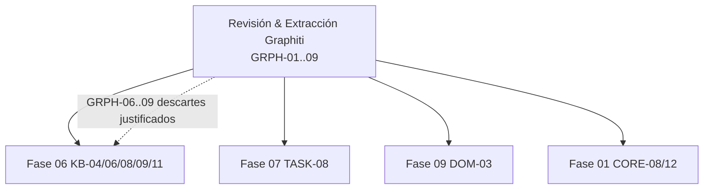

## Backlog de Revisión y Extracción: Graphiti (getzep/graphiti) ##

### Bitemporalidad de dos ejes, invalidación por contradicción y resolución de entidades en cascada ###

| Campo | Valor |
| --- | --- |
| Estado | Activo — Backlog canónico de revisión y extracción |
| Repositorio Origen | `repos-referencia/graphiti/` — `getzep/graphiti` 0.31.1, commit `6e3e3cb` (rama `main`, profundidad 1), Apache-2.0 |
| Total de Tareas | 9 (`GRPH-01..09`) |
| Fases Impactadas en Ego | Fase 06 (Knowledge & Data, `KB-01..11`), Fase 07 (Tasks & Background, `TASK-08`), Fase 09 (Dominios, `DOM-03`) |
| Owner | ness-e |
| Fecha | 2026-10-20 |
| Última verificación | 2026-10-20 — grep sobre `packages/` + `apps/desktop/src/` (excluye `test/`, `dist/`, `node_modules/`) |

> **Propósito:** registro canónico y secuencial de auditoría, extracción de patrones y adaptación técnica de
> `repos-referencia/graphiti` hacia el monorepo de Ego.
> **Regla de Operación:** *No copiar código directamente*. Extraer la lógica de diseño, los contratos temporales y
> los patrones de inferencia, reescribiéndolos en TypeScript estricto y TypeScript + Node 22 Main Process, apoyándose
> en VantaDB como sustrato de memoria.
> **Esquema:** Tabla canónica de 10 columnas:
> `| ID | Severidad | Hallazgo | Archivo Graphiti | Esfuerzo | Prioridad | Estado | Descripción & Adaptación en`
> `Ego | Relaciones Ego | Dependencias |`

## 0. Verificación de estado (2026-10-20) ##

Cada fila fue auditada contra el **código real** de Graphiti (`repos-referencia/graphiti/`, commit `6e3e3cb`) y
contra el **código real de Ego**. Criterio de `✅ Completada`: existe el fichero adaptado **y** hay un caller en
producción (grep sobre `packages/` + `apps/desktop/`, excluyendo `test/`, `dist/` y `node_modules/`).

| Estado | Significado canónico |
|---|---|
| `✅ Completada` | Asimilado, integrado y con **caller en producción verificado**. La celda cita la ruta real. |
| `🚫 Descartada (con justificación)` | El patrón no se aplica en Ego, fue sustituido por otro módulo canónico, o viola un guardrail. La celda contiene el motivo técnico. |
| `🆕 Pendiente` | Patrón asimilado (el código existe y está probado) pero **sin caller en producción**. La celda dice el **cableado exacto** y **quién lo ejecuta**. |
| `⏳ Futura (fase)` | Diferido a una fase posterior, con fase destino explícita. |

**Nota de alcance (repo nuevo):** Graphiti entra en Ego por primera vez. **Ningún artefacto suyo ha sido asimilado
todavía**, de modo que el recuento de `✅ Completada` es legítimamente **0**; los hallazgos transferibles cierran en
`🆕 Pendiente` (con cableado y owner) o en `⏳ Futura (fase)`. Cero filas en el limbo.

**Búsquedas de verificación ejecutadas:**

```text
grep -r "BitemporalQueries|FactLifecycle|GraphRagEngine|ProjectMemoryGraph|HybridSearch" packages/ apps/desktop/src
  -> packages/knowledge/src/{HybridSearch,GraphRagEngine,FactLifecycle,BitemporalQueries,ProjectMemoryGraph}.ts
     + packages/knowledge/test/*
grep -r "bitemporalQueries|factLifecycle|graphRagEngine|projectMemoryGraph|hybridSearch" apps/desktop/src
  -> apps/desktop/src/main.ts:2207-2212 (instanciacion)
  -> apps/desktop/src/main/ipc/register-ipc.ts:1349-1438 (callers IPC)
grep -r "getVersionHistory|getAtTimestamp" packages/
  -> packages/memory/EgoMemoryAdapter.ts:986,1048-1049 + test  (0 callers)
grep -r "label_propagation|labelPropagation|rrf|reciprocalRank" packages/  -> No matches found
grep -r "contradict" packages/memory packages/tasks              -> No matches found
```

## 1. Resumen Ejecutivo de Extracción ##

Graphiti aporta a Ego **tres modelos semánticos** que el monorepo todavía no tiene, y que son transferibles sin
arrastrar su stack (Python + Neo4j + embeddings en cliente):

- **Un segundo eje temporal.** Graphiti separa el tiempo de *validez* (`valid_at`/`invalid_at`) del tiempo de
  *transacción* (`created_at`/`expired_at`). Ego solo tiene un eje y contamina el campo de validez con tiempo de
  transacción (`packages/knowledge/src/FactLifecycle.ts:162` escribe `invalid_at: now`), con lo que su motor
  "bitemporal" (`packages/knowledge/src/BitemporalQueries.ts:93-155`) consulta de hecho el tiempo de transacción.
  Esto es exactamente `VDB-REQ-06` (`docs/VANTADB-FEEDBACK-Y-MEJORAS.md:34,216-221`).
- **Invalidación por contradicción.** Un contrato de prompt (`duplicate_facts` / `contradicted_facts`) decide qué
  hecho refuta a cuál, y una regla **determinista** de fechas aplica la caducidad. Ego deduplica por firma y caduca
  por antigüedad, nunca por refutación.
- **Cascada de resolución de entidades** (identidad → nombre exacto → similitud → LLM): primero lo determinista, el
  modelo solo como último recurso.

Lo que **no** se traspasa: el runtime Python, los drivers Neo4j/FalkorDB/Neptune/Kuzu, los servidores FastAPI/MCP, el
RRF multi-lista (el sustrato de Ego devuelve una lista única) y el cálculo de embeddings en TypeScript (guardrail
duro: la inferencia densa vive en `vantadb-mcp`).

### MATRIZ DE DISTRIBUCIÓN POR FASE ###

```text
FASE 06 — KNOWLEDGE & DATA (KB-01..11)
  GRPH-01 Bitemporalidad de dos ejes ................ [PENDIENTE]  KB-08/09
  GRPH-02 Normalizacion de bounds temporales ......... [PENDIENTE]  KB-04/08
  GRPH-03 Deteccion de contradicciones + invalidac. .. [PENDIENTE]  KB-08/09
  GRPH-04 Cascada de resolucion de entidades ........ [PENDIENTE]  KB-08/11
  GRPH-05 Comunidades + resumen jerarquico .......... [FUTURA]     KB-06/11
  GRPH-06 RRF multi-lista ........................... [DESCARTADA] KB-04
  GRPH-07 BFS + reranker por distancia .............. [DESCARTADA] KB-06
FASE 07 — TASKS & BACKGROUND (TASK-08)
  GRPH-03/04 -> DreamConsolidator + MemoryCurator ... [PENDIENTE]
FASE 09 — DOMINIOS (DOM-03)
  GRPH-05 -> Knowledge (investigacion y sintesis) ... [FUTURA]
SIN CABLEADO (descarte con fundamento escrito en la ficha)
  GRPH-06 RRF multi-lista       -> peticion upstream de VantaDB
  GRPH-07 BFS + distancia      -> sustituido por GraphRagEngine
  GRPH-08 embeddings cliente   -> guardrail: denso solo en vantadb-mcp
  GRPH-09 drivers + servidores -> VantaDB es el sustrato unico
```

**Recuento de estados (verificado sobre las 9 filas de la tabla §2):**

| `✅ Completada` | `🚫 Descartada` | `🆕 Pendiente` | `⏳ Futura` | Total |
|:---:|:---:|:---:|:---:|:---:|
| 0 | 4 | 4 | 1 | **9** |

## 2. Catálogo Detallado de Extracción (10 Columnas Canónicas) ##

| ID | Severidad | Hallazgo | Archivo Graphiti | Esfuerzo | Prioridad | Estado | Descripción & Adaptación en Ego | Relaciones Ego | Dependencias |
|---|---|---|---|---|---|---|---|---|---|
| `GRPH-01` | Crítica | **Bitemporalidad de dos ejes: `valid_at`/`invalid_at` (validez) separados de `created_at`/`expired_at` (transacción)** | `graphiti_core/edges.py:263-290` · `graphiti_core/utils/maintenance/edge_operations.py:715-783` | 2-3d | P0 | 🆕 Pendiente | El segundo eje **no existe** en Ego: `packages/knowledge/src/schemas/knowledge.ts:50-53` solo declara `validAt`/`invalidAt`, y `packages/knowledge/src/FactLifecycle.ts:162` escribe `invalid_at: now` (tiempo de transaccion) en el campo de validez. Divergencia interna: `packages/memory/EgoMemoryAdapter.ts:1048-1069` (`getAtTimestamp`) razona en tiempo de transaccion (`created_at`/`superseded_at`) y `:986` (`getVersionHistory`) recorre la cadena de versiones, pero **0 callers en produccion**. **Cableado:** anadir `recordedAt`/`supersededAt` al esquema `Fact`, separar los ejes en `FactLifecycle.supersedeFact` (`:117-177`) y corregir el filtro de `BitemporalQueries.asOf` (`packages/knowledge/src/BitemporalQueries.ts:110-111`) para que use el intervalo de validez — owner KB/A2. | Ego: `KB-08`, `KB-09`, `DSEK-01`, `DSEK-02` · Upstream: `VDB-REQ-06` · Ver: `docs/extractions/graphiti.md` §4 | `DSEK-02` (depurar los dos motores bitemporales) |
| `GRPH-02` | Alta | **Normalizacion determinista de bounds temporales: asercion en futuro vs deadline blando vs estado en curso** | `graphiti_core/utils/maintenance/temporal_edge_utils.py:14-37,39-96` · reglas equivalentes en `graphiti_core/prompts/extract_edges.py:184-193` | 1d | P1 | 🆕 Pendiente | Tres regex (`_FUTURE_ASSERTION_RE`, `_DEADLINE_RE`, `_ONGOING_STATE_END_RE`) separan "will move" de "by March 2026" y normalizan `valid_at`/`invalid_at` **sin llamar al modelo**. En Ego no existe nada equivalente: `packages/knowledge/src/extractors/FactExtractor.ts:99,140` fija `validAt: now` invariable y el esquema solo admite el `temporalScope` grueso (`packages/knowledge/src/schemas/knowledge.ts:47`). **Cableado:** funcion pura `normalizeTemporalBounds()` en `packages/knowledge/src/`, invocada desde `FactExtractor.extractFromText` (`FactExtractor.ts:66`) y `parseFactJson` (`:157`) — determinista, sin coste de embeddings, compatible con el guardrail del fast path — owner KB/A2. | Ego: `KB-04`, `KB-08`, `CORE-12` | `GRPH-01` (necesita `referenceTime`) |
| `GRPH-03` | Crítica | **Deteccion de contradicciones (`duplicate_facts` / `contradicted_facts`) + invalidacion temporal determinista** | `graphiti_core/prompts/dedupe_edges.py:25-33,44-117` · `graphiti_core/utils/maintenance/edge_operations.py:715-783,864-1089` | 2-3d | P0 | 🆕 Pendiente | El prompt devuelve dos listas de indices con numeracion continua y trae contrapesos anti-falso-positivo ("NEVER mark facts as contradicted unless the new fact explicitly makes the old fact false", `:48-49`; ejemplo "software engineer" vs "senior engineer" = contradiccion, no duplicado, `:104-106`); la **aplicacion** es aritmetica (`resolve_edge_contradictions` fija `invalid_at = candidate.valid_at` y `expired_at = now`). En Ego **no hay deteccion de contradiccion**: grep `contradict` sobre `packages/` → 0; `packages/tasks/src/DreamConsolidator.ts:274-305` deduplica por firma y `packages/tasks/src/MemoryCurator.ts:181-187` caduca por antiguedad (`superseded_by: 'curator:stale'`). **Cableado:** nuevo `packages/knowledge/src/ContradictionResolver.ts` (inferencia via `ModelRouter` + regla temporal determinista) invocado desde `FactLifecycle.consolidateMemories` (`packages/knowledge/src/FactLifecycle.ts:183-284`) y `DreamConsolidator` — owner KB/A2. | Ego: `KB-08`, `KB-09`, `TASK-08`, `CORE-12` | `GRPH-01` (ejes temporales), `GRPH-02` |
| `GRPH-04` | Alta | **Cascada de resolucion de entidades: identidad → nombre exacto → similitud → LLM (determinista primero)** | `graphiti_core/utils/maintenance/node_operations.py:456-484,540-575,816-910` | 2-3d | P1 | 🆕 Pendiente | `resolve_extracted_nodes` resuelve por propiedad de identidad, luego por nombre exacto (lookup durable, `:554`), luego por similitud, y **solo lo no resuelto llega al LLM** (`:874-891`). Ego no tiene cascada: `packages/knowledge/src/extractors/FactExtractor.ts:97,128` deriva el id por hash `sha256(subject:object:source)` sin resolucion, y `DreamConsolidator` deduplica en barrido plano. **Cableado:** nuevo `packages/knowledge/src/EntityResolution.ts` con los niveles lexico-exactos en el fast path, el nivel semantico delegado al subproceso `vantadb-mcp` (Cognitive Path) y el nivel LLM via `ModelRouter`; **nunca calcular embeddings en TypeScript** — owner KB/A2. | Ego: `KB-08`, `TASK-08`, `CORE-12` · Guardrail: `VDB-REQ-02` | `GRPH-01`, `GRPH-03` |
| `GRPH-05` | Media | **Deteccion de comunidades por label propagation + resumen jerarquico map-reduce + re-resumen incremental** | `graphiti_core/utils/maintenance/community_operations.py:96-141,201-253,397-434` | 3d | P2 | ⏳ Futura (Fase 06) | Sin implementacion en Ego (grep `label_propagation\|labelPropagation` → 0). El sustrato de grafo **ya es real**: `packages/knowledge/src/ProjectMemoryGraph.ts:114-143` siembra aristas `derived_from` via `packages/memory/EgoMemoryAdapter.ts:1144-1148` (`addEdge`). **Diferimiento:** el grafo de Ego solo tiene aristas de trazas de ingenieria; la deteccion de comunidades exige un grafo denso y el resumen map-reduce multiplica las llamadas al modelo (coste no justificado en P0). **Fase destino:** Fase 06 (`KB-06`, `KB-11`), Ola 2. | Ego: `KB-06`, `KB-11`, `DOM-03` | `GRPH-04` (resolucion de entidades antes de agrupar) |
| `GRPH-06` | Alta | **Fusion RRF multi-lista de listas rankeadas independientes** | `graphiti_core/search/search_utils.py:1786-1801` · `graphiti_core/search/search_config.py:32-118` | 1d | P2 | 🚫 Descartada (con justificación) | Ego no dispone de multi-lista: `packages/memory/EgoMemoryAdapter.ts:665-681` documenta que `searchMulti` fusiona por score en un **unico ranking** y que el fast path es BM25 puro (`VDB-REQ-02`); `packages/knowledge/src/HybridSearch.ts:28-37` declara el mismo limite ("**No hay RRF** ... el re-rank es mono-lista") y `:125-180` aplica MMR sobre lista unica. El RRF real es una peticion **upstream de VantaDB** (`docs/agent-ops/plans/2026-10-19-remediation-wave1/handoff/A2-ola1b.md:206`), no un patron que Graphiti aporte: sin lista densa por hit no hay nada que fusionar. La config declarativa de rerankers si es transferible y queda recogida en `GRPH-03`/`GRPH-04`. | Ego: `KB-04` · Upstream: `VDB-REQ-02` | — |
| `GRPH-07` | Media | **Expansion BFS desde nodos origen + reranker por distancia al nodo centro** | `graphiti_core/search/search.py:308-362` · `graphiti_core/search/search_utils.py:1804-1863` | 1d | P2 | 🚫 Descartada (con justificación) | Sustituido por el modulo canonico de Ego: `packages/knowledge/src/GraphRagEngine.ts:160-246` implementa expansion multi-salto con poda de grado (`maxDegreePerNode`) y decaimiento de peso por salto (`:221`), y `:272-340` (`expandViaNativeGraph`) consume las aristas reales del sustrato de VantaDB. **Verificado en produccion:** `apps/desktop/src/main.ts:2208` (`new GraphRagEngine(adapter)`) → `apps/desktop/src/main/ipc/register-ipc.ts:1369` (`ipc.knowledge.graphRag`). El *reranker* por shortest-path de Graphiti exige el motor IQL `query`, que el binding napi-rs no expone (`packages/knowledge/src/GraphRagEngine.ts:52-59`). | Ego: `KB-06`, `DOM-03` | — |
| `GRPH-08` | Crítica | **Embeddings densos calculados en el cliente + reranking con cross-encoder** | `graphiti_core/edges.py:292-303` · `graphiti_core/utils/maintenance/edge_operations.py:520,1043-1051` · `graphiti_core/embedder/` · `graphiti_core/cross_encoder/` | 1d | P0 | 🚫 Descartada (con justificación) | **Guardrail duro AGENTS.md §4:** no calcular embeddings en TypeScript en el fast path. El binding `NativeVantaDB` es BM25 puro (`query_vector: []`, `VDB-REQ-02`) y la inferencia densa ONNX y las capas L0-L3 residen exclusivamente en el subproceso `vantadb-mcp`. `packages/knowledge/src/HybridSearch.ts:14-17` ya documenta que no existe lista vectorial densa y que la similitud del MMR es coseno lexico. Asimilarlo violaria dos guardrails simultaneos (fast path en TS y unicidad del gateway de memoria). | Ego: `KB-04`, `CORE-08` · Guardrail: `VDB-REQ-02` | — |
| `GRPH-09` | Alta | **Drivers de grafo externos + indexacion temporal + servidores FastAPI/MCP en Python** | `graphiti_core/driver/` · `graphiti_core/graph_queries.py:40-126` · `server/` · `mcp_server/` · `graphiti_core/namespaces/` | 1d | P1 | 🚫 Descartada (con justificación) | AGENTS.md §4: "NO acceso directo a VantaDB — todo pasa por `EgoMemoryAdapter`"; el sustrato de grafo de Ego es el grafo nativo de VantaDB (`packages/memory/EgoMemoryAdapter.ts:1111-1210`: `insertNode`/`addEdge`/`graphragSearch`), sin drivers externos ni procesos Python residentes. El desktop es local-first: la interfaz se expone por IPC tipado (`apps/desktop/src/preload.ts`) y los conectores externos ya estan cubiertos por `packages/integrations/` (`INT-04`). La indexacion temporal de Graphiti (`graph_queries.py:79-81`) solo es aplicable con soporte nativo equivalente → se arrastra a `VDB-REQ-06`. | Ego: `INT-04`, `KB-06` · Upstream: `VDB-REQ-06` | — |

## 3. Matriz de Integración con el Backlog Maestro ##

Cada tarea `GRPH-*` se ejecuta como **pre-requisito de diseño y código** de las fases del Backlog Maestro de Ego
(`docs/roadmap/Backlog.md`):



### Protocolo de Extracción por Tarea ###

1. **Aislamiento:** descartar runtime Python, drivers de grafo, FastAPI/MCP y el cálculo de embeddings en cliente.
2. **Reescritura Canónica:** módulo en TypeScript strict dentro de `packages/knowledge/src/`, sin embeddings en el
   fast path e inferencia delegada al `ModelRouter` (o a `vantadb-mcp` para el nivel semántico).
3. **Cierre:** `✅ Completada` solo con fichero adaptado + caller en producción verificado; si no aplica,
   `🚫 Descartada (con justificación)`; si existe sin cablear, `🆕 Pendiente` con cableado y responsable; si se
   difiere, `⏳ Futura (fase)` con la fase destino.

## 4. Deuda abierta derivada de esta verificación ##

| # | Ítem | Tipo | Owner | Bloqueante |
|---|---|---|---|---|
| D1 | `GRPH-01`: el eje de validez esta contaminado por tiempo de transaccion (`packages/knowledge/src/FactLifecycle.ts:162`) y conviven dos motores temporales con semanticas distintas (`packages/knowledge/src/BitemporalQueries.ts` por validez vs `packages/memory/EgoMemoryAdapter.ts:986,1048` por transaccion, sin callers) | Codigo | KB/A2 | No |
| D2 | `GRPH-03`: no existe deteccion de contradiccion en ningun paquete; `MemoryCurator` caduca por antiguedad, no por refutacion | Codigo | KB/A2 | No |
| D3 | `GRPH-05`: el sustrato de grafo de VantaDB solo tiene aristas `derived_from` de trazas; la deteccion de comunidades necesita un grafo denso | Codigo | KB | Si (densidad del grafo) |
| D4 | `GRPH-04`: el nivel semantico de la cascada de resolucion no puede ejecutarse en el fast path (BM25 puro); depende del subproceso `vantadb-mcp` | Decision | A2 | Si (Cognitive Path) |
| D5 | Numeracion divergente de `VDB-REQ-08`: el registro canonico (`docs/VANTADB-FEEDBACK-Y-MEJORAS.md:36`) lo define como "cifrado en reposo", mientras el codigo (`packages/knowledge/src/HybridSearch.ts:36`, `packages/memory/EgoMemoryAdapter.ts:679`) y el handoff lo usan para "RRF real / lista vectorial densa" | Documentacion | A1 | No |
