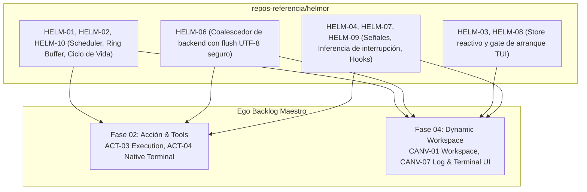

# Helmor Review & Extraction Backlog — Ego SOC #

> **Propósito:** registro canónico y secuencial de auditoría, extracción de patrones de terminal y
> adaptación técnica de Helmor hacia el monorepo de Ego.
> **Regla de Operación:** *No copiar código directamente*. Extraer la arquitectura de coalescencia de
> ráfagas y el puente reactivo de sincronización UI, adaptándolos a TypeScript estricto en React 19 y
> Node 22 para las herramientas de terminal y la visualización en Canvas.
> **Esquema:** tabla canónica de 10 columnas: `ID`, `Severidad`, `Hallazgo`, `Archivo Helmor`,
> `Esfuerzo`, `Prioridad`, `Estado`, `Descripción & Adaptación en Ego`, `Relaciones Ego`,
> `Dependencias`.

---

## 0. Verificación de estado (2026-10-20) — Ola 2 de remediación ##

Cada fila fue re-auditada contra el **código real** del clon (`repos-referencia/helmor`, commit
`a76cda1`) y contra el workspace de Ego. Criterio de `✅ Completada`: existe el fichero adaptado **y**
hay un caller en producción (grep sobre `packages/` + `apps/desktop/`, excluyendo `test/`, `dist/` y
`node_modules/`).

| Estado | Significado canónico |
|---|---|
| `✅ Completada` | Asimilado, integrado y con **caller en producción verificado**. La celda cita la ruta real. |
| `🚫 Descartada (con justificación)` | El patrón no se aplica en Ego, fue sustituido por otro módulo canónico, o viola un guardrail. La celda contiene el motivo técnico. |
| `🆕 Pendiente` | Asimilado (el código existe y está probado) pero **sin caller en producción**, o el patrón aún no se ha asimilado. La celda dice el cableado exacto y quién lo ejecuta. |
| `⏳ Futura (fase)` | Diferido a una fase posterior, con fase destino explícita. |

**Correcciones factuales aplicadas en esta ola (2026-10-20):**

1. **No hay PTY en Ego.** `Select-String "node-pty"` sobre `packages/` + `apps/` → **0**. La
   coalescencia de Helmor se adaptó **sobre pipes** de `node:child_process`, no sobre un PTY.
2. **Las cuotas son en BYTES, no en caracteres** en la adaptación de Ego
   (`TerminalOutputBuffer.ts:18-19`: `DRAIN_CHUNK_BYTES = 16 * 1024`, `MAX_QUEUE_BYTES = 2 * 1024 * 1024`),
   mientras que el original usa `MAX_QUEUE_CHARS` (chars). El buffer de Ego retiene cabeza y cola
   (`compact()`, líneas 91-103); Helmor **descarta solo lo más antiguo**.
3. **La línea base de las citas era incorrecta en tres puntos.** `registerNativeTools` está en
   `apps/desktop/src/main.ts:2148` (no 3086); `pushTerminalOutput` en `apps/desktop/src/main.ts:360`
   (no 395); y `apps/desktop/src/main.ts` **no hace ningún `spawn`** — los dos sitios reales son
   `packages/tools/src/native/terminal/NativeTerminalTool.ts:97` y
   `apps/desktop/src/main/ipc/register-ipc.ts:1940`.
4. **`terminal-ime.ts` no contiene ningún mapeo de señales.** `terminal-ime.ts:1-117` es solo un guard
   de composición IME para xterm en WKWebView. El patrón de señal vive en
   `src-tauri/src/terminal.rs:105-110` (`is_interrupt_keypress`) y en la disciplina de línea del PTY.
   En Ego, `NativeTerminalTool.ts:115-135` implementa la escalada `AbortSignal` → `SIGINT` →
   `SIGTERM`, que es lo que queda asimilado.
5. **La cuota de 16 KB de `TerminalOutputBuffer` es código inerte.** `getDrainChunkBytes()`
   (`TerminalOutputBuffer.ts:49`) no tiene ningún consumidor: el drenado real está en el renderer,
   `apps/desktop/renderer/components/canvas/TerminalView.tsx:16-38`.
6. **El store de sesiones está duplicado byte a byte** y cada copia exporta su propio
   `defaultTerminalSessionStore`: `packages/tools/src/native/terminal/TerminalSessionStore.ts` y
   `packages/ui-runtime/src/TerminalSessionStore.ts` (324 líneas cada una). El renderer consume la copia
   de `@ego/ui-runtime`, luego hay **dos estados separados** en el proceso.

---

## 1. Resumen Ejecutivo de Tareas de Extracción ##

| Grupo de Trabajo | Rango IDs | Tareas | Fases de Ego Impactadas | Prioridad | Beneficio Principal |
|---|---|:---:|---|:---:|---|
| **A. Coalescencia de salida de terminal** | `HELM-01..02`, `HELM-10` | 3 | Fase 02 (`ACT`), Fase 04 (`CANV`) | 🔴 P0 | Previene el congelamiento del Event Loop y de React ante salidas masivas |
| **B. Coalescencia de backend y sanitización UTF-8** | `HELM-06` | 1 | Fase 02 (`ACT`), Fase 04 (`CANV`) | 🔴 P0 | Evita cortar secuencias UTF-8 a mitad en el umbral de bytes |
| **C. Sincronización UI reactiva** | `HELM-03`, `HELM-08` | 2 | Fase 04 (`CANV`) | 🟠 P1 | Puente limpio de sincronización de eventos sin suscripciones redundantes |
| **D. Interrupción, señales y hooks de ciclo de vida** | `HELM-04`, `HELM-07`, `HELM-09` | 3 | Fase 02 (`ACT`), Fase 04 (`CANV`) | 🟠 P1 | Estado *busy/idle* real y cancelación fiable del CLI de agente |
| **E. Context Mention Badges** | `HELM-05` | 1 | Fase 04 (`CANV`), Fase 01 (`CORE`) | 🟠 P1 | Cápsulas interactivas para menciones de archivos `@` en Composer y Chat |
| **TOTAL** | `HELM-01..10` | **10** | **Fases 01, 02, 04** | — | — |

**Recuento de estados (verificado programáticamente sobre las 10 filas de la tabla §2):**

| `✅ Completada` | `🚫 Descartada` | `🆕 Pendiente` | `⏳ Futura` | Total |
|:---:|:---:|:---:|:---:|:---:|
| 4 | 0 | 6 | 0 | **10** |

---

## 2. Catálogo Detallado de Extracción (10 Columnas Canónicas) ##

| ID | Severidad | Hallazgo | Archivo Helmor | Esfuerzo | Prioridad | Estado | Descripción & Adaptación en Ego | Relaciones Ego | Dependencias |
|---|---|---|---|---|---|---|---|---|---|
| `HELM-01` | 🔴 Crítica | **Planificador de salida y coalescencia de terminal (`terminal-output-scheduler.ts`)** | `src/components/terminal-output-scheduler.ts:9-154` | 🟢 1d | 🔴 P0 | ✅ Completada | Extraer el drenado por cuotas (`DRAIN_CHUNK_CHARS = 16 * 1024`, línea 11) con ventana dual (8 ms foreground / 50 ms background, líneas 9-10) y fast-path de primer plano (líneas 99-102). **Adaptación sobre pipes, no sobre PTY.** Implementado en `apps/desktop/renderer/components/canvas/TerminalView.tsx:16-38` (`CHUNK_SIZE = 16384` + `drainOutputChunks` con `setTimeout(pump, 16)`). **Evidencia:** `canvas/registry.ts:69` → `ComponentRenderer.tsx:41` → `CanvasRuntime.tsx:168`. **Corrección:** la cuota de `TerminalOutputBuffer` es inerte (ver `HELM-10` y §0.5). | Ego: `ACT-04`, `CANV-07` | — |
| `HELM-02` | 🟠 Alta | **Manejo de buffer anular anti-OOM (`ring-buffer cap`)** | `src/components/terminal-output-scheduler.ts:11-16` | 🟢 0.5d | 🔴 P0 | ✅ Completada | Limitar la cola en memoria a 2 MB para evitar memory leaks en background runs. Implementado en `packages/tools/src/native/terminal/TerminalOutputBuffer.ts:19` (`MAX_QUEUE_BYTES = 2 * 1024 * 1024`) con compactación head+tail en `compact()` (`:91-103`). **Corrección:** la cifra es en **bytes** (`MAX_QUEUE_BYTES`), no en caracteres (`MAX_QUEUE_CHARS` del original). **Evidencia:** `NativeTerminalTool.ts:83,139,143,165` → `packages/tools/src/native/index.ts:41` → `apps/desktop/src/main.ts:2148`. | Ego: `ACT-03`, `ACT-04` | `HELM-01` |
| `HELM-03` | 🟠 Alta | **Puente reactivo de estado de terminales (`terminal-session-store.ts`)** | `src/features/terminal/terminal-session-store.ts:1-363` | 🟢 1d | 🟠 P1 | 🆕 Pendiente | asimilado en `packages/ui-runtime/src/TerminalSessionStore.ts` y `packages/tools/src/native/terminal/TerminalSessionStore.ts` (replay determinista de chunks, snapshot y suscripciones por workspace). Los hooks `apps/desktop/renderer/hooks/useTerminalSession.ts:30,158` **existen pero no tienen consumidor en producción**: los únicos usos son el re-export `renderer/hooks/index.ts:3` y el test `renderer/test/terminal-and-badges.test.tsx`. **Deuda asociada:** el store está **duplicado byte a byte** y cada copia exporta su propio `defaultTerminalSessionStore` → dos estados separados. **Cableado pendiente:** consumir los hooks en `apps/desktop/renderer/components/canvas/TerminalView.tsx` (`CANV-07`) y fijar el store canónico — owner A4. | Ego: `CANV-01`, `CANV-07` | — |
| `HELM-04` | 🟡 Media | **Escalada de cancelación por señales (`SIGINT` → `SIGTERM`)** | `src-tauri/src/terminal.rs:105-110` (`is_interrupt_keypress`) | 🟢 0.5d | 🟡 P2 | ✅ Completada | Rutina de cancelación cooperativa con `AbortSignal` y escalada de señales: `SIGINT` inmediato y `SIGTERM` a los 1500 ms. Implementado en `packages/tools/src/native/terminal/NativeTerminalTool.ts:115-135`. **Corrección:** la ficha anterior citaba `terminal-ime.ts` como fuente del patrón; ese fichero es solo el guard de composición IME para xterm en WKWebView y **no contiene ninguna señal** (§0.4). **Evidencia:** `packages/tools/src/native/index.ts:42` → `apps/desktop/src/main.ts:2148`; política de comandos vivos en `apps/desktop/src/main/terminal-policy.ts`. | Ego: `ACT-04` | — |
| `HELM-05` | 🟠 Alta | **File Mention Badges en Composer y Chat (`file-mention-badge.tsx`)** | `src/components/file-mention-badge.tsx` | 🟢 0.5d | 🟠 P1 | ✅ Completada | Cápsula visual interactiva para menciones de archivos `@archivo` con distinción de iconos según tipo, botón de apertura en Canvas y soporte de remoción en Composer. Implementado en `apps/desktop/renderer/components/FileMentionBadge.tsx:41`. **Evidencia:** `renderer/components/ego-chat.tsx:37` importa `FileMentionBadge` y lo renderiza en `:1694`. | Ego: `CANV-04`, `CORE-01` | — |
| `HELM-06` | 🔴 Crítica | **Coalescedor de backend con flush UTF-8 seguro** | `src-tauri/src/workspace/scripts.rs:64-68,1017-1141` | 🟢 1d | 🔴 P0 | 🆕 Pendiente | El backend coalesce **antes** de cruzar la frontera IPC: ventana de 8 ms (`PTY_FLUSH_INTERVAL`) o umbral de 16 KB (`PTY_FLUSH_BYTES`), y emite solo el **prefijo UTF-8 válido** conservando la cola incompleta (`std::str::from_utf8`, líneas 1034-1053), con volcado *lossy* si la cola incompleta excede la longitud máxima de una secuencia. **Ego:** no existe equivalente; `TerminalOutputBuffer` concatena y decodifica al final (correcto), pero el drenado del renderer trocea por unidades UTF-16 (`TerminalView.tsx:30`) y puede partir un par suplente. **Cableado pendiente:** troceado seguro por code point en `TerminalView.tsx:drainOutputChunks` + un `drain()` real en `TerminalOutputBuffer` — owner A4. | Ego: `ACT-04`, `CANV-07` | `HELM-01` |
| `HELM-07` | 🟠 Alta | **Inferencia de interrupción en el backend con ventana de asentamiento** | `src-tauri/src/terminal.rs:55-110` (`observe_stdin`) | 🟢 1d | 🟠 P1 | 🆕 Pendiente | Detecta `ESC` / `ETX` (y sus formas CSI-u) escritos a la sesión y, tras `INTERRUPT_SETTLE = 500 ms`, libera el estado *busy* si ningún hook lo liberó antes. El razonamiento (fallos asimétricos: un idle falso se autocura, un interrupt perdido cuelga el spinner) y la decisión de moverlo al backend —la versión en el renderer se eliminó porque rompía la composición IME— son la parte transferible. **Ego:** `NativeTerminalTool.ts` solo cancela por `AbortSignal`; no infiere la interrupción. **Cableado pendiente:** helper de inferencia en `packages/tools/src/native/terminal/` + consumer en `apps/desktop/src/main/ipc/register-ipc.ts` — owner A4. | Ego: `ACT-04` | `HELM-09` |
| `HELM-08` | 🟡 Media | **Gate de arranque TUI con replay de secuencias ANSI** | `src/features/terminal/terminal-session-store.ts:150-186` | 🟢 0.5d | 🟡 P2 | 🆕 Pendiente | Retiene la salida previa a la TUI (prompt del shell y eco del comando de arranque) hasta el marcador de pantalla alternativa (`1049h` / `2026h` / `1004h`) o un timeout de 3 s, y **reproduce las secuencias de control del prefijo descartado** para no desincronizar el estado del emulador. **Ego:** el visor de terminal del Canvas muestra hoy ese prompt y ese eco como salida del agente; `packages/ui-runtime/src/AnsiParser.ts` es el receptor natural del replay. **Cableado pendiente:** gate en `TerminalSessionStore` (buffer de pre-arranque liberado por marcador o timeout) — owner A4. | Ego: `CANV-07` | `HELM-03` |
| `HELM-09` | 🟠 Alta | **Hook de ciclo de vida del CLI de agente (estado busy/idle)** | `src-tauri/src/cli/terminal_hook.rs:1-90` | 🟢 1d | 🟠 P1 | 🆕 Pendiente | El host inyecta un comando de callback en los eventos de ciclo de vida del agente (SessionStart, UserPromptSubmit, Stop) y de ahí deriva *busy/idle* (`SessionStart` **no** es busy) y el prompt enviado, que auto-nombra la sesión. Es no-op estricto sin variable de entorno de sesión y traga todos los fallos: un hook jamás debe romper al agente. **Ego:** `TerminalSessionStatus` solo distingue `running` / `exited` / `error`; no hay estado *busy* (agente trabajando) frente a *idle* (esperando al usuario). **Cableado pendiente:** campo `busy` en `TerminalSessionSnapshot` + derivación desde los eventos de tool/progreso del runtime — owner A4. | Ego: `ACT-04`, `CANV-07` | — |
| `HELM-10` | 🟡 Media | **Ciclo de vida del scheduler: cancelación del drenado y liberación del timer** | `src/components/terminal-output-scheduler.ts:142-154` | 🟢 0.5d | 🟡 P2 | 🆕 Pendiente | El scheduler expone `clearTerminalWrites` (descartar la cola de un terminal) y `disposeTerminalWrites` (eliminar el terminal **liberando el timer de drenado** cuando no queda ninguna cola). Sin esa segunda operación, el `setTimeout` del drenado sobrevive al desmontaje y retiene el proceso. **Ego:** `TerminalView.tsx:28-37` encadena `setTimeout(pump, 16)` sin `clearTimeout` ni bandera de cancelación: el drenado sobrevive al desmontaje y escribe en un `setState` de un componente ya retirado. **Cableado pendiente:** ref de timer + `clearTimeout` en el `useEffect` de retorno de `TerminalView.tsx` — owner A4. | Ego: `CANV-07` | `HELM-01` |

---

## 3. Integración en el Flujo de Construcción de Ego ##

---

## 4. Descarte a nivel de componente (matriz de la ficha `docs/extractions/helmor.md` §3) ##

| Componente / Feature de Helmor | Archivo Fuente | Acción | Justificación Técnica |
|---|---|:---:|---|
| Backend en Rust nativo de Tauri | `src-tauri/` | 🚫 **Descartada (con justificación)** | Ego está basado en Electron + Node 22; los bindings nativos se confinan a `NativeVantaDB` (napi-rs). |
| Storybook y configuraciones de Bun | `.storybook/`, `bun.lock` | 🚫 **Descartada (con justificación)** | Ego utiliza pnpm y Vite puro sin dependencias de Bun ni Storybook en producción. |
| Guard de composición IME para xterm | `components/terminal-ime.ts` | 🚫 **Descartada (con justificación)** | El terminal de Ego no es xterm sino un `
` de líneas de texto (`TerminalView.tsx:176-209`): no hay compositor de terminal que sincronizar, luego los tres quirks de WebKit no tienen receptor. |
| Quick Switcher / Command Palette (`Ctrl+K`) | `features/quick-switch/` | 💡 **Solo Inspiración** | Ego ya implementó el atajo en `CORE-13` (omnibar federado, `HERM-20`); se extrajeron solo los estilos visuales de badges. |
| Tauri 2 (framework de shell) | `src-tauri/` | 🚫 **Descartada (con justificación)** | Decisión de stack de `AGENTS.md` §1: Electron. |
| Persistencia efímera en memoria | — | 🚫 **Descartada (con justificación)** | Todo el historial de ejecución y las salidas de terminal relevantes persisten en VantaDB. |

---

## 5. Deuda abierta derivada de esta verificación (→ handoff A5/A4) ##

| # | Ítem | Tipo | Owner | Bloqueante |
|---|---|---|---|---|
| D1 | `HELM-01/02`: el camino IPC de sesión (`apps/desktop/src/main/ipc/register-ipc.ts:1940-1960`) emite los chunks en crudo hacia `ipc.event` y **no pasa por `TerminalOutputBuffer`** → doble camino de salida sin coalescer ni limitar a 2 MB | Código | A4 | No |
| D2 | `HELM-03`: los hooks `useTerminalSession` / `useWorkspaceTerminalSessions` no tienen consumidor en producción; el visor `canvas/TerminalView.tsx` no los usa | Código | A4 | No |
| D3 | `HELM-03`: el store de sesiones de terminal está **duplicado byte a byte** (`packages/tools/src/native/terminal/TerminalSessionStore.ts` y `packages/ui-runtime/src/TerminalSessionStore.ts`) y cada copia exporta su propio `defaultTerminalSessionStore` → dos estados separados en el proceso. Designar el canónico antes de cablear `HELM-03`, `HELM-08` o `HELM-09` | Código | A4 | Sí (bloquea `HELM-08` y `HELM-09`) |
| D4 | `HELM-01`: `TerminalOutputBuffer.DRAIN_CHUNK_BYTES` es una constante inerte (`getDrainChunkBytes()` sin consumidores): el drenado por cuota solo existe en el renderer | Código | A4 | No |
| D5 | `HELM-06`: el drenado del renderer trocea por unidades de código UTF-16 (`TerminalView.tsx:30`) y puede emitir mojibake al partir un par suplente | Código | A4 | No |
| D6 | `HELM-10`: el `setTimeout(pump, 16)` de `TerminalView.tsx:28-37` no se cancela al desmontar el componente | Código | A4 | No |
| D7 | Contexto de secuencia para el drenaje de terminal: `EgoEvent` no tiene campo `seq` (`packages/events/src/types.ts:76-95`) y el `EventBus` conserva solo 100 eventos en RAM (`packages/events/src/EventBus.ts:84-85,153-157`); el verificador de secuencia de `AGUI-05` necesita ese campo | Contrato | A4 | Sí (bloquea `AGUI-05`) |
| D8 | Sincronizar los recuentos agregados tras esta ola: `docs/extractions/README.md` §4.1 (tabla maestra) y `docs/roadmap/Backlog.md:41-47` siguen declarando `helmor` con 5 tareas | Docs | A5 | No |
