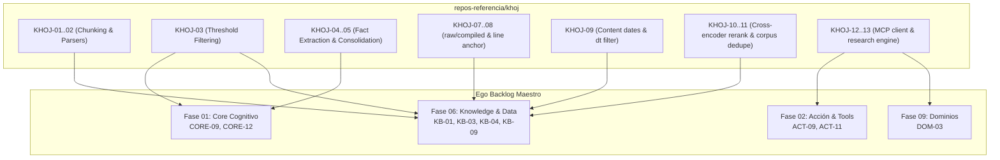

# Khoj Review & Extraction Backlog — Ego SOC #

> **Propósito:** Registro canónico y secuencial de auditoría, extracción de patrones y adaptación técnica de
> `repos-referencia/khoj` hacia el monorepo de Ego.
> **Regla de Operación:** *No copiar código directamente*. Khoj es Python FastAPI; Ego extrae únicamente la lógica
> algorítmica (chunking por límite de tokens con deduplicación, filtrado por umbral y heurísticas de extracción de
> hechos) adaptándola a TypeScript estricto sobre VantaDB nativo (BM25 Fast Path y L0-L3 Cognitive Path).
> **Esquema:** Tabla canónica de 10 columnas:
> `| ID | Severidad | Hallazgo | Archivo Khoj | Esfuerzo | Prioridad | Estado | Descripción | Relaciones | Dependencias |`

---

## 0. Verificación de estado (2026-10-20) — Ola 2 de remediación ##

Cada fila fue re-auditada contra el **código real** del clon (`ae229ca`) y contra el **código real de Ego**. Criterio
de `✅ Completada`: existe el fichero adaptado **y** hay un caller en producción (grep sobre `packages/` +
`apps/desktop/`, excluyendo `test/`, `dist/` y `node_modules/`).

| Estado | Significado canónico |
|---|---|
| `✅ Completada` | Asimilado, integrado y con **caller en producción verificado**. La celda cita la ruta real. |
| `🚫 Descartada (con justificación)` | El patrón no se aplica en Ego, fue sustituido por otro módulo canónico, o viola un guardrail. La celda contiene el motivo técnico. |
| `🆕 Pendiente` | Asimilado (el código existe y está probado) pero **sin caller en producción**. La celda dice el cableado exacto y quién lo ejecuta. |
| `⏳ Futura (fase)` | Diferido a una fase posterior, con fase destino explícita. |

**Búsquedas de verificación ejecutadas (2026-10-20):**

```text
Select-String "FactExtractor"    packages/ apps/  -> FactExtractor.ts + index.ts:8 + 2 tests (0 callers de produccion)
Select-String "consolidateMemories" packages/ apps/ -> solo FactLifecycle.ts:183 y 3 ficheros de test (0 callers)
Select-String "new DreamConsolidator|new MemoryCurator" -> solo packages/tasks/test (nunca instanciado en produccion)
Select-String "promoteFromQuarantine" apps/desktop/src -> register-ipc.ts:1390 (unica capacidad de FactLifecycle en produccion)
Select-String "ScoreThresholdFilter" packages/ -> HybridSearch.ts:2,88 + similarity.ts:81 + tests
Select-String "ScoreThresholdFilter|CosineThresholdFilter" packages/memory -> 0 (el umbral NO vive en searchMulti)
Select-String "DocumentParser|AdaptiveChunker" packages/ apps/ -> main.ts:40,214,2238 + register-ipc.ts:1340-1341
Select-String "getAtTimestamp" packages/ -> EgoMemoryAdapter.ts:1048 + version-tree.test.ts (0 callers de produccion)
```

**Reversiones de la Ola 2 (búsqueda de caller en producción):**

- `KHOJ-05` **pasa de `✅ Completada` a `🆕 Pendiente`**: la evidencia que lo sostenía era la existencia de
  `FactLifecycle.ts` y su instanciación en `main.ts`, pero el método que implementa la consolidación
  (`consolidateMemories`) **no lo invoca nadie en producción**, y el motor real de consolidación
  (`packages/tasks/src/DreamConsolidator.ts`) **nunca se instancia fuera de los tests**. La única capacidad de
  `FactLifecycle` cableada en producción es `promoteFromQuarantine` (`register-ipc.ts:1390`), que es un verbo
  distinto (promoción de cuarentena, `KB-07` / `CARP-04`) y no la consolidación por contradicciones de `KHOJ-05`.
- `KHOJ-03` **mantiene `✅ Completada`** pero con rutas corregidas: el corte se aplica en
  `packages/knowledge/src/HybridSearch.ts:88-89`, **no** en `HybridSearch.ts:55` (esa línea no existe como punto de
  aplicación) y **no** en `EgoMemoryAdapter.searchMulti` (`packages/memory/EgoMemoryAdapter.ts:682`), que devuelve
  la lista BM25 cruda sin filtrar.

**Correcciones de la ficha (`docs/extractions/khoj.md`) aplicadas en la Ola 2:**

- `CosineThresholdFilter.ts` → `ScoreThresholdFilter.ts` (ya corregido en Ola 1; se mantiene).
- `helpers.py:150-210` (`extract_facts`) → **`helpers.py:994-1034`** (`extract_facts_from_query`); las líneas
  citadas anteriormente correspondían a constantes OAuth y a `is_query_empty`, sin relación con la extracción.
- `helpers.py:220-290` (`ai_update_memories`) → **`helpers.py:1038-1066`**.
- `text_to_entries.py:45-120` → **`text_to_entries.py:60-140`** (`split_entries_by_max_tokens`).
- `text_search.py:80-140` (umbral) → **`text_search.py:113-135`** (resolución del umbral del bi-encoder).
- `routers/billing.py` (no existe) → **`routers/api_subscription.py`** para Stripe; `api_phone.py` para
  Twilio/WhatsApp; `twilio.py` y `email.py` para SMS y SMTP.
- Descripción del chunking de Khoj: el solapamiento real es `chunk_overlap=0`, el hash real es **MD5** y la
  jerarquía de encabezados se inyecta como **prefijo de texto** (no existe campo `heading_path`).
- Descripción de `extract_facts`: el esquema real de Khoj es `MemoryUpdates` con dos listas planas (`create`,
  `delete`); la "categoría, certeza e impacto temporal" es el esquema de Ego, no el de Khoj.
- Descripción de `ai_update_memories`: Khoj **borra** físicamente las memorias; el `soft-replace` con arista
  `SUPERSEDED_BY` es una mejora propia de Ego.

---

## 1. Resumen Ejecutivo de Tareas de Extracción ##

| Grupo de Trabajo | Rango IDs | Tareas | Fases de Ego Impactadas | Prioridad | Beneficio Principal |
|---|---|:---:|---|:---:|---|
| **A. Chunking & Ingesta** | `KHOJ-01..02` | 2 | Fase 06 (`KB`), Fase 01 (`CORE`) | 🟠 P1 | Chunking por límite de tokens con deduplicación por hash y metadatos de encabezado |
| **B. Búsqueda Híbrida & Umbrales** | `KHOJ-03` | 1 | Fase 06 (`KB`), Fase 01 (`CORE`) | 🟠 P1 | Filtrado de resultados semánticos por corte de umbral de similitud |
| **C. Extracción Cognitiva de Hechos** | `KHOJ-04..05` | 2 | Fase 01 (`CORE`), Fase 06 (`KB`), Fase 03 (`SUB`) | 🟠 P1 | Heurísticas estructuradas para extraer hechos persistentes de conversaciones |
| **D. Monetización & Comunicación** | `KHOJ-06` | 1 | Ego Web / Dominios, P1 | 🔵 P3 | Conectores Stripe / Twilio / SMTP (futuro) |
| **E. Procedencia y Vistas de Chunk** | `KHOJ-07..08` | 2 | Fase 06 (`KB`), P1 | 🟠 P1 | Doble vista `raw` / `compiled` y anclaje de línea de origen para cita trazable |
| **F. Ejes Temporales y Recuperación en Dos Etapas** | `KHOJ-09..11` | 3 | Fase 06 (`KB`), P1 | 🟡 P2 | Fechas del contenido con filtro `dt`, re-rank con cross-encoder y dedupe por corpus |
| **G. Herramientas y Orquestación** | `KHOJ-12..13` | 2 | Fase 02 (`ACT`), Fase 09 (`DOM`) | 🟡 P2 | Cierre de compuerta del cliente MCP y del motor de investigación iterativa |
| **TOTAL** | `KHOJ-01..13` | **13** | **Fases 01, 02, 03, 06, 09** | — | — |

**Recuento de estados (verificado programáticamente sobre las 13 filas de la tabla §2):**

| `✅ Completada` | `🚫 Descartada` | `🆕 Pendiente` | `⏳ Futura` | Total |
|:---:|:---:|:---:|:---:|:---:|
| 3 | 1 | 2 | 7 | **13** |

---

## 2. Catálogo Detallado de Extracción (10 Columnas Canónicas) ##

| ID | Severidad | Hallazgo | Archivo Khoj | Esfuerzo | Prioridad | Estado | Descripción & Adaptación en Ego | Relaciones Ego | Dependencias |
|---|---|---|---|---|---|---|---|---|---|
| `KHOJ-01` | 🟠 Alta | **Fragmentación por límite de tokens con deduplicación por hash de contenido** | `processor/content/text_to_entries.py:60-140` | 🟢 1d | 🟠 P1 | ✅ Completada | Khoj trocea con `RecursiveCharacterTextSplitter` (`chunk_size=256`, `chunk_overlap=0`, longitud contada en **palabras**) y deduplica con hash **MD5** (`text_to_entries.py:36-37`). **Corrección Ola 2:** la ficha anterior atribuía a Khoj solapamiento de 32-64 tokens, SHA-256 y tokenización TikToken; ninguna se sostiene en el código. Implementado en `packages/knowledge/src/ingest/AdaptiveChunker.ts:16,42` (que sí aplica solapamiento 32 y SHA-256 como mejora propia). Test: `packages/knowledge/test/AdaptiveChunker.test.ts`. **Evidencia:** `AdaptiveChunker` → `packages/knowledge/src/ingest/DocumentParser.ts:4,17` y `MarkdownExtractor.ts:2,19` → `apps/desktop/src/main.ts:40,2238` → `apps/desktop/src/main/ipc/register-ipc.ts:1340-1341`. | Ego: `KB-01`, `KB-02` | — |
| `KHOJ-02` | 🟡 Media | **Extractores por formato (Markdown, Org, PDF, DOCX, Plaintext, GitHub, Notion)** | `processor/content/markdown/markdown_to_entries.py`, `processor/content/pdf/pdf_to_entries.py`, `processor/content/docx/docx_to_entries.py` | 🟡 1-2d | 🟠 P1 | ✅ Completada | Normalización por formato antes del troceado; el parser Markdown trocea recursivamente por nivel de encabezado (`markdown_to_entries.py:72-142`) y PDF/DOCX usan loaders de `langchain_community`. Implementado en `packages/knowledge/src/ingest/DocumentParser.ts:12,53-71` y `MarkdownExtractor.ts:15,77-94`. Test: `packages/knowledge/test/DocumentParser.test.ts`. **Evidencia:** `apps/desktop/src/main.ts:40,2238` y `apps/desktop/src/main/ipc/register-ipc.ts:1340-1341`. **Alcance asimilado:** Markdown, texto plano, JSON y CSV; PDF y DOCX quedan fuera (el sidecar `scripts/ingest/bulk_import.py` es la vía prevista, no cableada para esos formatos). | Ego: `KB-01` | `KHOJ-01` |
| `KHOJ-03` | 🟠 Alta | **Filtrado por umbral de similitud y descarte de ruido semántico** | `search_type/text_search.py:113-135` | 🟢 1d | 🟠 P1 | ✅ Completada | Khoj resuelve el corte desde la configuración del modelo de búsqueda (`bi_encoder_confidence_threshold`, sin valor por defecto: `math.inf`); **no existe un `min_score` en el código**. En Ego: `packages/knowledge/src/filters/ScoreThresholdFilter.ts:22,27` (por defecto 0.70, modo `normalized` con normalización min-max del lote). Test: `packages/knowledge/test/ScoreThresholdFilter.test.ts`. **Evidencia:** `ScoreThresholdFilter` → `packages/knowledge/src/HybridSearch.ts:88-89` → `apps/desktop/src/main.ts:33,2231` → `apps/desktop/src/main/ipc/register-ipc.ts:1350`. **Corrección Ola 2:** el corte se aplica en `HybridSearch.ts:88-89`, no en `:55`, y **no** en `EgoMemoryAdapter.searchMulti` (`packages/memory/EgoMemoryAdapter.ts:682`), que devuelve la lista BM25 cruda. | Ego: `CORE-09`, `KB-03` | — |
| `KHOJ-04` | 🟠 Alta | **Extracción estructurada de hechos desde el último turno (`extract_facts_from_query`)** | `routers/helpers.py:994-1034` (el prompt en `processor/conversation/prompts.py`) | 🟢 1d | 🟠 P1 | 🆕 Pendiente | Khoj arma el prompt con los **dos últimos turnos** (`construct_chat_history(..., n=2)`) y las memorias existentes como `matched_facts`, y obliga a un esquema estricto `MemoryUpdates` con dos listas planas (`create`, `delete`) que degrada a vacío si el JSON no valida (`helpers.py:987-991,1032-1034`). **Corrección Ola 2:** la ficha anterior atribuía a Khoj hechos "atómicos con categoría, certeza e impacto temporal"; eso es el esquema de Ego, no el de Khoj. En Ego existe `packages/knowledge/src/extractors/FactExtractor.ts:62` (heurística determinista, triples `subject`/`predicate`/`object`) **sin consumidor**: `Select-String "FactExtractor"` sobre `packages/` + `apps/` devuelve solo el propio fichero, el re-export `packages/knowledge/src/index.ts:8` y dos tests; `FactLifecycle` (en producción) no lo invoca. **Cableado pendiente:** invocar el extractor en el post-turno (`apps/desktop/src/main.ts:1775`, `lifecycle.syncTurn`) o dentro de `FactLifecycle.consolidateMemories` — owner A2. | Ego: `CORE-12`, `KB-04` | — |
| `KHOJ-05` | 🟡 Media | **Actualización y consolidación autónoma de memorias (`ai_update_memories`)** | `routers/helpers.py:1038-1066` | 🟢 1d | 🟠 P1 | 🆕 Pendiente | Khoj compara los hechos nuevos con los existentes y **borra físicamente** las memorias marcadas para eliminar (`UserMemoryAdapters.delete_memory`), sin supersesión ni historial. **Corrección Ola 2:** la ficha anterior afirmaba que Khoj "marca el hecho previo como obsoleto" y que el patrón mapeaba 1:1 al `supersede()` de Ego; el *soft-replace* con arista `SUPERSEDED_BY` es una mejora propia de Ego. Estado real: `packages/knowledge/src/FactLifecycle.ts:117,183` existe y está probado, pero `consolidateMemories` tiene **0 callers en producción** (`Select-String "consolidateMemories"` → solo `FactLifecycle.ts:183` y tres tests) y el motor real `packages/tasks/src/DreamConsolidator.ts:274-319` **nunca se instancia fuera de `packages/tasks/test`** (`Select-String "new DreamConsolidator"` → solo tests). La única capacidad de `FactLifecycle` en producción es `promoteFromQuarantine` (`apps/desktop/src/main/ipc/register-ipc.ts:1390`), que es otro verbo (`KB-07` / `CARP-04`). **Cableado pendiente:** instanciar `DreamConsolidator` junto a `factLifecycle` (`apps/desktop/src/main.ts:2234`) y/o invocar `FactLifecycle.consolidateMemories` desde el post-turno (`main.ts:1775`) — owner A2. Test: `packages/knowledge/test/QuarantineAndLifecycle.test.ts`. | Ego: `CORE-12`, `SUB-12`, `TASK-08` | `KHOJ-04` |
| `KHOJ-06` | 🔵 Futura | **Conectores de Monetización y Comunicación de Dominio (Stripe, Twilio, SMTP)** | `routers/api_subscription.py`, `routers/api_phone.py`, `routers/twilio.py`, `routers/email.py` | 🟣 3-4d | 🔵 P3 | ⏳ Futura (P1) | Módulos para administración de suscripciones y pagos con Stripe, alertas por SMS con Twilio y correos transaccionales SMTP, tanto para Ego Web (cuentas y planes) como para productos de usuarios. **Corrección Ola 2:** el fichero `routers/billing.py` citado antes **no existe**; el módulo de Stripe es `routers/api_subscription.py`. **Motivo del diferimiento:** es dominio de **Ego Web**, no del desktop SOC; el guardrail §4 de `AGENTS.md` prohíbe contaminar el desktop con dominios ajenos y la ficha de extracción ya los marca `🚫 Descartada (con justificación)` a nivel de componente. Fase destino: P1 en `Ego-Web` / `DOM-05`, `DOM-06`. | Ego: `DOM-05`, `DOM-06`, `Ego-Web` | — |
| `KHOJ-07` | 🟡 Media | **Doble vista `raw` / `compiled` con prefijo de contexto** | `processor/content/markdown/markdown_to_entries.py:171-183` | 🟡 1-2d | 🟠 P1 | ⏳ Futura (Fase 06, P1) | Khoj guarda dos representaciones del mismo chunk: `raw` (texto original, la que se muestra y se cita) y `compiled` (texto con el nombre del fichero como encabezado `# <fichero>` y la ancestría de encabezados antepuesta, sobre la que se calcula el embedding y se busca). Ego solo tiene una vista: `DocumentChunk` (`packages/knowledge/src/schemas/knowledge.ts`) guarda `content`, y `headingPath` es un array estructurado que no se compensa con un prefijo de contexto. **Motivo del diferimiento:** requiere ampliar el esquema de chunk y el contrato de indexación (`KB-01`), con cambio de contrato en `KnowledgeIndexer`; es una capacidad nueva, no una mejora de lo ya definido. Fase destino: Fase 06 (`KB-01`), P1. | Ego: `KB-01` | `KHOJ-01` |
| `KHOJ-08` | 🟡 Media | **Anclaje de línea de origen por chunk (`file://…#line=N`)** | `processor/content/markdown/markdown_to_entries.py:169`, `processor/content/text_to_entries.py:82-109` | 🟡 1-2d | 🟠 P1 | ⏳ Futura (Fase 06, P1) | Khoj ancla cada chunk a su línea exacta en el fichero original: la línea se propaga durante el troceado (`start_line` recursivo en `markdown_to_entries.py:112,125`) y se recalcula localizando el chunk en el texto crudo (`text_to_entries.py:97-106`); el fragmento URI `file://<ruta>#line=<n>` viaja al resultado de búsqueda. Ego no guarda offsets de línea: el metadato `chunk_index` (`KnowledgeIndexer.ts:80`) permite ordenar pero no citar la línea. **Motivo del diferimiento:** requiere extender el esquema de chunk y el metadato indexado, y definir el contrato de cita en la UI. Fase destino: Fase 06 (`KB-01`), P1. | Ego: `KB-01` | `KHOJ-01` |
| `KHOJ-09` | 🟡 Media | **Extracción e indexación de fechas del contenido con filtro temporal de consulta (`dt`)** | `search_filter/date_filter.py:87-100`, `processor/content/text_to_entries.py:237-247` | 🟡 2-3d | 🟡 P2 | ⏳ Futura (Fase 06, P1) | Khoj extrae en la ingesta las fechas mencionadas en el texto (formatos estructurados y naturales) y las indexa como entradas `EntryDates` ligadas al chunk; en la consulta, un DSL `dt>=` / `dt<` sobre la query se convierte en un intervalo que acota los resultados (`date_filter.py:118-174`). Ego cubre el eje de **validez** del registro (`packages/knowledge/src/BitemporalQueries.ts:77`, `KB-09`) pero **no** extrae fechas del contenido (`KnowledgeIndexer` no las indexa) ni ofrece filtro temporal de consulta. El eje transaccional de `EgoMemoryAdapter.getAtTimestamp` (`:1048`) **no tiene caller en producción** (solo `packages/memory/test/version-tree.test.ts`) y, por semántica, no sirve de sustrato: es tiempo de transacción, no de contenido. **Motivo del diferimiento:** requiere un eje temporal tercero, con su propio esquema de metadatos y de consulta. Fase destino: Fase 06 (`KB-09`), P1. | Ego: `KB-09` | `KHOJ-01` |
| `KHOJ-10` | 🟡 Media | **Re-rank de segundo nivel con cross-encoder y orden por doble score** | `search_type/text_search.py:192-257` | 🔴 3-5d | 🟡 P2 | ⏳ Futura (Fase 06, P1) | Tras la recuperación por bi-encoder, Khoj re-puntúa cada par (consulta, chunk) con un cross-encoder servido por endpoint de inferencia y ordena por score de cross-encoder, con el de bi-encoder como desempate. Ego reordena por score del motor y aplica MMR por diversidad (`packages/knowledge/src/HybridSearch.ts:104-113`), sin re-puntuación semántica. **Motivo del diferimiento:** exige un modelo de re-puntuación y un presupuesto de inferencia que no están presupuestados en `packages/models/src/ModelRouter.ts`, y el score vectorial denso sigue pendiente de `VDB-REQ-08` (`EGO-FIND-41`). Fase destino: Fase 06 (`KB-04`), P1, condicionado a `VDB-REQ-08`. | Ego: `KB-04` | `KHOJ-03` |
| `KHOJ-11` | 🟡 Media | **Deduplicación por corpus para que un documento no monopolice el top-k** | `search_type/text_search.py:141-164` | 🟡 1d | 🟡 P2 | ⏳ Futura (Fase 06, P1) | `collate_results` descarta los hits cuyo `corpus_id` ya apareció, de modo que cada documento aporta como máximo un fragmento al resultado final, y hace lo propio con `hashed_value`. Ego no tiene esa garantía: el MMR de `HybridSearch` diversifica por **similitud** del texto, de forma que un documento con varios chunks casi idénticos puede acaparar el top-k. **Motivo del diferimiento:** requiere decisión de contrato (cuántos fragmentos por documento) y una clave de corpus en los hits, que hoy `KnowledgeIndexer` no emite. Fase destino: Fase 06 (`KB-04`), P1. | Ego: `KB-04` | `KHOJ-01` |
| `KHOJ-12` | 🟡 Media | **Cliente MCP de herramientas externas (`mcp.py`)** | `processor/tools/mcp.py:13-124` | 🟢 1d | 🟡 P2 | 🚫 Descartada (con justificación) | Envoltura fina sobre el SDK oficial de Python para MCP: selecciona transporte `stdio` o `SSE` según la ruta (`:32-37`), llama a `list_tools` (`:39-48`) y `call_tool` (`:50-67`) y normaliza el contenido tipado (`TextContent`, `AudioContent`, `ImageContent`). **Fundamento del descarte:** Ego ya consume el SDK oficial de MCP en TypeScript (`packages/integrations/src/mcp/McpClient.ts`, con `McpManager`, `SecretProxy` y puente de schemas), de modo que la envoltura no aporta ninguna capacidad que el SDK no dé; `AGENTS.md` §7 exige además que las integraciones se apoyen en el SDK oficial y que añadir una integración no toque Runtime, Router ni Sub-Egos. No procede abrir tarea. | Ego: `ACT-09`, `ACT-11` | — |
| `KHOJ-13` | 🟡 Media | **Motor de investigación iterativa multi-paso (`research.py`)** | `routers/research.py:277,476` | 🔴 3-5d | 🟡 P2 | ⏳ Futura (Fase 09, P1) | Khoj desglosa una pregunta de investigación en sub-consultas, elige la siguiente herramienta (`apick_next_tool`), sintetiza hallazgos parciales y refina la hipótesis final. Ego cubre la iteración de forma genérica (runtime de Sub-Ego → `ToolExecutionLoop`, `packages/subegos/src/SubEgoRuntime.ts:213`) y tiene el dominio Knowledge en producción (`packages/domains/src/knowledge/KnowledgeDomain.ts`, instanciado en `apps/desktop/src/main/ipc/register-ipc.ts:1588`, con `searchKnowledge`, `synthesizeBibliography` y `getGraphNeighborhood`), pero **no** existe un orquestador con descomposición explícita de la pregunta, síntesis parcial refinable y política de herramientas propia. **Motivo del diferimiento:** abrir un orquestador específico es una **capa nueva**, no una mejora de lo ya definido; por `docs/extractions/README.md` §2 (Vía 2) exige ficha en `docs/research/` y aprobación del owner antes de codificar. Fase destino: Fase 09 (`DOM-03`), P1. | Ego: `DOM-03`, `SUB-01` | `KHOJ-10` |

---

## 3. Integración en el Flujo de Construcción de Ego ##



---

## 4. Descarte a nivel de componente (matriz de la ficha `docs/extractions/khoj.md` §3) ##

Los descartes de componente ya estaban redactados en la ficha con la forma canónica
`🚫 Descartada (con justificación)`. Se reproducen aquí para que el backlog tenga el veredicto completo:

| Componente / Feature de Khoj | Archivo Fuente | Acción | Justificación Técnica |
|---|---|:---:|---|
| Scraper web y búsqueda online pesada | `processor/tools/online_search.py` | 🚫 **Descartada (con justificación)** | Fuera de alcance de P0; viola el principio local-first soberano. Las búsquedas externas en Ego se canalizan vía herramientas MCP gobernadas. |
| Ejecución arbitraria de código Python | `processor/tools/run_code.py` | 🚫 **Descartada (con justificación)** | Riesgo de seguridad severo. Ego utiliza el Execution Manager con aislamiento de procesos y aprobación HITL (`ACT-03`, `SEC-05`). |
| Backend FastAPI / Routers HTTP | `main.py`, `routers/api*.py` | 🚫 **Descartada (con justificación)** | Ego es una aplicación desktop con proceso Main Node.js 22; no requiere un servidor REST HTTP intermedio. |
| PostgreSQL, pgvector y migraciones SQL | `database/` | 🚫 **Descartada (con justificación)** | Incompatible con la arquitectura soberana local basada en VantaDB in-process (Fjall LSM). |
| Módulos Twilio, WhatsApp, Email y Stripe | `routers/twilio.py`, `routers/api_phone.py`, `routers/email.py`, `routers/api_subscription.py` | 🚫 **Descartada (con justificación)** | Contaminación de dominios ajenos (Guardrail §4 de `AGENTS.md`). Ver `KHOJ-06` para la fila de backlog asociada (diferida a Ego Web). |
| Cliente de herramientas MCP | `processor/tools/mcp.py` | 🚫 **Descartada (con justificación)** | Envoltura fina sobre el SDK oficial; Ego usa el SDK oficial en TypeScript (`packages/integrations/src/mcp/McpClient.ts`). Ver `KHOJ-12`. |

**Guardrail de embeddings (re-verificado 2026-10-20):** no hay `sentence-transformers`, `gte-small` ni cálculo de
embeddings en TypeScript en `packages/` ni en `apps/`. La inferencia densa reside exclusivamente en el subproceso
`vantadb-mcp` (capas L0-L3), conforme al guardrail de `AGENTS.md` §4.

**Guardrail de dominio (re-verificado 2026-10-20):** barrido de `twilio`, `stripe`, `smtp`,
`sentence-transformers` y `gte-small` sobre `packages/` y `apps/` → **0 casos de dominio**. Las tres coincidencias
literales de `stripe` no son contaminación: `packages/avatar/index.d.ts:66` (nombre de paleta),
`packages/avatar/vendor/coucou/core/state.ts:68` (metadato de UI vendorizado) y
`packages/security/src/SecretsFilter.ts:89` (patrón de redacción de claves Stripe). **LIMPIO.**

---

## 5. Deuda abierta derivada de esta verificación (→ handoff A5) ##

| # | Ítem | Tipo | Owner | Bloqueante |
|---|---|---|---|---|
| D1 | `KHOJ-04`: `FactExtractor` sin consumidor — la consolidación de hechos no usa el extractor | Código | A2 | No |
| D2 | `KHOJ-05`: `FactLifecycle.consolidateMemories` y `DreamConsolidator` sin caller en producción | Código | A2 | No |
| D3 | Corregir en `docs/extractions/khoj.md` las rutas `helpers.py:150-210` / `:220-290` y `text_to_entries.py:45-120` | Docs | A5 (hecho, Ola 2) | No |
| D4 | Corregir la descripción del chunking de Khoj (solapamiento, hash, tokenizer) y la de `extract_facts` | Docs | A5 (hecho, Ola 2) | No |
| D5 | Actualizar el recuento de `khoj` en `docs/extractions/README.md` §4.1 y en `docs/roadmap/Backlog.md` (6 → 13 tareas) | Docs | A5 | No |
