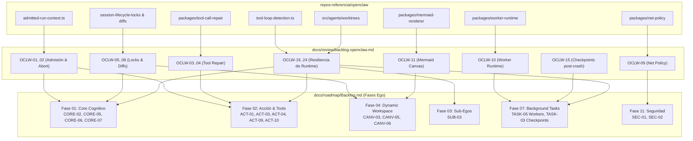

# OpenClaw Review & Extraction Backlog — Ego SOC #

> **Propósito:** Registro canónico y secuencial de auditoría, extracción de patrones y adaptación
> técnica de `repos-referencia/openclaw` hacia el monorepo de Ego.
> **Regla de Operación:** *No copiar código directamente*. Extraer la lógica de diseño, contratos y
> patrones arquitectónicos en TypeScript nativo, apoyándose en VantaDB como sustrato de memoria y
> Electron IPC para la UI.
> **Esquema:** Tabla canónica de 10 columnas: `ID`, `Severidad`, `Hallazgo`, `Archivo OpenClaw`,
> `Esfuerzo`, `Prioridad`, `Estado`, `Descripción & Adaptación en Ego`, `Relaciones Ego`,
> `Dependencias`.

---

## 0. Verificación de estado (2026-10-20) — Ola 2 de remediación ##

Cada fila fue re-auditada contra el **código real** tras los cambios de A2/A3 y, el 2026-10-20,
contra el **clon en profundidad 1** de `repos-referencia/openclaw`. Criterio de `✅ Completada`:
existe el fichero adaptado **y** hay un caller en producción (grep sobre `packages/` +
`apps/desktop/`, excluyendo `test/`, `dist/` y `node_modules/`).

| Estado | Significado canónico |
|---|---|
| `✅ Completada` | Asimilado, integrado y con **caller en producción verificado**. La celda cita la ruta real. |
| `🚫 Descartada (con justificación)` | El patrón no se aplica en Ego, fue sustituido por otro módulo canónico, o viola un guardrail. La celda contiene el motivo técnico. |
| `🆕 Pendiente` | Asimilado (el código existe y está probado) pero **sin caller en producción**, o **aún no asimilado**. La celda dice el cableado exacto y quién lo ejecuta. |
| `⏳ Futura (fase)` | Diferido a una fase posterior, con fase destino explícita. |

**Búsquedas de verificación ejecutadas** (resultado recogido en la columna *Evidencia* de cada fila):

```text
Select-String "HotReload|FileWatcher"  packages/                       -> 0 coincidencias (OCLW-16/17: los ficheros NO existen)
Select-String "NetPolicy"               packages/ apps/                 -> canónica única en packages/security/src/ssrfPolicy.ts
Select-String "TaskCheckpointManager"   apps/desktop/src/main.ts        -> main.ts:53, 225, 2248, 2263-2264 (OCLW-15)
Select-String "createWorktree|finalizeWorktree" packages/ apps/          -> 0 callers de producción (OCLW-21)
Select-String "getWorkerTaskPool("      packages/ apps/                 -> 0 llamadas (OCLW-10: el pool nunca recibe trabajo)
```

**Cambios de estado de la revisión del 2026-10-20:**

| ID | Antes | Ahora | Motivo |
|---|:---:|:---:|---|
| `OCLW-09` | 🆕 Pendiente | ✅ Completada | La "divergencia" ya no existe: la Ola 1b unificó la política SSRF en `packages/security/src/ssrfPolicy.ts`; `packages/tools/src/native/security/NetPolicy.ts` es un reexport puro y la fachada `packages/security/src/netPolicy.ts` delega en la canónica. Hay caller de producción. |
| `OCLW-10` | ✅ Completada | 🆕 Pendiente | El puerto de Ego (`packages/tasks/src/WorkerTaskPool.ts`) declara en su propio encabezado que **NO usa `worker_threads`**; `getWorkerTaskPool()` tiene 0 llamadas, así que el patrón de origen (aislamiento real de CPU) no está asimilado. |
| `OCLW-14` | 🆕 Pendiente | 🚫 Descartada (con justificación) | El `ToolExecutionLoop` ya emite `tool.started` / `tool.executed` / `tool.failed` en el `EventBus`, y el bus retransmite al renderer por `ipc.event`. `ToolActivityEmitter` sería un segundo emisor de los mismos tipos canónicos. |

---

## 1. Resumen Ejecutivo de Tareas de Extracción ##

| Grupo de Trabajo | Rango IDs | Tareas | Fases de Ego Impactadas | Prioridad | Beneficio Principal |
|---|---|:---:|---|:---:|---|
| **A. Gobernanza & Admisión** | `OCLW-01..02` | 2 | Fase 01 (`CORE`), Fase 02 (`ACT`) | 🔴 P0 | Contexto inmutable de runs y cancelación nativa con `AbortSignal` |
| **B. Resiliencia de Tools** | `OCLW-03..04` | 2 | Fase 02 (`ACT`) | 🔴 P0 | Auto-reparación de JSON malformado emitido por modelos pequeños |
| **C. Sesiones & Diffs** | `OCLW-05..08` | 4 | Fase 01 (`CORE`), Fase 02 (`ACT`), Fase 04 (`CANV`) | 🟠 P1 | Locks atómicos de sesión, paginación y seguimiento de diffs |
| **D. Seguridad, Workers & Canvas** | `OCLW-09..14` | 6 | Fase 04 (`CANV`), Fase 07 (`TASK`), Fase 11 (`SEC`) | 🟠 P1 | Protección anti-SSRF, worker threads y Mermaid para Canvas |
| **E. Checkpoints, Hot-Reload & Watcher** | `OCLW-15..17` | 3 | Fase 07 (`TASK`), Fase 02 (`ACT`) | 🟠 P1 | Puntos de control post-crash; hot-reload y file watcher (descartados) |
| **F. Mensajería Externa** | `OCLW-18` | 1 | Fase 11 (`SEC`), P1 | 🔵 P3 | Bot de mensajería cifrado (futuro) |
| **G. Resiliencia de Runtime (Ola 2)** | `OCLW-19..24` | 6 | Fase 02 (`ACT`), Fase 03 (`SUB`), Fase 07 (`TASK`) | 🔴 P0 | Detección de bucles, cuarentena de tools, worktrees, carreras con abort, compactación adaptativa y reparación de transcripción |
| **TOTAL** | `OCLW-01..24` | **24** | **Fases 01, 02, 03, 04, 07, 10, 11** | — | — |

**Recuento de estados (verificado programaticamente sobre las 24 filas de la tabla §2):**

| `✅ Completada` | `🚫 Descartada` | `🆕 Pendiente` | `⏳ Futura` | Total |
|:---:|:---:|:---:|:---:|:---:|
| 7 | 5 | 11 | 1 | **24** |

---

## 2. Catálogo Detallado de Extracción (10 Columnas Canónicas) ##

| ID | Severidad | Hallazgo | Archivo OpenClaw | Esfuerzo | Prioridad | Estado | Descripción & Adaptación en Ego | Relaciones Ego | Dependencias |
|---|---|---|---|---|---|---|---|---|---|
| `OCLW-01` | 🔴 Crítica | **Contexto inmutable de admisión `admitted-run-context.ts`** | `src/agents/admitted-run-context.ts` | 🟢 1d | 🔴 P0 | ✅ Completada | Extraer la arquitectura de tokens de admisión inmutables (`AdmittedRunContext`, `OperationalRunInstanceRef`) para trazar `runId`, `instanceId` y auditoría en cada turno del Cognitive Runtime. Implementado en `packages/execution/src/AdmittedRunContext.ts:7,27,175` con propagación en `ExecutionManager`. **Evidencia:** caller de producción en `packages/decision/src/schemas/intent.ts:2,11` (importa `validateAdmittedRunContext` y `toDecisionRunContext` de `@ego/execution`), `packages/execution/src/ExecutionManager.ts:253,270,293,330` y `apps/desktop/src/main.ts:1508,1543`. | Ego: `ACT-01`, `ACT-03` · Extracción: `docs/extractions/openclaw.md` §Bloque A | — |
| `OCLW-02` | 🔴 Crítica | **Propagación de autoridad y `AbortSignal` en ejecuciones** | `src/agents/admitted-run-context.ts` | 🟢 0.5d | 🔴 P0 | ✅ Completada | Extraer el patrón de propagación de `AbortSignal` en cancelaciones operativas implementado en `ExecutionManager.ts` con cancelación cooperativa y límites de tiempo. **Evidencia:** `apps/desktop/src/main.ts:265` (`llmAbortControllers`), `:1464` (alta por turno), `:1827` (baja), handler `ipc.llm.cancel` en `apps/desktop/src/main/ipc/register-ipc.ts:517`, `packages/execution/src/ExecutionManager.ts:171-176,276` y `packages/execution/src/ApprovalEngine.ts:295-330`. | Ego: `CORE-02`, `ACT-03` | `OCLW-01` |
| `OCLW-03` | 🔴 Crítica | **Motor de auto-reparación de Tool Calls (`tool-call-repair`)** | `packages/tool-call-repair/` | 🟡 1-2d | 🔴 P0 | ✅ Completada | Extraer el paquete de auto-reparación de llamadas a herramientas malformadas producidas por modelos LLM (JSON truncado, comillas rotas, parámetros mal convertidos) sin quemar turnos extra. Implementado en el paquete `@ego/tool-call-repair`. **Evidencia:** `packages/tool-call-repair/src/ToolCallRepairEngine.ts:23` importado en `packages/runtime/src/ToolExecutionLoop.ts:19` y usado en `:368`, `:375`, `:443` -> `apps/desktop/src/main.ts:19` (import de `@ego/runtime`) y `:2518` (`new ToolExecutionLoop`). Atribución de upstream en `packages/tool-call-repair/src/grammar.ts:3`. | Ego: `ACT-01`, `ACT-09` (RFC-OCLW-01) | — |
| `OCLW-04` | 🟠 Alta | **Heurísticas de normalización de argumentos de herramientas** | `packages/tool-call-repair/src/` | 🟢 1d | 🔴 P0 | ✅ Completada | Extraer normalizadores deterministas que corrigen esquemas de argumentos (ej. convertir strings numéricos a enteros, arrays unielemento) antes de ejecutar el validador Zod. Implementado en `@ego/tool-call-repair/src/coercion.ts`. **Evidencia:** `normalizeToolArguments` (`coercion.ts:63`) importado por `packages/tool-call-repair/src/ToolCallRepairEngine.ts:3` y usado en `:31`, `:46`, `:58`, `:114` -> mismo caller en producción que `OCLW-03`. | Ego: `ACT-01` | `OCLW-03` |
| `OCLW-05` | 🟠 Alta | **Locks atómicos por sesión `session-lifecycle-locks.ts`** | `src/sessions/session-lifecycle-locks.ts` | 🟢 0.5d | 🔴 P0 | 🚫 Descartada (con justificación) | el módulo `packages/memory/SessionLifecycleLocks.ts:23` **no tiene caller funcional**: solo se cita como **string** en el manifiesto del Canvas (`apps/desktop/renderer/components/canvas/WorkbenchView.tsx:88`), y con una ruta **obsoleta** (`packages/memory/src/SessionLifecycleLocks.ts`) que no existe (los ficheros de `@ego/memory` viven en la raíz del paquete). La exclusión mutua de sesión en producción la dan `packages/memory/SessionCheckpointPolicy.ts` (fail-closed) y `packages/memory/SessionFork.ts`. Un tercer mecanismo de lock de sesión sería una tercera fuente de verdad sobre la secuencia de turnos. **Acción:** corregir la ruta del manifiesto del Canvas (owner A4) y no cablear el módulo standalone. | Ego: `CORE-07`, `REC-01` | — |
| `OCLW-06` | 🟠 Alta | **Ventanas deslizantes de lectura `transcript-read-window.ts`** | `src/sessions/transcript-read-window.ts` | 🟢 1d | 🔴 P0 | 🆕 Pendiente | asimilado en `packages/memory/TranscriptReadWindow.ts:38` **sin caller en producción** (única referencia: el re-export `packages/memory/index.ts:14`). **Cableado pendiente:** usarlo al leer turnos de sesión para el compositor en `packages/memory/EgoMemoryAdapter.ts` (owner A2) en lugar de cargar el historial completo. | Ego: `CORE-05`, `CORE-07` | — |
| `OCLW-07` | 🟠 Alta | **Grafo de seguimiento de revisiones y diffs acumulados** | `src/sessions/session-diff-revisions.ts` | 🟡 1-2d | 🟠 P1 | 🆕 Pendiente | asimilado en `packages/tools/src/native/git/SessionDiffRevisions.ts:41` **sin caller en producción** (única referencia: el re-export `packages/tools/src/native/index.ts:34`; la clase nunca se instancia). **Cableado pendiente:** exponer el diff acumulado por sesión desde `packages/tools/src/native/git/NativeGitTool.ts` (owner A3) para alimentar el panel de revisión del Canvas (`CANV-06`). | Ego: `ACT-10`, `CANV-06` (RFC-OCLW-02) | — |
| `OCLW-08` | 🟡 Media | **Parser determinista de parches unificados `session-diff-parser.ts`** | `src/sessions/session-diff-parser.ts` | 🟢 1d | 🟠 P1 | ✅ Completada | Extraer parser de diffs Git y unidiff para formatear y colorear cambios de código antes de enviarlos a previsualización en el Canvas. Implementado en `packages/tools/src/native/git/GitParser.ts:39`. **Evidencia:** `GitParser` -> `NativeGitTool.ts:6,51,95` -> `packages/tools/src/native/index.ts:32` -> `apps/desktop/src/main.ts:2148` (`registerNativeTools`). | Ego: `ACT-04`, `CANV-02`, `CANV-06` | `OCLW-07` |
| `OCLW-09` | 🔴 Crítica | **Política de seguridad de red anti-SSRF `net-policy`** | `packages/net-policy/` | 🟢 1d | 🔴 P0 | ✅ Completada | **la divergencia que este backlog declaraba ya no existe:** la Ola 1b unificó la política en una sola implementación, `packages/security/src/ssrfPolicy.ts:67` (`export class NetPolicy`); `packages/tools/src/native/security/NetPolicy.ts:37-41` es un **reexport puro** y `packages/security/src/netPolicy.ts:10,19,35` es una fachada de compatibilidad que delega en la canónica. **Evidencia (caller de producción):** `packages/integrations/src/mcp/types.ts:1,314,350` (`NetPolicy.validateUrl` y `NetPolicy.validateUrlWithDns`), `apps/desktop/src/main/security/electron-security.ts:14,305` (`validateSSRFUrl`) y `apps/desktop/src/main.ts:2539` (`evaluateToolCall` -> `packages/security/src/ToolPermissions.ts:23,248`). | Ego: `SEC-01`, `SEC-02` | — |
| `OCLW-10` | 🟠 Alta | **Runtime de Workers en Node.js `worker-runtime`** | `packages/worker-runtime/`, `src/infra/worker-task-pool.ts` | 🟡 1-2d | 🟠 P1 | 🆕 Pendiente | **asimilación degradada:** `packages/tasks/src/WorkerTaskPool.ts:78` es en realidad `LocalTaskPool` y su encabezado (líneas 60-77) declara que **NO usa `node:worker_threads`** ni aporta paralelismo real (`WorkerTaskPool:297` es un alias de retrocompatibilidad). En producción se instancia (`apps/desktop/src/main.ts:2295`) y se termina (`:2875`), pero `getWorkerTaskPool()` (`:774`) tiene **0 llamadas**: nadie le despacha trabajo. **Cableado pendiente:** que `packages/tasks/src/BackgroundEngine.ts` y `packages/tasks/src/ProactivityEngine.ts` despachen al pool (owner A3/A4); para CPU-bound real hace falta `worker_threads` con payloads serializables, fuera de este pool (ver deuda D5). | Ego: `TASK-05` (RFC-OCLW-03) | — |
| `OCLW-11` | 🟡 Media | **Renderizado y validación reactiva de diagramas Mermaid** | `packages/mermaid-renderer/` | 🟢 1d | 🟠 P1 | 🆕 Pendiente | asimilado en `packages/ui-runtime/src/MermaidRenderer.ts:47` **sin caller en producción** (única referencia: el re-export `packages/ui-runtime/src/index.ts:8`). **Cableado pendiente:** registrar Mermaid como componente del Canvas en `packages/ui-runtime/src/ComponentRegistry.ts` y `apps/desktop/renderer/components/canvas/registry.ts` (`CANV-03` / `CANV-05`) — owner A3/A4. | Ego: `CANV-03`, `CANV-05` | — |
| `OCLW-12` | 🟡 Media | **Compilación de formularios interactivos `structured-input.ts`** | `src/agents/harness/structured-input.ts` | 🟢 1d | 🟠 P1 | 🚫 Descartada (con justificación) | el formulario de entrada estructurada al usuario **ya existe en producción y es otro**: `packages/execution/src/WidgetHitlBridge.ts` (puente HITL, importado en `apps/desktop/src/main.ts:20`), `apps/desktop/renderer/components/tools/ApprovalCard.tsx:31` (tarjeta de aprobación) y `apps/desktop/renderer/components/assistant-ui/ask-directive.tsx` (directiva interactiva). `packages/runtime/src/StructuredInput.ts:62` quedaría como un **segundo generador de esquemas** de entrada sin destino de consumo (sólo referenciado por el re-export `packages/runtime/src/index.ts:5`); la granularidad de aprobación por tool call (guardrail §6 de gobernanza) la impone el `ApprovalEngine`, no un harness de formularios. | Ego: `ACT-04` | — |
| `OCLW-13` | 🟡 Media | **Mecanismo de detección y auto-recuperación de proceso** | `src/entry.respawn.ts`, `node-runtime-recovery.mjs` | 🟢 1d | 🟠 P1 | 🆕 Pendiente | asimilado en `packages/recovery/src/ProcessSupervisor.ts:20` **sin caller en producción** (única referencia: el re-export `packages/recovery/src/index.ts:9`). **Cableado pendiente:** el respawn con preservación de estado debe vivir en el arranque de Electron (`apps/desktop/src/main.ts`, owner A4), donde ya existe `packages/recovery/src/CrashRecoveryEngine.ts`; el supervisor de proceso se cablea como capa de re-spawn, no como módulo suelto. | Ego: `REC-02`, `REC-03` | — |
| `OCLW-14` | 🟡 Media | **Despachador tipado de actividad de herramientas** | `src/infra/agent-activity-events.ts` | 🟢 0.5d | 🟡 P2 | 🚫 Descartada (con justificación) | `packages/events/src/ToolActivityEmitter.ts:52` sólo se referencia en el re-export `packages/events/src/index.ts:5`. **Motivo:** el patrón ya está cubierto en producción por el propio loop, que emite `tool.started` (`packages/runtime/src/ToolExecutionLoop.ts:404,869`), `tool.executed` (`:727,911`) y `tool.failed` (`:117,417,452,749,934`) directamente en el `EventBus`, y el bus retransmite al renderer por `ipc.event` (`apps/desktop/src/main.ts:2755-2758`). `ToolActivityEmitter` emitiría los **mismos tipos canónicos** sobre el mismo bus, es decir una **segunda fuente de verdad** para el mismo evento. Sólo `tool.patch_summary` es propio: si el Canvas lo necesita, se añade un tipo de evento al bus, no un segundo emisor. | Ego: `CANV-08`, `TASK-02` | — |
| `OCLW-15` | 🔴 Crítica | **Puntos de control de tarea con reanudación post-crash** | `src/agents/main-session-recovery/main-session-recovery-checkpoint.ts` | 🟢 1d | 🔴 P0 | ✅ Completada | *Fila creada 2026-10-19* (el ID estaba referenciado en `docs/roadmap/Backlog.md:317` y en el plan de Fase 07 pero **no tenía fila en este backlog**). Implementado en `packages/tasks/src/TaskCheckpoint.ts` (`TaskCheckpointManager:16`, checksum SHA-256 en `:25`, namespace `tasks/<taskId>/checkpoints`). **Evidencia:** `apps/desktop/src/main.ts:53` (import), `:225` (instancia), `:2248` (construcción), `:2263-2264` (`loadLatestCheckpoint`); `TASK-03` y `TASK-10` en `docs/roadmap/Backlog.md` marcados Completada con esta compuerta. **Ruta de origen corregida:** el path `snapshots/session/` citado en la Ola 1 **no existe** en el clon. | Ego: `TASK-03`, `TASK-10` · Ver: `docs/engineering/testing-e2e.md:152` | — |
| `OCLW-16` | 🟠 Alta | **Carga y Recarga en Caliente de Herramientas (`Hot-Reloading Tools`)** | `src/gateway/config-reload.ts`, `src/config/source-file.ts` | 🟡 1-2d | 🟠 P1 | 🚫 Descartada (con justificación) | **el fichero `packages/tools/src/HotReloadToolLoader.ts` nunca existió** (verificado: `Select-String "HotReload"` sobre `packages/` -> 0 coincidencias; el backlog lo declaraba "Completada" — falso verde). **Matiz re-verificado el 2026-10-20:** el clon **sí** tiene hot-reload, pero de **configuración**, no de código de tools (`src/gateway/config-reload.ts:1434`, `src/config/source-file.ts:293,312`); la ruta de origen citada antes (`src/tools/dynamic-loader.ts`) **no existe**. **Motivo técnico:** el catálogo de tools de Ego es código embebido y versionado con la app (`packages/tools/src/native/index.ts` -> `registerNativeTools` en `apps/desktop/src/main.ts:2148`); recargar tools en caliente exigiría invalidar los contratos Zod ya cacheados, re-registrar en `ToolRegistry` y **re-validar permisos** en `@ego/security/ToolPermissions` (superficie de ataque y de gobernanza) para un beneficio marginal en un desktop local-first. **Alternativa ya presente:** las skills de usuario se re-escanean en arranque (`SkillScanner`, `main.ts:2198`) y una skill nueva se activa reiniciando la app. | Ego: `ACT-01`, `ACT-11` | — |
| `OCLW-17` | 🟠 Alta | **Observador de Archivos en Tiempo Real (`File Watcher` Reactivo)** | `src/infra/file-watch-notifier.ts` | 🟢 1d | 🟠 P1 | 🚫 Descartada (con justificación) | **el fichero `packages/tools/src/WorkspaceFileWatcher.ts` nunca existió** (verificado: `Select-String "FileWatcher"` sobre `packages/` -> 0 coincidencias; el backlog lo declaraba "Completada" — falso verde). **Ruta de origen corregida:** `src/infra/file-watcher.ts` tampoco existe; el fichero real del clon es `src/infra/file-watch-notifier.ts`. **Motivo técnico:** la reactividad de archivo ya la cubre `packages/tasks/src/ProactivityEngine.ts` con `fs.watch` (owner A3, Ola 1) y el Canvas refresca por acción del usuario; un watcher global de workspace en `@ego/tools` sería una **segunda ruta de invalidación** del Canvas. **Nota:** si `CANV-06` (diff acumulado en vivo) lo exige, se implementa **dentro de `OCLW-07`** (`SessionDiffRevisions`), no como módulo aparte. | Ego: `CANV-04`, `CANV-06` | `OCLW-07` |
| `OCLW-18` | 🔵 Futura | **Adaptadores de Mensajería Externa (WhatsApp & Telegram Bots)** | `extensions/whatsapp/`, `extensions/telegram/` | 🟣 3-4d | 🔵 P3 | ⏳ Futura (P1) | Conectores para orquestar y consultar a los Sub-Egos de Ego mediante bots de mensajería cifrados. **Rutas de origen corregidas:** los adaptadores viven como **plugins** en `extensions/whatsapp/` y `extensions/telegram/`; los paths citados en la Ola 1 (`src/channels/whatsapp/`, `src/channels/telegram/`) tienen 0 ficheros. **Motivo del diferimiento:** exige un canal de red saliente y credenciales por canal, incompatibles con el modelo *local-first soberano* del desktop (principios 1 y 8) sin una capa de relay stateless que Ego todavía no tiene (el patrón de relay está especificado en `docs/extractions/coucou.md` §36 pero sin implementación). Fase destino: P1 (`INT-05`, `DOM-04`). | Ego: `INT-05`, `DOM-04` | — |
| `OCLW-19` | 🔴 Crítica | **Detección de bucle de herramienta por no-progreso (`tool-loop-detection`)** | `src/agents/tool-loop-detection.ts`, `src/agents/tool-loop-no-progress.ts` | 🟡 1-2d | 🔴 P0 | 🆕 Pendiente | **aún no asimilado.** El clon no corta la repetición de una tool por *fallos*, la corta por *ausencia de progreso*: seis detectores (repetición genérica, argument churn, tool desconocida repetida, poll sin progreso, circuit breaker global, ping-pong) sobre el hash del outcome, con umbrales escalonados 10/20/30. **Ego no lo tiene:** `packages/execution/src/CircuitBreaker.ts` cuenta **fallos consecutivos** y `packages/decision/src/LoopBreaker.ts` corta **ciclos de delegación**; ninguno detecta repetición **semántica** de la misma tool sin progreso — precisamente el fallo típico de los modelos locales que Ego ejecuta. **Cableado pendiente:** detector sobre el historial de tool calls en `packages/runtime/src/ToolExecutionLoop.ts` (owner A2). | Ego: `ACT-09`, `CORE-06` | — |
| `OCLW-20` | 🟠 Alta | **Cuarentena de esquemas de tool no soportados (`tool-schema-quarantine`)** | `src/agents/tool-schema-quarantine.ts`, `src/agents/tool-schema-quarantine-health.ts` | 🟡 1-2d | 🟠 P1 | 🆕 Pendiente | **aún no asimilado.** Cuando el proveedor rechaza una forma concreta de schema, el clon **pone esa tool en cuarentena** con un diagnóstico fiable y la recupera después, en lugar de tumbar la llamada completa; la cuarentena se persiste y es observable. **Ego:** `packages/tools/src/ToolRegistry.ts:156` (`validateInput`) valida contra el contrato Zod pero no aísla la tool, de modo que un schema no soportable puede invalidar el turno entero. **Cableado pendiente:** cuarentena por herramienta en `packages/tools/src/ToolRegistry.ts` + emisión del diagnóstico en `packages/events` (owner A3). | Ego: `ACT-01`, `ACT-04` | — |
| `OCLW-21` | 🔴 Crítica | **Ciclo de vida de worktrees con capacidad, leases y GC** | `src/agents/worktrees/` | 🟡 1-2d | 🔴 P0 | 🆕 Pendiente | **asimilado a medias y sin caller:** Ego tiene `packages/subegos/src/SubEgoWorktree.ts`, pero `createWorktree:139` y `finalizeWorktree:187` **no tienen caller de producción** (verificado: sólo `pruneOrphanWorktrees` desde `apps/desktop/src/main.ts:1281-1282` y `listWorktrees` desde `apps/desktop/src/main/ipc/register-ipc.ts:1654`), de modo que el aislamiento de Sub-Egos está implementado y desconectado. El clon añade las tres piezas que hacen el ciclo seguro: **capacidad** (reserva/liberación con reintento diferido, `capacity.ts:22`), **lease por run** (`run-lease.ts`) para que el GC no pode un worktree en uso, y **GC con límites y protección de propietario** (`gc-limits.ts`, `owner-protection.ts`, `gc-removal.ts`). **Cableado pendiente:** invocar `createWorktree` al delegar en un Sub-Ego de ingeniería y `finalizeWorktree` al cerrar (owner A3, ver deuda D6). | Ego: `SUB-03`, `CANV-06` | — |
| `OCLW-22` | 🟠 Alta | **Primitivas de carrera con `AbortSignal` y timeout acotado (`packages/retry`)** | `packages/retry/src/index.ts` | 🟢 0.5d | 🟠 P1 | 🆕 Pendiente | **aún no asimilado.** `racePromiseWithAbortSignal:9` y `raceWithTimeout:48` resuelven de forma uniforme el patrón "promesa que debe abortar o caducar", con `cause` preservado, `unref` del timer, límite duro de timer (`:1`) y limpieza del listener de abort. **Ego:** `packages/execution/src/ExecutionManager.ts:171-176` crea e inyecta el `AbortController`, pero no existe una primitiva única de carrera con abort + timeout (grep `raceWithTimeout\|racePromise` en `packages/` -> 0), de modo que cada consumidor reimplementa la carrera a mano. **Cableado pendiente:** primitiva compartida en `@ego/execution` usada por `ExecutionManager`, `ApprovalEngine` y `ToolExecutionLoop` (owner A2). | Ego: `ACT-03`, `CORE-02` | `OCLW-02` |
| `OCLW-23` | 🟠 Alta | **Planificación adaptativa de compactación por chunks (`compaction-planning`)** | `src/agents/compaction-planning.ts`, `src/agents/compaction-planning-worker.ts` | 🟡 1-2d | 🟠 P1 | 🆕 Pendiente | **aún no asimilado.** El clon decide entre resumir de una vez o dividir el historial en chunks con tamaño adaptativo (ratio base 0.4, mínimo 0.15, `SAFETY_MARGIN` 1.2, `SUMMARIZATION_OVERHEAD_TOKENS` 4096), proyecta lo omitido y delega el cómputo a un worker. **Ego:** `packages/runtime/src/ContextCompaction.ts:531` (`planCompaction`) hace un único poda head/tail con umbrales fijos, de modo que con historiales largos se pierde contexto útil por el resumen único y el cómputo bloquea el hilo de Electron. **Cableado pendiente:** extender `planCompaction` con modo *split* y ejecutar la proyección vía `packages/tasks/src/WorkerTaskPool.ts` (owner A2/A3). | Ego: `CORE-05`, `TASK-05` | `OCLW-10` |
| `OCLW-24` | 🟠 Alta | **Reparación de transcripción y emparejamiento `tool_use`↔`tool_result`** | `src/agents/session-transcript-repair.ts` | 🟡 1-2d | 🟠 P1 | 🆕 Pendiente | **aún no asimilado.** `repairToolUseResultPairing` y `stripToolResultDetails` reparan bloques `tool_result` huérfanos (sin su `tool_use` correspondiente) que un proveedor estricto rechaza; se aplican antes de compactar (`compaction-planning.ts:9,295`), en el safeguard de compactación (`agent-hooks/compaction-safeguard.ts:45`) y en el replay del historial (`embedded-agent-runner/replay-history.ts:49,631`). **Ego:** `packages/tool-call-repair` (RFC-OCLW-01) repara **JSON malformado**, no el **emparejamiento** de bloques de tool; grep `tool_result\|pairing` en `packages/` sólo devuelve sanitización de contenido. Un `tool_result` huérfano invalida la llamada completa en proveedores estrictos. **Cableado pendiente:** reparación de emparejamiento antes de compactar y reenviar en `packages/runtime/src/ContextCompaction.ts` (owner A2). | Ego: `ACT-09`, `CORE-05` | `OCLW-23` |

---

## 3. Integración en el Flujo de Construcción de Ego ##

El catálogo `OCLW-*` se enlaza directamente con los hitos del Backlog Maestro de Ego:



### Protocolo de Extracción por Tarea ###

1. **Lectura directa en TypeScript:** al ser TypeScript nativo, verificar contratos de tipos con `pnpm --filter
   @ego/desktop build`.
2. **Desacoplar de SQLite:** conectar todas las operaciones de almacenamiento a las llamadas correspondientes en
   `EgoMemoryAdapter` (VantaDB).
3. **Validar IPC:** asegurar que ningún objeto de contexto interno de Node se exponga directamente al Renderer sin
   serialización tipada.
4. **Cierre de compuerta (2026-10-19, re-verificado 2026-10-20):** una fila solo pasa a `✅ Completada` cuando existe el
   fichero adaptado **y** un caller en producción verificado por grep. Un fichero ausente **nunca** se cierra como
   Completada: se cierra como `🚫 Descartada (con justificación)` o como `🆕 Pendiente` con el cableado exacto.
5. **Ruta de origen verificable (2026-10-20):** la columna *Archivo OpenClaw* debe apuntar a un fichero que **existe en
   el clon**. Ocho rutas del backlog de la Ola 1 eran incorrectas (`src/tools/dynamic-loader.ts`,
   `src/infra/file-watcher.ts`, `src/infra/agent-activity-events.js`, `snapshots/session/`, `src/channels/whatsapp/`,
   `src/channels/telegram/`) y se han corregido.

---

## 4. Deuda abierta derivada de esta verificación (→ handoff A5) ##

| # | Ítem | Tipo | Owner | Bloqueante |
|---|---|---|---|---|
| D1 | `OCLW-16` / `OCLW-17`: eliminar toda referencia residual a `HotReloadToolLoader` / `WorkspaceFileWatcher` si aparece en otro doc de `docs/roadmap/` | Docs | A1 | No |
| D2 | `OCLW-09`: **cerrado el 2026-10-20** — la consolidación de la política SSRF en una sola implementación (`packages/security/src/ssrfPolicy.ts`) ya está hecha; queda sólo sincronizar la nota de deuda | Docs | A1 | No |
| D3 | `OCLW-05`: corregir la ruta obsoleta `packages/memory/src/SessionLifecycleLocks.ts` del manifiesto del Canvas | Código | A4 | No |
| D4 | `OCLW-13`: decidir si el respawn de proceso vive en `packages/recovery` o en el arranque de Electron | Decisión | A4 | Sí (bloquea el cableado) |
| D5 | `OCLW-10`: los handlers del pool actual no son transferibles entre hilos; definir el contrato serializable para `worker_threads` reales | Decisión | A3/A4 | Sí (bloquea `TASK-05`) |
| D6 | `OCLW-21`: el aislamiento de Sub-Egos no es funcional hasta que `createWorktree` tenga caller; definir el punto de cableado en la delegación | Decisión | A3 | Sí (bloquea `CANV-06`) |
| D7 | `OCLW-19..24`: los seis hallazgos nuevos no tienen tarea en `docs/roadmap/Backlog.md`; requieren promoción explícita del owner (protocolo de Vía 2 de `docs/extractions/README.md` §1) | Decisión | Owner | Sí (bloquea el cableado) |
