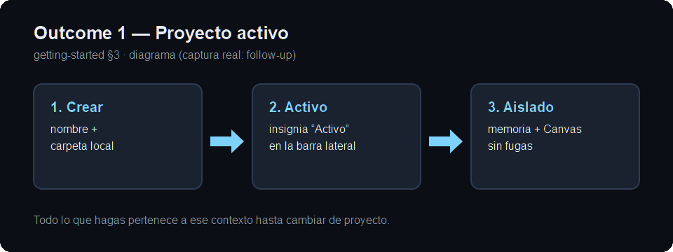
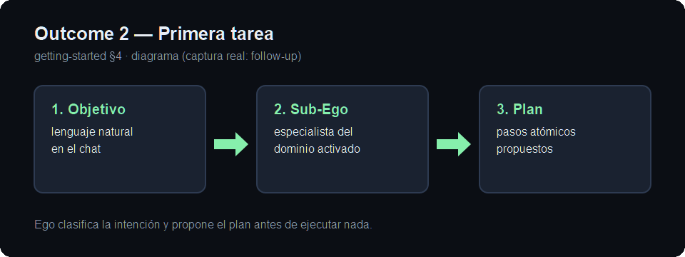
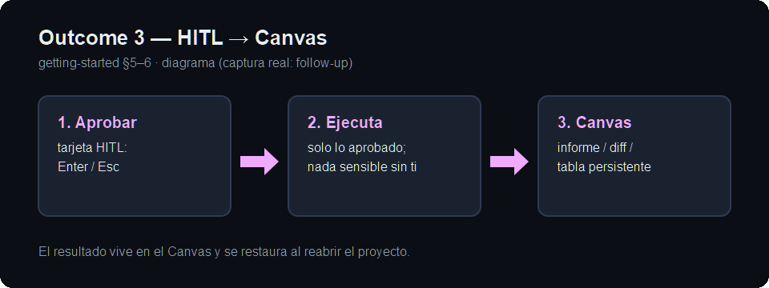

# Primeros pasos con Ego

## 1. Abrir Ego

Abre la aplicación Ego instalada en tu equipo. En el primer arranque,
Ego abre su base de memoria local (VantaDB) y muestra el Estado
Dinámico del Proyecto: qué pasó, qué está en curso, qué necesita tu
atención y qué conviene hacer hoy.

Si al abrir ves el chat vacío en lugar del Estado Dinámico, no perdiste
nada: la persistencia de sesión es complementaria y puedes retomar
desde el historial de sesiones de la barra lateral.

## 2. Conectar un modelo (obligatorio para trabajar)

Sin modelo configurado, Ego opera en modo `mock` (respuestas
deterministas, sin inferencia real). Para trabajo real configura un
proveedor en Configuración (engranaje de la barra lateral). Tienes dos
vías:

- **Nube con tu propia key (BYOK):** OpenAI, Anthropic, Google o
  DeepSeek. Pega la key del proveedor que elijas y selecciona ese
  proveedor como activo.
- **Local sin keys:** Ollama corriendo en tu máquina
  (`http://localhost:11434` por defecto). No requiere API key.

Detalle completo en [Configuración de modelos](./configuration.md).

## 3. Crear o seleccionar un proyecto

Todo en Ego ocurre dentro de un **proyecto**: el contexto, la memoria
y los archivos se aíslan por proyecto.

1. En la barra lateral, sección Proyectos, crea uno nuevo indicando
   nombre y carpeta local (por ejemplo, tu repositorio de código).
2. El proyecto queda activo (insignia "Activo") y todo lo que hagas a
   partir de ahí pertenece a ese contexto.
3. Para cambiar de contexto, selecciona otro proyecto: la memoria, los
   borradores y los archivos conmutan limpiamente sin fugas entre
   proyectos.

## 4. Tu primera tarea: pedir en lenguaje natural

Escribe en el chat un objetivo concreto, por ejemplo:

> Audita las dependencias de este proyecto y propone un plan para
> actualizarlas.

Ego clasifica la intención, activa o propone el Sub-Ego especialista
adecuado y formula un plan de pasos atómicos.

## 5. Aprobar acciones sensibles

Cuando el Sub-Ego necesita ejecutar algo con impacto (un comando de
terminal, escribir fuera del área de trabajo, borrar archivos), el chat
muestra una **tarjeta de aprobación** con la herramienta exacta, el
comando, la justificación y el nivel de riesgo. Opciones:

- **Aprobar** (o `Enter`): ejecuta la acción.
- **Rechazar** (o `Esc`): la bloquea.
- **Inspeccionar diff**: revisa los cambios propuestos antes de decidir.

Ningún comando sensible se ejecuta sin tu confirmación explícita.

## 6. Ver el resultado en el Canvas

Los resultados no quedan sepultados en el chat: informes, diffs,
tablas y listas de tareas aparecen en el **Canvas**, la superficie de
trabajo junto al chat. Puedes seleccionar elementos del Canvas y
enviarlos al chat como contexto para seguir iterando.

## 7. Cerrar y retomar al día siguiente

Puedes cerrar Ego por completo. Al reabrirlo, el proyecto activo, el
historial, las decisiones y los artefactos del Canvas se restauran
desde la memoria local. Si algo no se restauró como esperabas, consulta
[Solución de problemas](./troubleshooting.md).

## Atajos útiles

| Atajo | Acción |
|---|---|
| `Ctrl+B` | Mostrar / ocultar la barra lateral |
| `Ctrl+N` | Nueva sesión en el proyecto activo |
| `Ctrl+K` | Buscar en la memoria |
| `Enter` / `Esc` | Aprobar / rechazar una acción pendiente |
